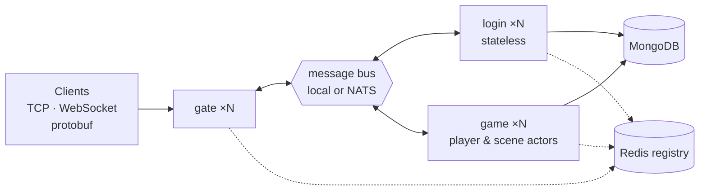

# Golang Game Server

[中文](README.zh-CN.md)

A production-style game server in Go, split into a reusable **framework** and
a sample **MMO/RPG business layer**. The same binary runs as a single
all-in-one process (zero dependencies) or as a distributed cluster of gate,
login and game nodes over NATS, Redis and MongoDB.



## Features

**Framework (`framework/`)** — game-agnostic

* TCP + WebSocket transport, length-prefixed protobuf packets, non-blocking per-session writer
* Gateway with heartbeat, idle timeout, per-session rate limiting, max connections, msg-id range routing (stateless or sticky), session binding, kicks and broadcasts
* Typed handler router with middleware (panic recovery, Prometheus metrics, access/slow log)
* Actor model for lock-free game logic, with timers
* Cluster layer: in-process bus or NATS, memory or Redis service registry, rendezvous hashing
* Module lifecycle with ordered start and graceful reverse shutdown
* YAML config with `${ENV:-default}`, strict keys and validation; `log/slog` logging
* Snowflake ids, typed hot-swappable config tables, Redis/Mongo modules
* Admin endpoint: `/healthz`, `/readyz`, `/metrics`, `/debug/pprof`
* Go client SDK

**Business layer (`game/`)** — sample MMO

* Login with bcrypt, auto-registration, Snowflake uids, sticky game-node assignment
* Character load/create, starter pack, duplicate-login kick
* Bag with data-driven item effects and level-up curve
* World chat (cross-node broadcast) and scene chat (AOI)
* Scene with nine-grid AOI and server-authoritative movement
* GM commands, dirty-flag periodic saving, save on logout and shutdown

**Quality**

* Unit tests, full end-to-end tests over real sockets, and an in-process
  distributed cluster test (embedded NATS + miniredis)
* Browser test console with one-click self-test, verified by a headless-Chrome test
* Robot load tester, Dockerfile, docker-compose cluster
* Bilingual documentation with diagrams for every module

## Quick start

```bash
# 1. run a complete server with zero dependencies
go run ./cmd/server -config configs/allinone.yaml

# 2. open the browser test console and click "Run self-test"
#    http://127.0.0.1:9100/

# 3. in another terminal: 20 simulated players
go run ./cmd/robot -n 20 -duration 10s

# 4. tests
go test ./...
```

The [web console](game/webconsole/README.md) lets you log in, move on a map,
chat, use items and watch every packet — or check the whole flow with one click.

Distributed cluster (Docker): `docker compose -f deploy/docker-compose.yml up -d --build`.
See [Getting started](docs/getting-started.md).

## Repository layout

```
cmd/          server (node entry) and robot (load tester)
framework/    reusable framework — app, config, logx, network, gate, router, cluster, actor, message, ...
game/         sample MMO — bootstrap, protocol, loginsvc, gamesvc, logic, repo, model, gamedata
proto/        protobuf sources (framework/ and game/); generated Go code is committed
configs/      allinone, allinone-mongo, gate, login, game
deploy/       Dockerfile, docker-compose.yml
test/         e2e (all-in-one) and cluster (distributed) integration tests
docs/         architecture, protocol, getting started, development log
```

## Documentation

| Document | Content |
|---|---|
| [Architecture](docs/architecture.md) | layers, topologies, message flows, concurrency, routing, persistence, failures, security, scaling, design decisions |
| [Protocol](docs/protocol.md) | wire format, message table, error codes, session states |
| [Getting started](docs/getting-started.md) | run, test, deploy, configuration reference, troubleshooting |
| [Development log](docs/development-log.md) | step-by-step record of how the server was built |
| [Framework overview](framework/README.md) | package map and principles |
| [Business layer](game/README.md) | game packages + tutorial: adding a new gameplay system |

Module READMEs: [network](framework/network/README.md) ·
[gate](framework/gate/README.md) · [router](framework/router/README.md) ·
[cluster](framework/cluster/README.md) · [actor](framework/actor/README.md) ·
[app](framework/app/README.md) · [config](framework/config/README.md) ·
[logx](framework/logx/README.md) · [message](framework/message/README.md) ·
[errcode](framework/errcode/README.md) · [client](framework/client/README.md) ·
[storage](framework/storage/README.md) · [admin](framework/admin/README.md) ·
[idgen](framework/idgen/README.md) · [datatable](framework/datatable/README.md) ·
[bootstrap](game/bootstrap/README.md) · [loginsvc](game/loginsvc/README.md) ·
[gamesvc](game/gamesvc/README.md) · [logic](game/logic/README.md) ·
[repo](game/repo/README.md) · [webconsole](game/webconsole/README.md) · [proto](proto/README.md) · [cmd](cmd/README.md) ·
[deploy](deploy/README.md) · [test](test/README.md)

## Tech stack

Go 1.27 · Protocol Buffers (buf) · gorilla/websocket · NATS · Redis (go-redis v9) ·
MongoDB (mongo-driver v2) · Prometheus · log/slog · Docker

## Conventions

* Code comments are in English; documentation is provided in English and Chinese (`README.md` / `README.zh-CN.md`).
* `framework/` must never import `game/`.
* Message ids and error codes are defined only in `.proto` enums.
