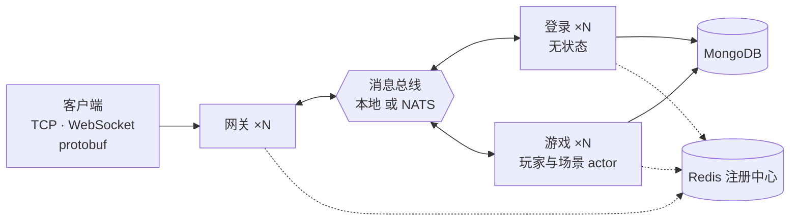
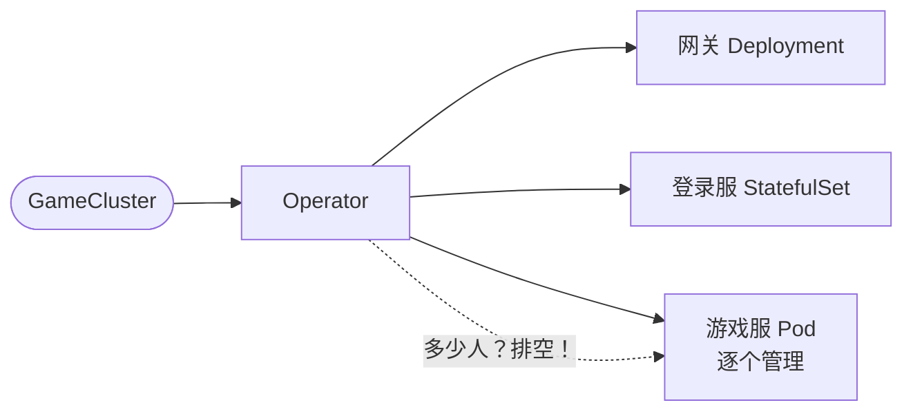

# Golang 游戏服务器

[English](README.md)

一个按生产标准设计的 Go 游戏服务器，分为可复用的**基础框架**和一个 **MMO/RPG 业务逻辑示例**。
同一个二进制既可以作为单个 all-in-one 进程运行（零依赖），也可以作为由网关、登录、游戏节点组成的
分布式集群运行（基于 NATS、Redis、MongoDB）；在 Kubernetes 上则由它自己的 **Operator** 管理——
按在线人数自动伸缩游戏服，删除节点前先排空，保证没有玩家丢失进度。



## Kubernetes Operator

> **[operator/README.zh-CN.md](operator/README.zh-CN.md)** —— 完整说明，带图示和真实测试输出。

```yaml
apiVersion: gameserver.dev/v1alpha1
kind: GameCluster
metadata: { name: demo }
spec:
  image: gameserver:dev
  infra: { natsURL: "nats://gs-nats:4222", redisAddr: "gs-redis:6379", mongoURI: "mongodb://gs-mongo:27017" }
  game:
    autoscale: { minReplicas: 2, maxReplicas: 6, targetPlayersPerNode: 50 }
    drainTimeout: 2m
```



* **按在线人数自动伸缩** —— `ceil(在线人数 / targetPlayersPerNode)`，缩容有冷却时间。
* **优雅排空** —— 人最少的节点不再接新玩家，等它变空（或超时），然后存盘并把玩家交接出去。
* **玩家在线时滚动升级** —— 先加一台、再排空一台；160 个机器人在线实测：约 1 分钟替换 4 台节点，没有人掉队。
* **崩溃恢复** —— 网关会踢掉失联节点上的玩家让他们重连；归属目录保证同一个玩家绝不会被加载两次。
* Helm Chart、带 Schema 校验的 CRD、选主、加固的 Pod，以及在 kind 上的端到端测试。

## 功能

**基础框架（`framework/`）** —— 与具体游戏无关

* TCP + WebSocket 传输，长度前缀的 protobuf 数据包，每会话非阻塞写协程
* 网关：心跳、空闲超时、每会话限流、最大连接数、按消息 ID 区间路由（无状态或粘性）、会话绑定、踢人、广播
* 强类型处理器路由，支持中间件（panic 恢复、Prometheus 指标、访问日志/慢请求日志）
* Actor 模型实现无锁游戏逻辑，带定时器
* 集群层：进程内总线或 NATS，内存或 Redis 注册中心，HRW 哈希
* 模块生命周期：有序启动、逆序优雅停机
* YAML 配置支持 `${ENV:-默认值}`、严格字段与校验；`log/slog` 日志
* 雪花 ID、可热替换的强类型配置表、Redis/Mongo 模块
* 管理端点：`/healthz`、`/readyz`、`/metrics`、`/debug/pprof`
* Go 客户端 SDK

**业务逻辑层（`game/`）** —— MMO 示例

* 登录：bcrypt、自动注册、雪花 uid、粘性分配游戏节点
* 角色加载/创建、新手礼包、顶号踢人
* 背包：数据驱动的道具效果、升级曲线
* 世界聊天（跨节点广播）与场景聊天（AOI）
* 场景：九宫格 AOI、服务器权威移动
* GM 命令、脏标记定时存盘、下线与停服存盘

**Kubernetes（`operator/`、`deploy/helm/`）**

* `GameCluster` CRD 与控制器（controller-runtime）、Helm Chart、开发用基础设施
* 自动伸缩、排空、滚动升级、崩溃恢复 —— 见上文

**质量保障**

* 单元测试、基于真实 socket 的完整端到端测试、进程内分布式集群测试（内嵌 NATS + miniredis）
* 带一键自检的网页测试控制台，并由无头 Chrome 自动化测试验证
* 机器人压测工具（支持自动重连）、Dockerfile、docker-compose 集群
* Kubernetes 端到端测试：160 个机器人在线时完成自动扩容、节点崩溃、滚动升级和缩容
* 每个模块都有中英双语、带图示的文档

## 快速开始

```bash
# 1. 零依赖运行完整服务器
go run ./cmd/server -config configs/allinone.yaml

# 2. 浏览器打开网页测试控制台，点击"运行自检"
#    http://127.0.0.1:9100/

# 3. 另开终端：20 个模拟玩家
go run ./cmd/robot -n 20 -duration 10s

# 4. 运行测试
go test ./...
```

[网页控制台](game/webconsole/README.zh-CN.md) 可以登录、在地图上移动、聊天、使用道具、查看每一个收发的数据包，
也可以一键检查整个流程。

分布式集群（Docker）：`docker compose -f deploy/docker-compose.yml up -d --build`。
Kubernetes：`helm install gs deploy/helm/gameserver -n game --create-namespace`（见 [Operator](operator/README.zh-CN.md#11-本地运行kind)）。
详见 [快速上手](docs/getting-started.zh-CN.md)。

## 目录结构

```
cmd/          server（节点入口）和 robot（压测工具）
framework/    可复用框架 —— app、config、logx、network、gate、router、cluster、actor、message……
game/         MMO 示例 —— bootstrap、protocol、loginsvc、gamesvc、presence、logic、repo、model、gamedata
operator/     Kubernetes Operator（独立 Go 模块）：GameCluster CRD 与控制器
proto/        protobuf 源文件（framework/ 与 game/）；生成的 Go 代码已提交
configs/      allinone、allinone-mongo、gate、login、game
deploy/       Dockerfile、docker-compose.yml、helm/gameserver Chart
test/         e2e（单体）、cluster（分布式）与 k8s（Operator 在 Kubernetes 上）测试
docs/         架构、协议、快速上手、构建日志
```

## 文档

| 文档 | 内容 |
|---|---|
| [总体架构](docs/architecture.zh-CN.md) | 分层、拓扑、消息流程、并发、路由、持久化、故障、安全、扩容、设计决策 |
| [协议规范](docs/protocol.zh-CN.md) | 线上格式、消息表、错误码、会话状态 |
| [快速上手](docs/getting-started.zh-CN.md) | 运行、测试、部署、配置参考、常见问题 |
| [构建日志](docs/development-log.zh-CN.md) | 服务器搭建过程的逐步记录 |
| [基础框架总览](framework/README.zh-CN.md) | 包结构与设计原则 |
| [业务逻辑层](game/README.zh-CN.md) | 游戏包说明 + 教程：新增一个玩法系统 |
| [Kubernetes Operator](operator/README.zh-CN.md) | 为什么需要 Operator、调和循环、自动伸缩、排空、滚动升级、崩溃恢复、API、测试 |

模块文档：[network](framework/network/README.zh-CN.md) ·
[gate](framework/gate/README.zh-CN.md) · [router](framework/router/README.zh-CN.md) ·
[cluster](framework/cluster/README.zh-CN.md) · [actor](framework/actor/README.zh-CN.md) ·
[app](framework/app/README.zh-CN.md) · [config](framework/config/README.zh-CN.md) ·
[logx](framework/logx/README.zh-CN.md) · [message](framework/message/README.zh-CN.md) ·
[errcode](framework/errcode/README.zh-CN.md) · [client](framework/client/README.zh-CN.md) ·
[storage](framework/storage/README.zh-CN.md) · [admin](framework/admin/README.zh-CN.md) ·
[idgen](framework/idgen/README.zh-CN.md) · [datatable](framework/datatable/README.zh-CN.md) ·
[bootstrap](game/bootstrap/README.zh-CN.md) · [loginsvc](game/loginsvc/README.zh-CN.md) ·
[gamesvc](game/gamesvc/README.zh-CN.md) · [logic](game/logic/README.zh-CN.md) ·
[repo](game/repo/README.zh-CN.md) · [presence](game/presence/README.zh-CN.md) · [webconsole](game/webconsole/README.zh-CN.md) · [proto](proto/README.zh-CN.md) · [cmd](cmd/README.zh-CN.md) ·
[deploy](deploy/README.zh-CN.md) · [helm](deploy/helm/gameserver/README.zh-CN.md) · [operator](operator/README.zh-CN.md) · [test](test/README.zh-CN.md) · [test/k8s](test/k8s/README.zh-CN.md)

## 技术栈

Go 1.27 · Protocol Buffers（buf）· gorilla/websocket · NATS · Redis（go-redis v9）·
MongoDB（mongo-driver v2）· Prometheus · log/slog · Docker · Kubernetes（controller-runtime、kind）· Helm

## 约定

* 代码注释使用英文；文档提供英文和中文两份（`README.md` / `README.zh-CN.md`）。
* `framework/` 绝不能 import `game/`。
* 消息 ID 和错误码只在 `.proto` 枚举中定义。
