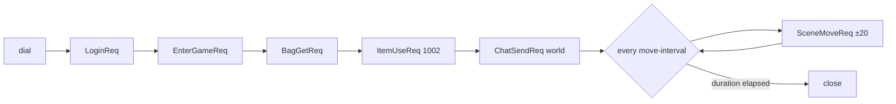

# cmd — executables

[中文](README.zh-CN.md)

| Binary | Purpose |
|---|---|
| `server` | runs one node; its roles come from the config file |
| `robot` | simulated players for smoke and load tests |

## server

```bash
go run ./cmd/server -config configs/allinone.yaml
go build -o bin/server ./cmd/server && ./bin/server -config configs/game.yaml
```

Flow: load config (env expansion + validation) → set up logging →
`bootstrap.Build` → `app.Run` (blocks until SIGINT/SIGTERM, then graceful stop).
Exit codes: `2` bad config, `1` startup or shutdown error, `0` clean exit.

## robot

```bash
go run ./cmd/robot [flags]
```

| Flag | Default | Meaning |
|---|---|---|
| `-addr` | `127.0.0.1:7000` | gate TCP address |
| `-ws` | — | WebSocket url (overrides `-addr`), e.g. `ws://127.0.0.1:7001/ws` |
| `-n` | 1 | number of robots |
| `-prefix` | `robot` | account name prefix (`robot_0`, `robot_1`, …) |
| `-password` | `robot123` | account password |
| `-duration` | 15s | time each robot stays online |
| `-move-interval` | 500ms | time between moves |
| `-ramp` | 5ms | delay between robot starts (avoid a login thundering herd) |



The final report shows successful logins, request count and errors, average
latency, pushes received and kicks. The process exits with code 1 if any login
failed, so it can gate a deployment pipeline.
