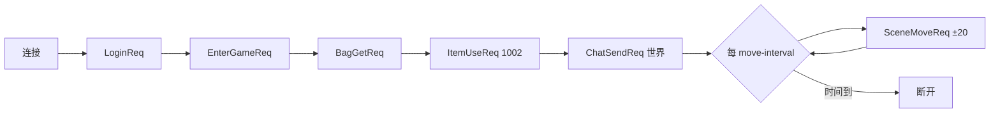

# cmd —— 可执行程序

[English](README.md)

| 程序 | 用途 |
|---|---|
| `server` | 运行一个节点；运行哪些角色由配置文件决定 |
| `robot` | 模拟玩家，用于冒烟测试和压力测试 |

## server

```bash
go run ./cmd/server -config configs/allinone.yaml
go build -o bin/server ./cmd/server && ./bin/server -config configs/game.yaml
```

流程：加载配置（环境变量展开 + 校验）→ 初始化日志 → `bootstrap.Build` → `app.Run`
（阻塞直到 SIGINT/SIGTERM，然后优雅停机）。
退出码：`2` 配置错误，`1` 启动或停机错误，`0` 正常退出。

## robot

```bash
go run ./cmd/robot [参数]
```

| 参数 | 默认值 | 含义 |
|---|---|---|
| `-addr` | `127.0.0.1:7000` | 网关 TCP 地址 |
| `-ws` | — | WebSocket 地址（覆盖 `-addr`），如 `ws://127.0.0.1:7001/ws` |
| `-n` | 1 | 机器人数量 |
| `-prefix` | `robot` | 账号前缀（`robot_0`、`robot_1`……） |
| `-password` | `robot123` | 账号密码 |
| `-duration` | 15s | 每个机器人在线时长 |
| `-move-interval` | 500ms | 两次移动的间隔 |
| `-ramp` | 5ms | 机器人启动间隔（避免登录瞬间洪峰） |



最终报告显示登录成功数、请求数与错误数、平均延迟、收到的推送数和被踢次数。
只要有一个登录失败，进程就以退出码 1 结束，可以用作部署流水线的关卡。
