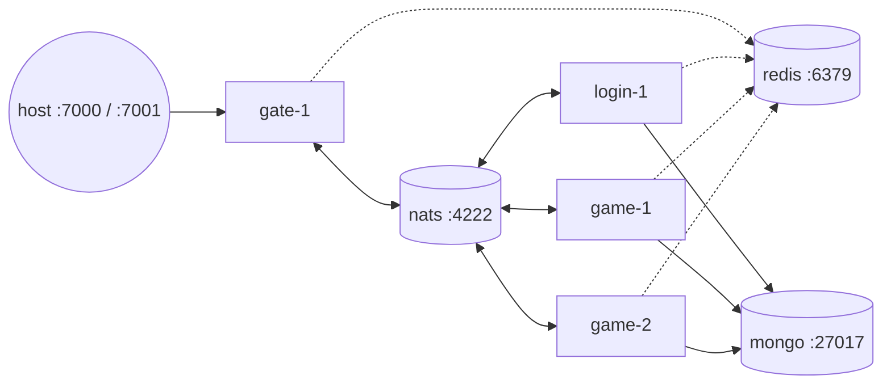

# deploy — containers

[中文](README.zh-CN.md) · [Getting started](../docs/getting-started.md)

| File | Purpose |
|---|---|
| `Dockerfile` | multi-stage build → static `server` and `robot` binaries in a distroless, non-root image |
| `docker-compose.yml` | full distributed cluster for local testing |

## Image

```bash
docker build -f deploy/Dockerfile -t gameserver .
docker run --rm -p 7000:7000 -p 7001:7001 gameserver                      # all-in-one (default CMD)
docker run --rm gameserver -config /app/configs/game.yaml                  # a specific role
```

* build stage: `golang:1.27`, module download cached in its own layer, `CGO_ENABLED=0`, `-trimpath -ldflags="-s -w"`;
* runtime stage: `gcr.io/distroless/static-debian12:nonroot` (no shell, no package manager, runs as non-root);
* configs are copied to `/app/configs`; override values with environment variables.

## Compose topology



| Service | Image | Notes |
|---|---|---|
| `nats` | `nats:2.10` | monitoring on `:8222` |
| `redis` | `redis:7-alpine` | health-checked |
| `mongo` | `mongo:7` | health-checked, volume `mongo-data` |
| `gate-1` | gameserver | publishes 7000 (TCP), 7001 (WS), 9100 (admin); override with `GATE_TCP_PORT`, `GATE_WS_PORT`, `GATE_ADMIN_PORT` |
| `login-1` | gameserver | `WORKER_ID=1` |
| `game-1`, `game-2` | gameserver | GM enabled for testing |

Application containers wait for Redis and MongoDB health checks. All nodes
share the YAML anchors `x-node` / `env`; adding a node is a copy of one block
with a new `NODE_ID`.

```bash
docker compose -f deploy/docker-compose.yml up -d --build
docker compose -f deploy/docker-compose.yml logs -f gate-1
docker compose -f deploy/docker-compose.yml down -v
```

## Production checklist

* run NATS as a 3-node cluster, Redis with Sentinel/Cluster, MongoDB as a replica set;
* put gates behind an L4 load balancer; terminate TLS (WSS) there;
* keep admin ports private; scrape `/metrics` with Prometheus;
* set `gm_enabled: false` on game nodes;
* give every login node a unique `WORKER_ID`;
* use `/readyz` for readiness and allow ≥ 30 s termination grace for saving players.
