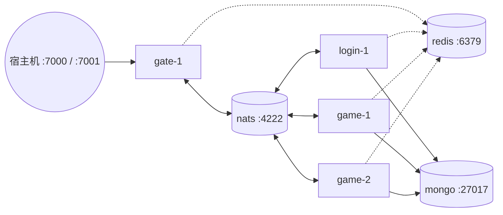

# deploy —— 容器部署

[English](README.md) · [快速上手](../docs/getting-started.zh-CN.md)

| 文件 | 用途 |
|---|---|
| `Dockerfile` | 多阶段构建 → 静态的 `server` 和 `robot` 二进制，放进 distroless 非 root 镜像 |
| `docker-compose.yml` | 用于本地测试的完整分布式集群 |

## 镜像

```bash
docker build -f deploy/Dockerfile -t gameserver .
docker run --rm -p 7000:7000 -p 7001:7001 gameserver                      # 单体模式（默认 CMD）
docker run --rm gameserver -config /app/configs/game.yaml                  # 指定角色
```

* 构建阶段：`golang:1.27`，模块下载单独成层以利用缓存，`CGO_ENABLED=0`，`-trimpath -ldflags="-s -w"`；
* 运行阶段：`gcr.io/distroless/static-debian12:nonroot`（无 shell、无包管理器、非 root 运行）；
* 配置文件复制到 `/app/configs`；用环境变量覆盖具体值。

## Compose 拓扑



| 服务 | 镜像 | 说明 |
|---|---|---|
| `nats` | `nats:2.10` | 监控端口 `:8222` |
| `redis` | `redis:7-alpine` | 带健康检查 |
| `mongo` | `mongo:7` | 带健康检查，数据卷 `mongo-data` |
| `gate-1` | gameserver | 暴露 7000（TCP）、7001（WS）、9100（管理）；可用 `GATE_TCP_PORT`、`GATE_WS_PORT`、`GATE_ADMIN_PORT` 覆盖 |
| `login-1` | gameserver | `WORKER_ID=1` |
| `game-1`、`game-2` | gameserver | 为测试开启了 GM |

应用容器会等待 Redis 和 MongoDB 健康检查通过。所有节点共享 YAML 锚点 `x-node` / `env`；
增加节点只需复制一个块并设置新的 `NODE_ID`。

```bash
docker compose -f deploy/docker-compose.yml up -d --build
docker compose -f deploy/docker-compose.yml logs -f gate-1
docker compose -f deploy/docker-compose.yml down -v
```

## Kubernetes

在 Kubernetes 上，整个集群由一个 `GameCluster` 对象描述，并由 [Operator](../operator/README.zh-CN.md) 运行：
它按在线人数自动伸缩游戏服，并在删除节点前先排空。Helm Chart 见 [helm/gameserver](helm/gameserver/README.zh-CN.md)。

```bash
helm install gs deploy/helm/gameserver -n game --create-namespace
kubectl get gamecluster -n game -w
```

## 生产环境检查清单

* NATS 部署为 3 节点集群，Redis 使用 Sentinel/Cluster，MongoDB 使用副本集；
* 网关放在四层负载均衡之后，并在负载均衡上终止 TLS（WSS）；
* 管理端口只对内网开放；用 Prometheus 抓取 `/metrics`；
* 游戏节点设置 `gm_enabled: false`；
* 每个登录节点分配唯一的 `WORKER_ID`；
* 就绪探针使用 `/readyz`，并留出 ≥ 30 秒的终止宽限期用于保存玩家。
