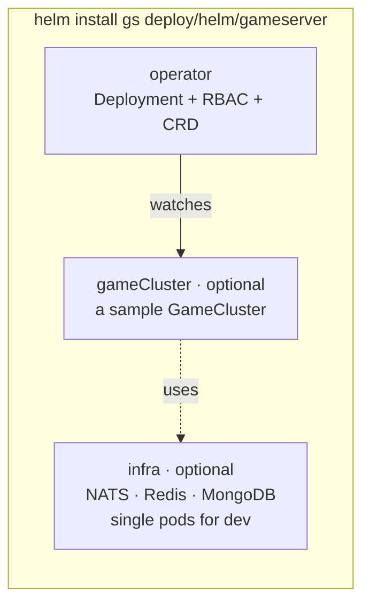

# Helm chart: gameserver

[中文](README.zh-CN.md) · [Operator](../../../operator/README.md)

One chart, three independent parts:



| Part | Value | Default | Production |
|---|---|---|---|
| Operator | `operator.*` | on | keep; 2 replicas with `leaderElect: true` |
| Dev infrastructure | `infra.enabled` | `true` | `false` — use managed NATS / Redis / MongoDB |
| Sample cluster | `gameCluster.enabled` | `true` | usually `false`; apply your own `GameCluster` objects |

The CRD lives in `crds/` (Helm installs it before anything else and never
deletes it on uninstall, so player clusters are not removed by accident).
Upgrade it explicitly with `kubectl apply --server-side -f deploy/helm/gameserver/crds/`.

## Install

```bash
# images must be pullable by the cluster (kind: `kind load docker-image ...`)
helm install gs deploy/helm/gameserver -n game --create-namespace
kubectl get gamecluster -n game -w
```

Use external infrastructure and no sample:

```bash
helm install gs deploy/helm/gameserver -n game --create-namespace \
  --set infra.enabled=false --set gameCluster.enabled=false
kubectl apply -n game -f my-gamecluster.yaml
```

## Values

| Key | Default | Meaning |
|---|---|---|
| `operator.image.repository` / `.tag` | `gameserver-operator` / `dev` | operator image |
| `operator.replicas` | `1` | >1 needs `leaderElect: true` |
| `operator.leaderElect` | `true` | one active reconciler, others on standby |
| `operator.pollInterval` | `5s` | how often player counts are read from game nodes |
| `operator.logLevel` | `info` | `debug` shows every reconcile |
| `infra.enabled` | `true` | deploy single-pod NATS, Redis, MongoDB |
| `infra.mongo.persistence` | `false` | `true` uses a PersistentVolumeClaim (`storageSize`) |
| `gameCluster.enabled` | `true` | create the sample `GameCluster` |
| `gameCluster.name` | `demo` | object name; prefixes every child object |
| `gameCluster.image` | `gameserver:dev` | game server image (all roles) |
| `gameCluster.gate.replicas` | `2` | gate pods |
| `gameCluster.gate.serviceType` | `ClusterIP` | `LoadBalancer` on a cloud |
| `gameCluster.gate.console` | `true` | browser test console on gate port 9100 (dev only) |
| `gameCluster.login.replicas` | `2` | login pods (StatefulSet) |
| `gameCluster.game.replicas` | `2` | fixed size when autoscaling is off |
| `gameCluster.game.autoscale.enabled` | `true` | size by online players |
| `gameCluster.game.autoscale.minReplicas` / `maxReplicas` | `2` / `6` | bounds |
| `gameCluster.game.autoscale.targetPlayersPerNode` | `50` | planned load per node |
| `gameCluster.game.autoscale.scaleDownDelay` | `2m` | cool-down before removing a node |
| `gameCluster.game.drainTimeout` | `2m` | max wait for players to leave a draining node |
| `gameCluster.game.gmEnabled` | `true` | GM commands (never in production) |
| `gameCluster.externalInfra.*` | | addresses used when `infra.enabled=false` |

## What gets created

```
gs-operator            Deployment, ServiceAccount, ClusterRole(+Binding), Role(+Binding) for leader election
gs-nats / gs-redis / gs-mongo    Deployment + Service each            (infra.enabled)
demo                   GameCluster                                    (gameCluster.enabled)
  └─ created by the operator, owned by the GameCluster:
     demo-config       ConfigMap  gate.yaml · login.yaml · game.yaml
     demo-gate         Deployment + Service (7000 TCP, 7001 WebSocket)
     demo-login        StatefulSet + headless Service
     demo-game-xxxxx   Pods, one per game node
```

Deleting the `GameCluster` deletes everything below it (owner references).
