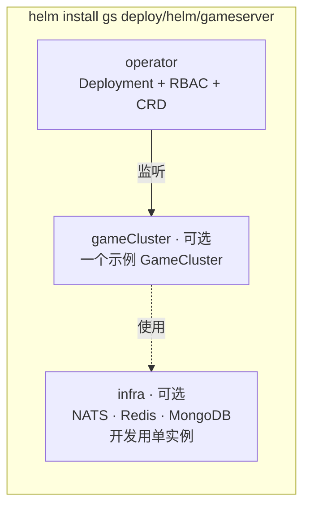

# Helm Chart：gameserver

[English](README.md) · [Operator](../../../operator/README.zh-CN.md)

一个 Chart，三个相互独立的部分：



| 部分 | 配置项 | 默认 | 生产环境 |
|---|---|---|---|
| Operator | `operator.*` | 开启 | 保留；2 副本并开启 `leaderElect: true` |
| 开发用基础设施 | `infra.enabled` | `true` | `false` —— 改用托管的 NATS / Redis / MongoDB |
| 示例集群 | `gameCluster.enabled` | `true` | 通常 `false`；自己提交 `GameCluster` 对象 |

CRD 放在 `crds/` 目录（Helm 会最先安装它，卸载时也不会删除，避免误删玩家集群）。
升级 CRD 需要显式执行 `kubectl apply --server-side -f deploy/helm/gameserver/crds/`。

## 安装

```bash
# 集群必须能拉取到镜像（kind 用 `kind load docker-image ...`）
helm install gs deploy/helm/gameserver -n game --create-namespace
kubectl get gamecluster -n game -w
```

使用外部基础设施、不安装示例：

```bash
helm install gs deploy/helm/gameserver -n game --create-namespace \
  --set infra.enabled=false --set gameCluster.enabled=false
kubectl apply -n game -f my-gamecluster.yaml
```

## 配置项

| 配置 | 默认 | 含义 |
|---|---|---|
| `operator.image.repository` / `.tag` | `gameserver-operator` / `dev` | Operator 镜像 |
| `operator.replicas` | `1` | 大于 1 时需要 `leaderElect: true` |
| `operator.leaderElect` | `true` | 只有一个实例在工作，其余待命 |
| `operator.pollInterval` | `5s` | 多久读取一次各游戏服的在线人数 |
| `operator.logLevel` | `info` | `debug` 会打印每一次调和 |
| `infra.enabled` | `true` | 部署单实例的 NATS、Redis、MongoDB |
| `infra.mongo.persistence` | `false` | `true` 时使用 PersistentVolumeClaim（大小 `storageSize`） |
| `gameCluster.enabled` | `true` | 创建示例 `GameCluster` |
| `gameCluster.name` | `demo` | 对象名，所有子对象都以它为前缀 |
| `gameCluster.image` | `gameserver:dev` | 游戏服务器镜像（所有角色共用） |
| `gameCluster.gate.replicas` | `2` | 网关 Pod 数 |
| `gameCluster.gate.serviceType` | `ClusterIP` | 云上可用 `LoadBalancer` |
| `gameCluster.gate.console` | `true` | 在网关 9100 端口提供浏览器测试控制台（仅开发） |
| `gameCluster.login.replicas` | `2` | 登录服 Pod 数（StatefulSet） |
| `gameCluster.game.replicas` | `2` | 关闭自动伸缩时的固定数量 |
| `gameCluster.game.autoscale.enabled` | `true` | 按在线人数伸缩 |
| `gameCluster.game.autoscale.minReplicas` / `maxReplicas` | `2` / `6` | 上下限 |
| `gameCluster.game.autoscale.targetPlayersPerNode` | `50` | 每台游戏服的计划承载人数 |
| `gameCluster.game.autoscale.scaleDownDelay` | `2m` | 缩容前的冷却时间 |
| `gameCluster.game.drainTimeout` | `2m` | 排空时最多等待玩家离开多久 |
| `gameCluster.game.gmEnabled` | `true` | GM 命令（生产环境禁止开启） |
| `gameCluster.externalInfra.*` | | `infra.enabled=false` 时使用的外部地址 |

## 会创建哪些对象

```
gs-operator            Deployment、ServiceAccount、ClusterRole(+Binding)、选主用的 Role(+Binding)
gs-nats / gs-redis / gs-mongo    各一个 Deployment + Service          （infra.enabled）
demo                   GameCluster                                     （gameCluster.enabled）
  └─ 由 Operator 创建，属于该 GameCluster：
     demo-config       ConfigMap  gate.yaml · login.yaml · game.yaml
     demo-gate         Deployment + Service（7000 TCP，7001 WebSocket）
     demo-login        StatefulSet + headless Service
     demo-game-xxxxx   Pod，每台游戏服一个
```

删除 `GameCluster` 会连带删除它下面的所有对象（通过 owner reference）。
