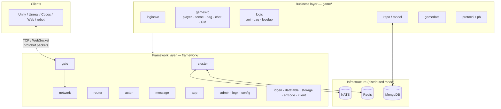
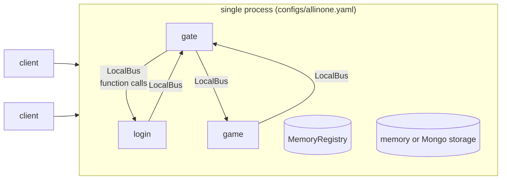
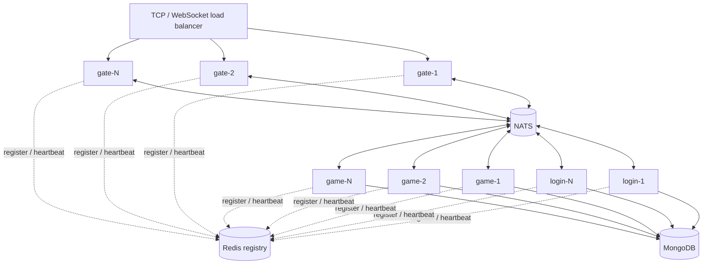
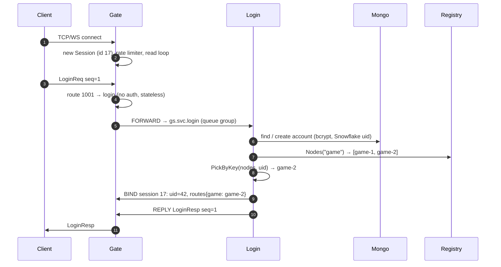
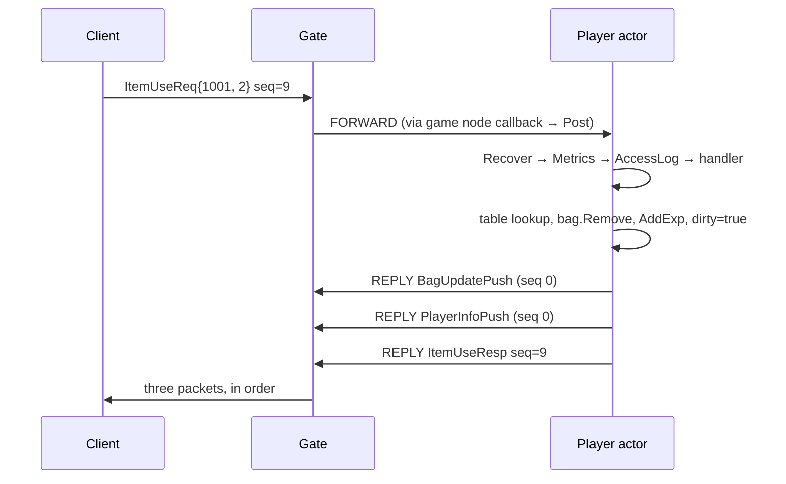
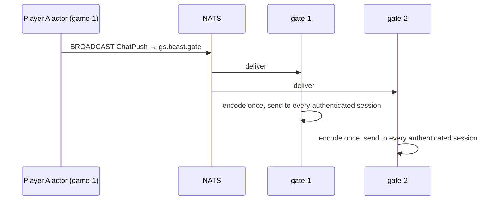
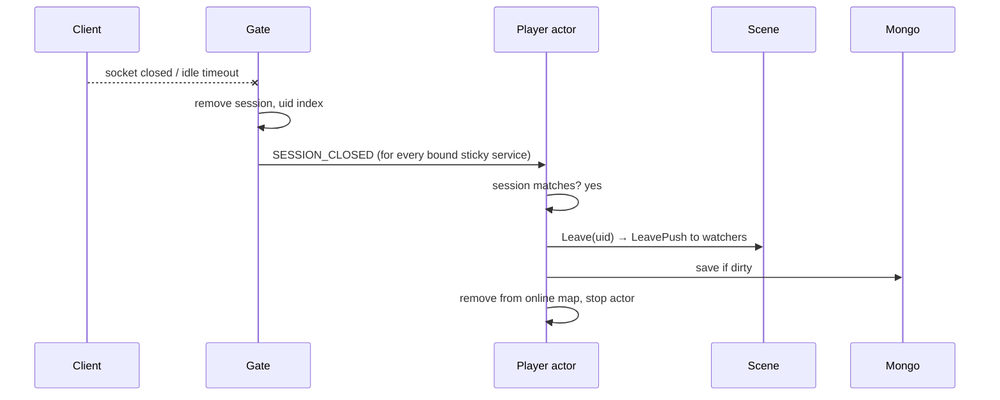
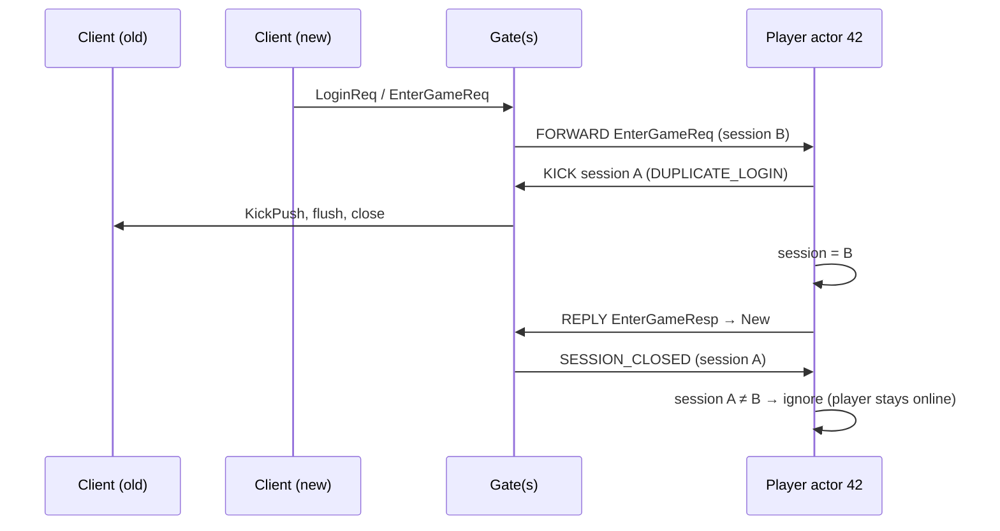
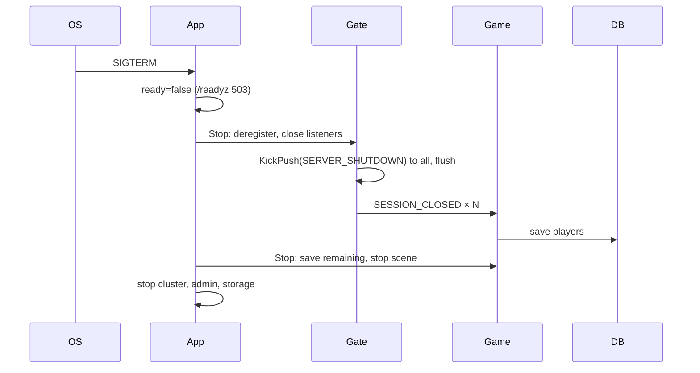
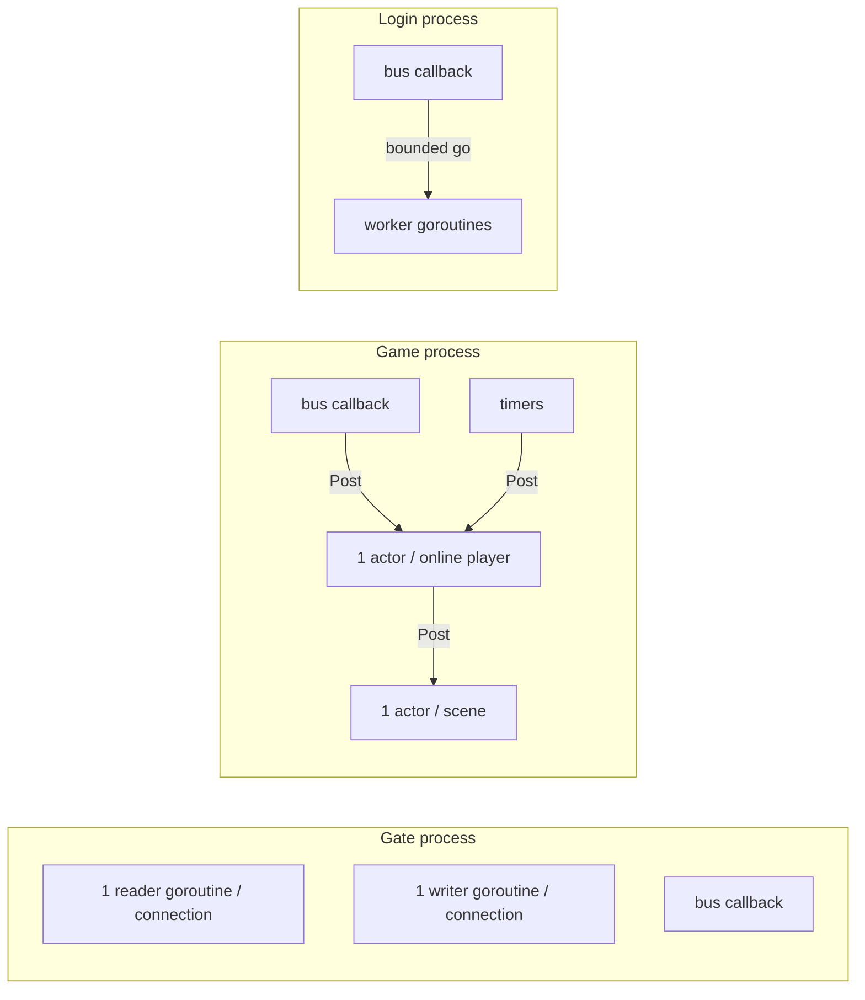

# Architecture

[中文](architecture.zh-CN.md) · [README](../README.md) · [Protocol](protocol.md) · [Getting started](getting-started.md) · [Development log](development-log.md)

This document describes the complete design of the server: its layers,
processes, message flows, concurrency model, routing, persistence, failure
handling, security, observability and the reasoning behind each decision.

---

## 1. Goals and non-goals

**Goals**

| # | Goal | How it is met |
|---|---|---|
| G1 | Clear split between reusable **framework** and **game logic** | `framework/` never imports `game/`; games plug in via message registry, routes, handlers |
| G2 | One codebase, **all-in-one or distributed** | pluggable bus (local/NATS) and registry (memory/Redis), chosen by config |
| G3 | **Lock-free** gameplay code | actor model: each player and scene owned by one goroutine |
| G4 | Industry-standard stack | protobuf, TCP + WebSocket, NATS, Redis, MongoDB, Prometheus, slog, Docker |
| G5 | Safe by default | rate limits, packet limits, auth gating, bcrypt, server authority, sanitized errors |
| G6 | Operable | graceful shutdown with save, health/readiness, metrics, pprof, structured logs |
| G7 | Testable | pure logic packages, in-process cluster tests, real-network end-to-end tests, robot load tool |

**Non-goals (for now)**: frame-synchronized combat, cross-node seamless world
(entities migrating between game nodes), payment integration, anti-cheat beyond
basic server validation. The architecture leaves room for them (see §15).

---

## 2. Layered overview



| Layer | Knows about | Does not know about |
|---|---|---|
| Framework | bytes, packets, msg ids, envelopes, sessions, actors, nodes | players, items, scenes |
| Business | gameplay rules, data model, which messages exist | sockets, NATS, how routing works internally |

---

## 3. Deployment topologies

### 3.1 All-in-one (development, tests, small games)



Zero external dependencies with memory storage. Message passing is a function
call; behaviour is identical to the distributed mode.

### 3.2 Distributed (production)



| Role | State | Scaling | Failure impact |
|---|---|---|---|
| gate | client connections only | add nodes behind LB | its clients reconnect to another gate |
| login | none | add nodes (queue group) | none; others keep serving |
| game | online players (in memory) | add nodes; new logins spread by hashing | its players are disconnected; data since last save may be lost (≤ `save_interval`) |
| NATS | none (fire-and-forget subjects) | NATS cluster (3 nodes) | bus outage; clients auto-reconnect when back |
| Redis | registry entries with TTL | Sentinel / Cluster | routing uses last cached view |
| MongoDB | accounts, players | replica set / sharding by `_id` | saves retried (players stay dirty) |

---

## 4. Components

| Component | Package | Responsibility |
|---|---|---|
| App | `framework/app` | ordered module lifecycle, signals, graceful stop |
| Network | `framework/network` | framing, TCP/WS connections, non-blocking session writer |
| Gate | `framework/gate` | sessions, heartbeat, idle timeout, rate limit, msg-id routing, delivery |
| Message registry | `framework/message` | `msg_id ⇄ protobuf type` |
| Router | `framework/router` | typed handlers, middleware, reply/push/broadcast/bind/kick |
| Cluster | `framework/cluster` | bus, registry, envelopes, rendezvous hashing |
| Actor | `framework/actor` | per-entity serial execution, timers |
| Admin | `framework/admin` | health, readiness, metrics, pprof |
| Login service | `game/loginsvc` | accounts, uid, game node assignment |
| Game service | `game/gamesvc` | player actors, scene actor, gameplay handlers, saving |
| Logic | `game/logic` | pure rules (AOI, bag, levels) |
| Repositories | `game/repo` | persistence interfaces and implementations |

---

## 5. Protocols

### 5.1 Client ⇄ gate

```
TCP frame: | u32 length | payload |        WebSocket: one binary message = payload
payload:   | u32 msg_id | u32 seq | protobuf body |
```

Request/response is correlated by `seq`; pushes use `seq = 0`. Errors are an
`ErrorResp` with the request's `seq`. Full specification: [protocol.md](protocol.md).

### 5.2 Node ⇄ node

Every inter-node message is a protobuf `Envelope` published on a NATS subject
(or the local bus):

```
gs.node.<service>.<node>   one instance       e.g. gs.node.game.game-2, gs.node.gate.gate-1
gs.svc.<service>           any instance       queue group, e.g. gs.svc.login
gs.bcast.<service>         every instance     e.g. gs.bcast.gate (world chat)
```

| Envelope kind | From → to | Purpose |
|---|---|---|
| `FORWARD` | gate → login/game | client request with session id, uid, msg id, seq, body |
| `REPLY` | backend → gate | one packet to one session |
| `BIND` | backend → gate | set uid and service routes on a session |
| `KICK` | backend → gate | disconnect with reason |
| `SESSION_CLOSED` | gate → backend | client disconnected |
| `BROADCAST` | backend → all gates | one packet to many uids |

The whole system is **asynchronous message passing**; no node blocks waiting
for another node on the request path.

---

## 6. Message flows

### 6.1 Connect and log in



### 6.2 Enter game

```mermaid
sequenceDiagram
    autonumber
    participant C as Client
    participant G as Gate
    participant GS as game-2 (bus callback)
    participant P as Player actor 42
    participant S as Scene actor
    participant DB as Mongo
    C->>G: EnterGameReq seq=2
    G->>G: route 2001 → game, auth ok, sticky → game-2
    G->>GS: FORWARD → gs.node.game.game-2
    GS->>P: getOrCreate(42) + Post(dispatch)
    P->>DB: Load(42) (or create character + starter pack)
    P->>P: bind session, start save timer
    P->>G: REPLY EnterGameResp seq=2
    P->>S: Enter(42, pos, session)
    S->>G: SceneEntityEnterPush (to 42: visible players; to them: 42)
    G->>C: EnterGameResp, then scene pushes
```

### 6.3 A gameplay request (use item)



### 6.4 World chat across nodes



### 6.5 Disconnect



### 6.6 Duplicate login (same account, second device)



Because uid → game node is deterministic, the second login reaches the same
game node even when it comes through a different gate; the in-memory player
is reused (no double load, no lost updates).

### 6.7 Graceful shutdown (SIGTERM)



---

## 7. Concurrency model



| Goroutine | Count | Blocks on |
|---|---|---|
| connection reader | 1 per client | socket read (with idle deadline) |
| connection writer | 1 per client | socket write (10 s deadline), send queue |
| player actor | 1 per online player | its mailbox; DB only during load/save |
| scene actor | 1 per scene | its mailbox |
| login worker | ≤ `max_concurrent` | bcrypt, DB |
| bus callback | 1 per subscription (NATS) | never (posts only) |

Rules:

* **Ownership**: player state ↔ player actor; scene state ↔ scene actor;
  session map ↔ gate (mutex, short critical sections only).
* **Ordering**: per-client request order is preserved end to end: one reader
  → one bus publisher → ordered subject → one player mailbox (FIFO).
* **No blocking on the hot path**: `Session.Send` and `Actor.Post` never block;
  overload is handled by dropping slow clients and gate rate limiting.
* **Isolation of failures**: panics are recovered per handler and per actor
  message.

A Go goroutine costs ~4–8 KB, so 10k online players ≈ 30k goroutines ≈ well
under 1 GB, comfortably within one machine.

---

## 8. Routing and service discovery

### 8.1 Gate route table

```go
{MinID: 1000, MaxID: 1999, Service: "login", RequireAuth: false, Sticky: false}
{MinID: 2000, MaxID: 9999, Service: "game",  RequireAuth: true,  Sticky: true}
```

* **Stateless** (`Sticky: false`): publish to `gs.svc.<service>`; NATS queue
  group picks one instance.
* **Stateful** (`Sticky: true`): read `routes[service]` from the session (set by
  `BIND`) and publish to `gs.node.<service>.<node>`.

### 8.2 Assigning players to game nodes

`PickByKey(registry.Nodes("game"), uid)` — rendezvous hashing:

* deterministic: same uid → same node while the set is unchanged;
* adding `game-4` moves only ~1/4 of uids (only affects *new* logins: online
  players stay where they are until they log out);
* removing a node moves only its uids.

### 8.3 Registry

Redis sorted set per service, score = expiry. Heartbeat every TTL/3;
expired entries are pruned by readers. Graceful shutdown deregisters
immediately; a crash is detected within `registry_ttl` (default 10 s).

---

## 9. Data and persistence

| Data | Store | Written by | When |
|---|---|---|---|
| accounts | MongoDB `accounts` | login | first login |
| players | MongoDB `players` | game | every `save_interval` if dirty, logout, shutdown |
| service registry | Redis `gs:registry:*` | every node | heartbeat |
| static tables | binary (`go:embed`) | designers | build time |

* **Write-behind with dirty flag**: gameplay mutates memory; saving is batched
  per player. This is the standard MMO approach — DB load is proportional to
  players, not to actions.
* **Single writer**: a player is loaded on exactly one node, so there are no
  concurrent writers to the same document.
* **Durability window**: a game node crash loses at most `save_interval` of
  that node's progress. Lower it for more safety; save immediately in handlers
  for critical events (purchases) — see §15.

---

## 10. Reliability and failure handling

| Failure | Detection | Behaviour |
|---|---|---|
| handler panic | `Recover` middleware | client gets `INTERNAL`; actor and process keep running |
| slow / stuck client | full send queue, write deadline | session closed; others unaffected |
| silent client | idle timeout | `KickPush(IDLE_TIMEOUT)`, close, player saved |
| malformed / oversized packet | decoder | connection dropped |
| flooding client | token bucket | `RATE_LIMITED` errors |
| login with no game node | registry empty | `SERVICE_UNAVAILABLE` |
| backend not running for a stateless route | registry empty | `SERVICE_UNAVAILABLE` |
| DB save error | error from repo | logged, player stays dirty, retried next tick |
| NATS disconnect | client callbacks | automatic reconnect with backoff |
| node crash | registry TTL | removed from routing; its players reconnect and are re-assigned |
| SIGTERM | `app.Run` | ordered graceful shutdown (§6.7) |
| request to a player that just logged out | `p.closed` | request re-dispatched to a fresh instance |

---

## 11. Security

| Threat | Mitigation |
|---|---|
| memory exhaustion via huge packets | `max_packet_size`, WebSocket read limit |
| request flooding | per-session token bucket at the gate |
| connection flooding | `max_conns`; put a LB / firewall with SYN protection in front |
| unauthenticated access to game | `RequireAuth` routes; uid set only by backends via `BIND` |
| session hijack of another uid | uid never comes from the client; envelopes carry the gate-bound uid |
| password theft from DB | bcrypt hashes |
| cheating (teleport, item duplication) | server-authoritative: bounds/step checks, items only change on the server |
| info leaks in errors | only `errcode.Error` messages reach clients |
| debug commands in prod | `gm_enabled: false` by default in `game.yaml` |
| admin endpoint exposure | bind admin to private interface |

TLS: terminate TLS at the load balancer (WSS for browsers), or wrap the
listener with `crypto/tls` — the `Conn` abstraction is unchanged.

---

## 12. Observability

* **Metrics** (`/metrics`): sessions, packets in/out, rejections by reason,
  handler latency histograms and error codes per message id, Go runtime.
* **Logs**: `log/slog`, JSON in production, every line tagged with `module`;
  slow requests logged at warn.
* **Profiling**: `/debug/pprof` on every node.
* **Health**: `/healthz` liveness, `/readyz` readiness.

Suggested alerts: handler p99 > 50 ms, `gs_handler_errors_total{code="1"}`
rising (internal errors), sessions dropping sharply, registry node count changes.

---

## 13. Performance notes

* Packets are encoded once; broadcasts share one encoded payload across all
  target sessions.
* TCP writes use `writev` (`net.Buffers`) for header + payload; `TCP_NODELAY`.
* Actor mailboxes swap slices (no per-message channel send).
* AOI limits scene fan-out to the 3×3 neighbourhood.
* The local bus costs a function call + protobuf envelope; on NATS, envelope
  size is ~20 bytes + body.

Tunables: `send_queue_size`, `rate_limit`, `max_conns`, `save_interval`,
`bcrypt_cost`, `max_concurrent`, AOI cell size, NATS pending limits.

Measure with `cmd/robot -n 1000` and pprof.

---

## 14. Scaling guide

| Bottleneck | Symptom | Action |
|---|---|---|
| connections / bandwidth | gate CPU, `gs_gate_sessions` high | add gates |
| login CPU (bcrypt) | login latency | add login nodes |
| players per game node | game CPU / memory | add game nodes (new logins rebalance) |
| one crowded scene | scene actor latency | split map into multiple scenes/channels (shards) |
| DB writes | save latency | raise `save_interval`, shard Mongo by `_id` |
| bus | NATS CPU | NATS cluster; keep envelopes small |

---

## 15. Extending

| Need | Where |
|---|---|
| new gameplay system | [game/README — tutorial](../game/README.md#tutorial-adding-a-new-gameplay-system) |
| new service (guild, match, mail) | new module + gate route + bootstrap role (same README) |
| new transport (KCP/UDP, QUIC) | implement `network.Conn` + `network.Acceptor` |
| different database | implement `repo.AccountRepo` / `repo.PlayerRepo` |
| service-to-service RPC | `Bus.Request` (NATS request/reply) already available |
| platform login (Steam, Apple…) | replace `loginsvc.findOrCreate` |
| immediate save for critical events | call `p.save()` in that handler |
| reconnect without re-login | issue a token in `LoginResp`, store in Redis, add a `ReconnectReq` |
| multiple scenes / instances | map scene id → `Scene`; put scene id in player data |

---

## 16. Key design decisions

| Decision | Alternatives considered | Why |
|---|---|---|
| Gate + backend split | monolith with sockets in game logic | security boundary, independent scaling, restarts without dropping all connections |
| Async envelopes, no RPC on hot path | gRPC between services | no blocking, natural ordering, no head-of-line stalls; RPC still available via `Bus.Request` |
| NATS | Kafka, Redis pub/sub, gRPC streams | low latency, queue groups, request/reply, simple ops; used by pitaya/nano-style game frameworks |
| Redis registry | etcd, Consul | already needed for game data; TTL heartbeat is enough for this scale |
| Actor per player | global lock, sharded locks | no locks in gameplay code, natural per-player ordering |
| Unbounded mailbox | bounded channel | no deadlocks on mutual posts; overload controlled at the gate |
| Rendezvous hashing | consistent ring, central allocator | simple, stateless, minimal disruption, no extra service |
| Whole-document saves + dirty flag | per-field updates, event sourcing | simple and robust; one writer per player |
| Protobuf with explicit id table | JSON, reflection-based ids | compact, cross-language, explicit reviewed contract |
| `log/slog` | zap, logrus | standard library, structured, fast enough |

---

## 17. Directory layout

```
.
├── cmd/
│   ├── server/          node entry point (-config)
│   └── robot/           load / smoke testing client
├── framework/           reusable framework (see framework/README.md)
├── game/                sample MMO business layer (see game/README.md)
├── proto/               .proto sources (framework/ and game/)
├── configs/             allinone, allinone-mongo, gate, login, game
├── deploy/              Dockerfile, docker-compose.yml
├── test/
│   ├── e2e/             full server over real TCP/WS
│   └── cluster/         distributed topology with embedded NATS + miniredis
├── docs/                architecture, protocol, getting started, development log
├── buf.yaml, buf.gen.yaml
└── Makefile
```
