# 总体架构

[English](architecture.md) · [README](../README.zh-CN.md) · [协议](protocol.zh-CN.md) · [快速上手](getting-started.zh-CN.md) · [构建日志](development-log.zh-CN.md)

本文完整描述服务器的设计：分层、进程、消息流、并发模型、路由、持久化、故障处理、安全、
可观测性，以及每个决策背后的理由。

---

## 1. 目标与非目标

**目标**

| # | 目标 | 实现方式 |
|---|---|---|
| G1 | 可复用的**基础框架**与**游戏逻辑**清晰分离 | `framework/` 从不 import `game/`；游戏通过消息注册表、路由表、处理器接入 |
| G2 | 一套代码，**单体或分布式**部署 | 可插拔的总线（本地/NATS）与注册中心（内存/Redis），由配置决定 |
| G3 | 玩法代码**无锁** | Actor 模型：每个玩家、每个场景归一个协程所有 |
| G4 | 业界标准技术栈 | protobuf、TCP + WebSocket、NATS、Redis、MongoDB、Prometheus、slog、Docker |
| G5 | 默认安全 | 限流、包大小限制、鉴权拦截、bcrypt、服务器权威、错误信息脱敏 |
| G6 | 易运维 | 带存盘的优雅停机、健康/就绪探针、指标、pprof、结构化日志 |
| G7 | 易测试 | 纯逻辑包、进程内集群测试、真实网络端到端测试、机器人压测工具 |

**暂不包含（非目标）**：帧同步战斗、跨节点无缝大世界（实体在游戏节点间迁移）、支付接入、
基础服务器校验之外的反作弊。架构为它们预留了空间（见 §15）。

---

## 2. 分层总览

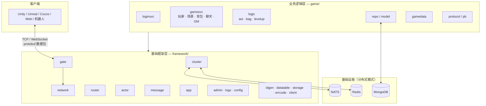

| 层 | 知道什么 | 不知道什么 |
|---|---|---|
| 框架层 | 字节、数据包、消息 ID、信封、会话、actor、节点 | 玩家、道具、场景 |
| 业务层 | 玩法规则、数据模型、有哪些消息 | socket、NATS、路由内部如何实现 |

---

## 3. 部署拓扑

### 3.1 单体 all-in-one（开发、测试、小型游戏）

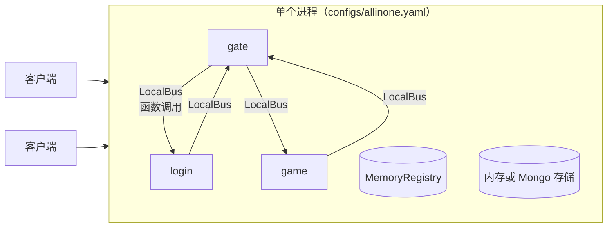

使用内存存储时零外部依赖。消息传递就是函数调用；行为与分布式模式完全一致。

### 3.2 分布式（生产）

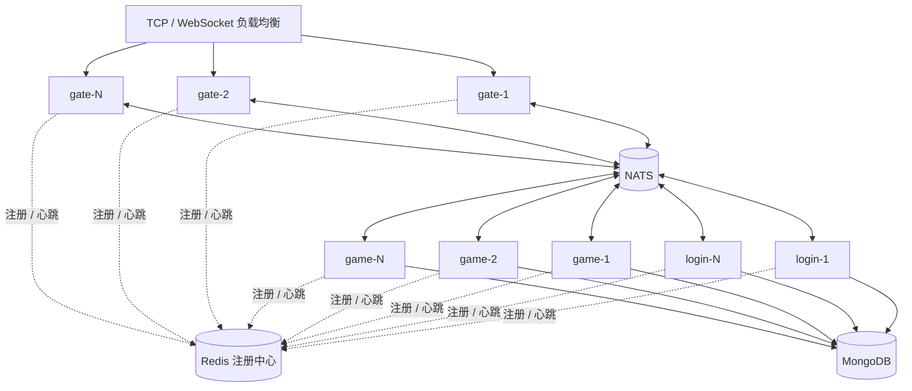

| 角色 | 状态 | 扩容方式 | 故障影响 |
|---|---|---|---|
| gate | 仅客户端连接 | 在负载均衡后加节点 | 其客户端重连到其他网关 |
| login | 无 | 加节点（队列组） | 无；其他节点继续服务 |
| game | 在线玩家（内存） | 加节点；新登录通过哈希分散 | 其玩家断线；最后一次存盘后的数据可能丢失（≤ `save_interval`） |
| NATS | 无（即发即弃的主题） | NATS 集群（3 节点） | 总线中断；恢复后客户端自动重连 |
| Redis | 带 TTL 的注册条目 | Sentinel / Cluster | 路由使用最后一次缓存的视图 |
| MongoDB | 账号、玩家 | 副本集 / 按 `_id` 分片 | 存盘重试（玩家保持脏标记） |

### 3.3 Kubernetes（Operator）

上面的分布式拓扑，用一个 `GameCluster` 对象描述，由 [Operator](../operator/README.zh-CN.md) 运行：

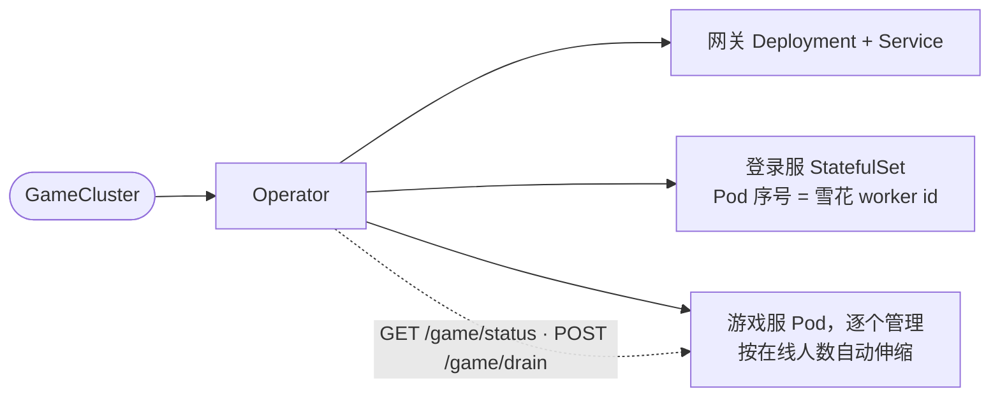

| 事件 | 发生什么 |
|---|---|
| 玩家增多 | 节点数 = `ceil(在线人数 / targetPlayersPerNode)`，新节点立即创建 |
| 玩家减少 | 经过 `scaleDownDelay` 后，人最少的节点开始排空，变空或超过 `drainTimeout` 后删除 |
| 新镜像或新配置 | 滚动升级：加一台、排空一台旧的，循环 |
| 游戏服 Pod 崩溃 | 被替换；网关踢掉它的会话（`BACKEND_LOST`）；玩家到别处重新登录 |

---

## 4. 组件

| 组件 | 包 | 职责 |
|---|---|---|
| App | `framework/app` | 有序的模块生命周期、信号、优雅停机 |
| Network | `framework/network` | 分帧、TCP/WS 连接、非阻塞的会话写协程 |
| Gate | `framework/gate` | 会话、心跳、空闲超时、限流、按消息 ID 路由、投递 |
| 消息注册表 | `framework/message` | `msg_id ⇄ protobuf 类型` |
| Router | `framework/router` | 强类型处理器、中间件、回复/推送/广播/绑定/踢人 |
| Cluster | `framework/cluster` | 总线、注册中心、信封、HRW 哈希 |
| Actor | `framework/actor` | 每实体串行执行、定时器 |
| Admin | `framework/admin` | 健康、就绪、指标、pprof |
| 登录服 | `game/loginsvc` | 账号、uid、分配游戏节点 |
| 游戏服 | `game/gamesvc` | 玩家 actor、场景 actor、玩法处理器、存盘 |
| Logic | `game/logic` | 纯规则（AOI、背包、等级） |
| 仓储 | `game/repo` | 持久化接口与实现 |

---

## 5. 协议

### 5.1 客户端 ⇄ 网关

```
TCP 帧:   | u32 length | payload |        WebSocket：一条二进制消息 = payload
payload:  | u32 msg_id | u32 seq | protobuf body |
```

请求与响应通过 `seq` 匹配；推送 `seq = 0`。错误以 `ErrorResp` 返回，带请求的 `seq`。
完整规范见 [protocol.zh-CN.md](protocol.zh-CN.md)。

### 5.2 节点 ⇄ 节点

节点之间的每条消息都是一个 protobuf `Envelope`，发布在 NATS 主题（或本地总线）上：

```
gs.node.<service>.<node>   某个实例       如 gs.node.game.game-2、gs.node.gate.gate-1
gs.svc.<service>           任意实例       队列组，如 gs.svc.login
gs.bcast.<service>         所有实例       如 gs.bcast.gate（世界聊天）
```

| 信封类型 | 方向 | 用途 |
|---|---|---|
| `FORWARD` | gate → login/game | 客户端请求，含会话 ID、uid、消息 ID、seq、body |
| `REPLY` | 后端 → gate | 给一个会话发一个包 |
| `BIND` | 后端 → gate | 给会话设置 uid 和服务路由 |
| `KICK` | 后端 → gate | 带原因断开 |
| `SESSION_CLOSED` | gate → 后端 | 客户端断开 |
| `BROADCAST` | 后端 → 所有 gate | 给多个 uid 发同一个包 |

整个系统是**异步消息传递**；请求链路上没有任何节点会阻塞等待另一个节点。

---

## 6. 消息流程

### 6.1 连接并登录

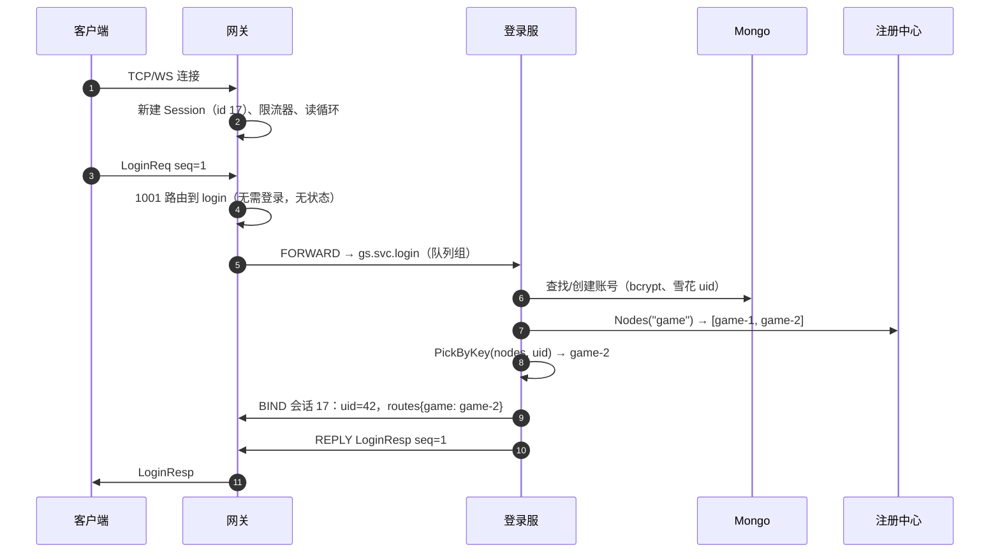

### 6.2 进入游戏

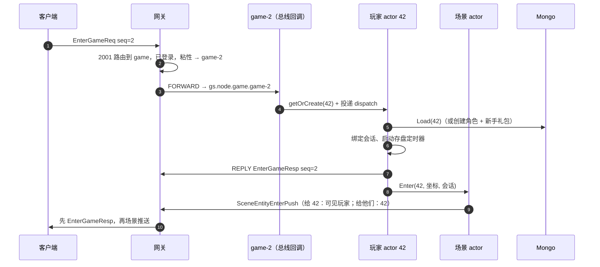

### 6.3 一个玩法请求（使用道具）

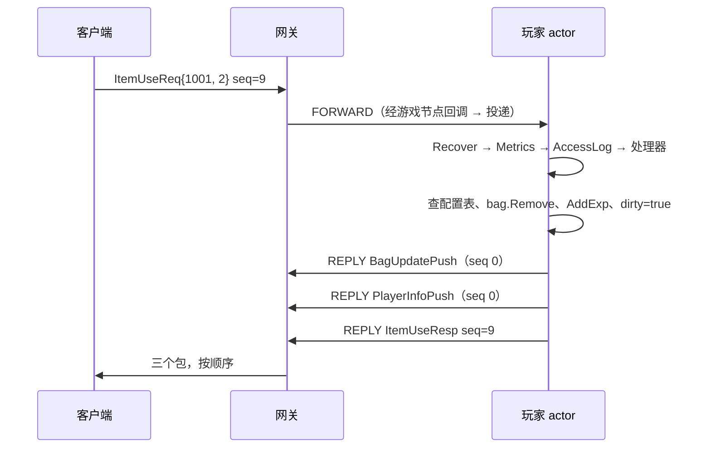

### 6.4 跨节点世界聊天

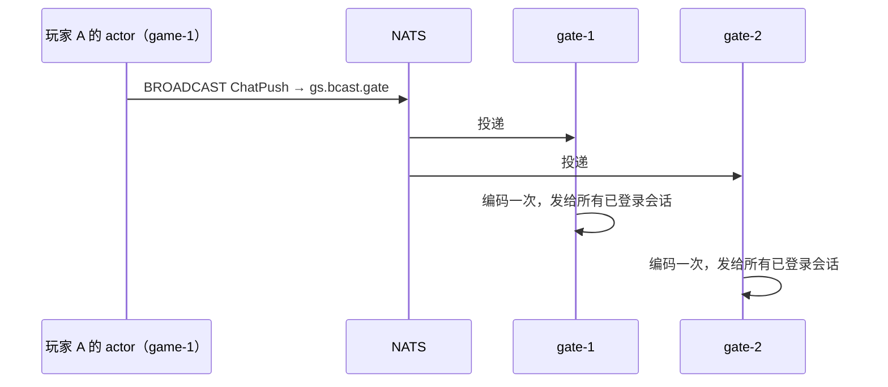

### 6.5 断线

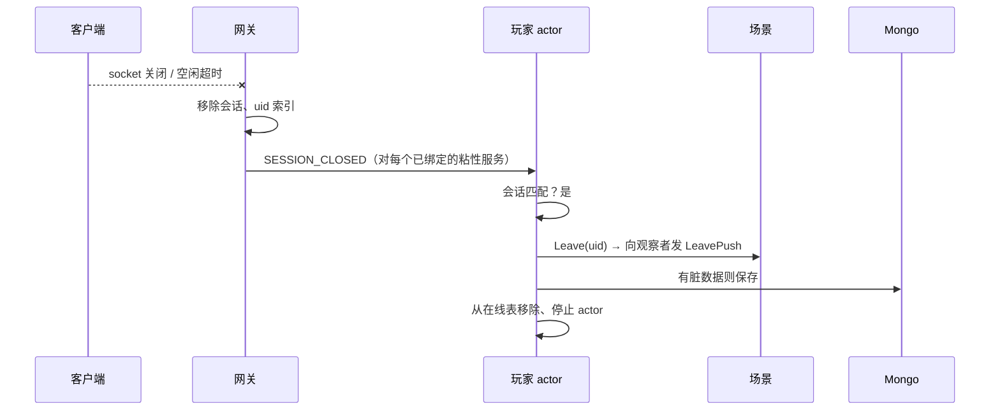

### 6.6 顶号（同一账号，第二台设备）

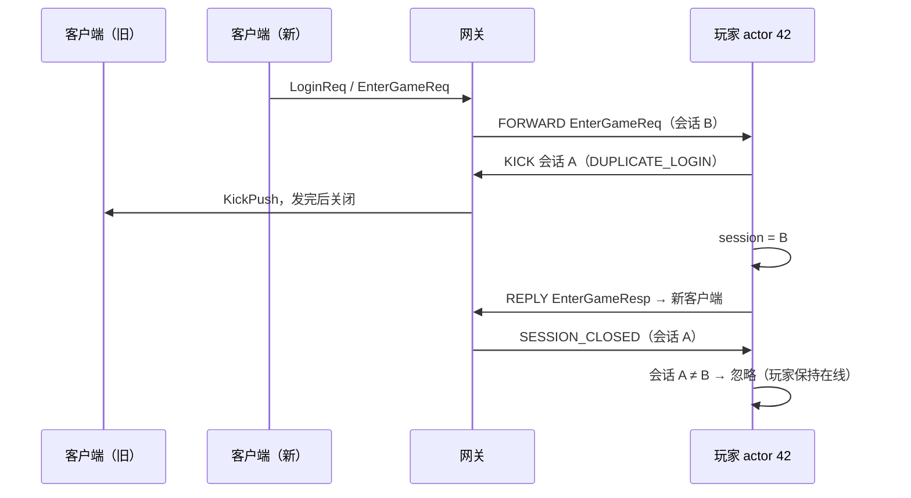

由于 uid → 游戏节点是确定的，即使第二次登录来自另一个网关，也会到达同一个游戏节点；
内存中的玩家对象被复用（不会重复加载，也不会丢失更新）。

### 6.7 优雅停机（SIGTERM）

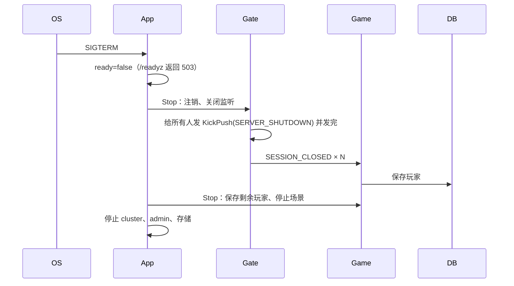

---

## 7. 并发模型

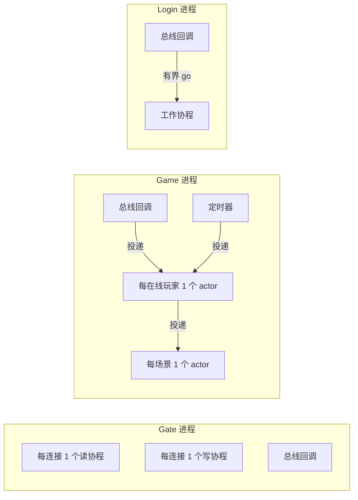

| 协程 | 数量 | 阻塞于 |
|---|---|---|
| 连接读协程 | 每客户端 1 个 | socket 读（带空闲超时） |
| 连接写协程 | 每客户端 1 个 | socket 写（10 秒超时）、发送队列 |
| 玩家 actor | 每在线玩家 1 个 | 自己的邮箱；仅加载/存盘时访问数据库 |
| 场景 actor | 每场景 1 个 | 自己的邮箱 |
| 登录工作协程 | ≤ `max_concurrent` | bcrypt、数据库 |
| 总线回调 | 每个订阅 1 个（NATS） | 从不阻塞（只投递） |

规则：

* **归属**：玩家状态 ↔ 玩家 actor；场景状态 ↔ 场景 actor；会话表 ↔ 网关（互斥锁，仅短临界区）。
* **顺序**：每个客户端的请求顺序端到端保持：一个读协程 → 一个总线发布者 → 有序主题 → 一个玩家邮箱（FIFO）。
* **热路径不阻塞**：`Session.Send` 和 `Actor.Post` 永不阻塞；过载通过断开慢客户端和网关限流处理。
* **故障隔离**：每个处理器、每条 actor 消息都有 panic 恢复。

一个 Go 协程约 4–8 KB，所以 1 万在线玩家 ≈ 3 万协程，远小于 1 GB，单机轻松承载。

---

## 8. 路由与服务发现

### 8.1 网关路由表

```go
{MinID: 1000, MaxID: 1999, Service: "login", RequireAuth: false, Sticky: false}
{MinID: 2000, MaxID: 9999, Service: "game",  RequireAuth: true,  Sticky: true}
```

* **无状态**（`Sticky: false`）：发布到 `gs.svc.<service>`；由 NATS 队列组挑选一个实例。
* **有状态**（`Sticky: true`）：从会话中读取 `routes[service]`（由 `BIND` 设置），发布到 `gs.node.<service>.<node>`。

### 8.2 玩家分配到游戏节点

先查[归属目录](../game/presence/README.zh-CN.md)：已经在线的玩家回到持有它的节点（正常或排空中）。
只有不在线的玩家才做哈希：

`PickByKey(registry.Nodes("game"), uid)` —— 最高随机权重哈希：

* 确定性：节点集合不变时，同一 uid → 同一节点；
* 增加 `game-4` 只会迁移约 1/4 的 uid（只影响*新*登录：在线玩家在下线前保持原地）；
* 移除一个节点只会迁移它自己的 uid；
* 排空中的节点登记在 `game-draining` 下，哈希会跳过它们，但它们自己的玩家仍能找到它们。

游戏节点加载玩家之前必须先获取该玩家的归属记录，所以即使节点不断加入和退出，同一个玩家也绝不会被加载到两个节点上。

### 8.3 注册中心

每个服务一个 Redis 有序集合，score = 过期时间。每 TTL/3 心跳一次；读者负责清理过期条目。
优雅停机会立刻注销；崩溃在 `registry_ttl`（默认 10 秒）内被发现。

---

## 9. 数据与持久化

| 数据 | 存储 | 写入方 | 时机 |
|---|---|---|---|
| 账号 | MongoDB `accounts` | 登录服 | 首次登录 |
| 玩家 | MongoDB `players` | 游戏服 | 每 `save_interval`（有脏数据时）、下线、停服 |
| 服务注册 | Redis `gs:registry:*` | 每个节点 | 心跳 |
| 归属（在线玩家归谁） | Redis `gs:presence:<uid>` | 游戏服 | 加载、每个存盘周期、下线 |
| 静态配置表 | 二进制（`go:embed`） | 策划 | 构建时 |

* **脏标记 + 延迟写回**：玩法只修改内存；按玩家批量存盘。这是 MMO 的标准做法 —— 数据库压力与玩家数成正比，而不是与操作次数成正比。
* **单一写者**：一个玩家只会加载在一个节点上——由归属目录（Redis 比较并设置）保证——因此同一文档不会有并发写入。
* **持久化窗口**：游戏节点崩溃最多丢失该节点 `save_interval` 内的进度。可调低以提高安全性；
  对关键事件（充值）在处理器中立即存盘 —— 见 §15。

---

## 10. 可靠性与故障处理

| 故障 | 发现方式 | 行为 |
|---|---|---|
| 处理器 panic | `Recover` 中间件 | 客户端收到 `INTERNAL`；actor 与进程继续运行 |
| 慢/卡死的客户端 | 发送队列满、写超时 | 关闭该会话；其他人不受影响 |
| 不发数据的客户端 | 空闲超时 | `KickPush(IDLE_TIMEOUT)`、关闭、保存玩家 |
| 畸形/超长包 | 解码器 | 断开连接 |
| 刷包客户端 | 令牌桶 | 返回 `RATE_LIMITED` |
| 登录时没有游戏节点 | 注册中心为空 | `SERVICE_UNAVAILABLE` |
| 无状态路由的后端未运行 | 注册中心为空 | `SERVICE_UNAVAILABLE` |
| 数据库存盘失败 | 仓储返回错误 | 记录日志，保持脏标记，下次重试 |
| NATS 断开 | 客户端回调 | 自动退避重连 |
| 节点崩溃 | 注册中心 TTL | 移出路由；网关踢掉它的会话（`BACKEND_LOST`）；玩家重新登录，新节点接管他们的归属记录 |
| 节点被排空（缩容、升级） | `POST /game/drain` | 不再接新玩家；现有玩家留到自己离开或节点停机（存盘、踢人、到别处重连） |
| SIGTERM | `app.Run` | 有序优雅停机（§6.7） |
| 请求发给了刚下线的玩家 | `p.closed` | 请求重新分发到新实例 |

---

## 11. 安全

| 威胁 | 缓解措施 |
|---|---|
| 超大包耗尽内存 | `max_packet_size`、WebSocket 读限制 |
| 请求洪泛 | 网关上每会话令牌桶 |
| 连接洪泛 | `max_conns`；前置带 SYN 防护的负载均衡/防火墙 |
| 未登录访问游戏 | `RequireAuth` 路由；uid 只能由后端通过 `BIND` 设置 |
| 冒用他人 uid | uid 从不来自客户端；信封携带的是网关绑定的 uid |
| 数据库泄露导致密码被盗 | bcrypt 哈希 |
| 作弊（瞬移、刷道具） | 服务器权威：边界/步长校验，道具只在服务端变化 |
| 错误信息泄露 | 只有 `errcode.Error` 的信息会发给客户端 |
| 线上开启调试命令 | `game.yaml` 中默认 `gm_enabled: false` |
| 管理端口暴露 | admin 只绑定内网地址 |

TLS：在负载均衡上终止 TLS（浏览器用 WSS），或用 `crypto/tls` 包装监听器 —— `Conn` 抽象不变。

---

## 12. 可观测性

* **指标**（`/metrics`）：会话数、收发包数、按原因统计的拒绝数、按消息 ID 的处理延迟直方图与错误码、Go 运行时。
* **日志**：`log/slog`，生产用 JSON，每行带 `module` 标签；慢请求记 warn。
* **性能分析**：每个节点都有 `/debug/pprof`。
* **健康**：`/healthz` 存活，`/readyz` 就绪。

建议告警：处理器 p99 > 50 ms、`gs_handler_errors_total{code="1"}`（内部错误）上升、
会话数骤降、注册中心节点数变化。

---

## 13. 性能要点

* 数据包只编码一次；广播时所有目标会话共享同一份编码结果。
* TCP 写使用 `writev`（`net.Buffers`）一次发出包头+载荷；开启 `TCP_NODELAY`。
* Actor 邮箱通过交换切片实现（不是每条消息一次 channel 发送）。
* AOI 把场景扇出限制在 3×3 邻域内。
* 本地总线开销 = 一次函数调用 + protobuf 信封；NATS 上信封大小约 20 字节 + body。

可调参数：`send_queue_size`、`rate_limit`、`max_conns`、`save_interval`、`bcrypt_cost`、
`max_concurrent`、AOI 格子大小、NATS 待处理上限。

用 `cmd/robot -n 1000` 和 pprof 测量。

---

## 14. 扩容指南

| 瓶颈 | 现象 | 处理 |
|---|---|---|
| 连接数 / 带宽 | 网关 CPU 高、`gs_gate_sessions` 高 | 加网关 |
| 登录 CPU（bcrypt） | 登录延迟高 | 加登录节点 |
| 单游戏节点玩家过多 | 游戏服 CPU / 内存高 | 加游戏节点（新登录自动均衡）；在 Kubernetes 上由 Operator 按 `targetPlayersPerNode` 自动完成 |
| 单个场景过于拥挤 | 场景 actor 延迟高 | 把地图拆成多个场景/分线 |
| 数据库写入 | 存盘延迟高 | 调大 `save_interval`，Mongo 按 `_id` 分片 |
| 总线 | NATS CPU 高 | NATS 集群；保持信封精简 |

---

## 15. 扩展方式

| 需求 | 位置 |
|---|---|
| 新玩法系统 | [game/README —— 教程](../game/README.zh-CN.md#教程新增一个玩法系统) |
| 新服务（公会、匹配、邮件） | 新模块 + 网关路由 + bootstrap 角色（同上文档） |
| 新传输（KCP/UDP、QUIC） | 实现 `network.Conn` + `network.Acceptor` |
| 换数据库 | 实现 `repo.AccountRepo` / `repo.PlayerRepo` |
| 服务间 RPC | 已提供 `Bus.Request`（NATS 请求/应答） |
| 平台登录（Steam、Apple……） | 替换 `loginsvc.findOrCreate` |
| 关键事件立即存盘 | 在对应处理器中调用 `p.save()` |
| 断线重连免登录 | `LoginResp` 下发令牌并存 Redis，增加 `ReconnectReq` |
| 多场景 / 副本 | 场景 ID → `Scene` 映射；玩家数据中记录场景 ID |

---

## 16. 关键设计决策

| 决策 | 考虑过的替代方案 | 原因 |
|---|---|---|
| 网关 + 后端分离 | socket 与逻辑在同一单体 | 安全边界、独立扩容、重启后端无需断开所有连接 |
| 热路径上异步信封，不做 RPC | 服务间 gRPC | 不阻塞、天然有序、无队头阻塞；需要时仍可用 `Bus.Request` |
| NATS | Kafka、Redis pub/sub、gRPC 流 | 低延迟、队列组、请求/应答、运维简单；pitaya/nano 一类游戏框架也采用 |
| Redis 注册中心 | etcd、Consul | 游戏数据本来就需要 Redis；TTL 心跳对此规模足够 |
| 每玩家一个 actor | 全局锁、分段锁 | 玩法代码无锁，天然按玩家有序 |
| 无界邮箱 | 有界 channel | 互相投递不会死锁；过载在网关控制 |
| HRW 哈希 | 一致性哈希环、中心分配器 | 简单、无状态、扰动最小、无需额外服务 |
| 在哈希之上加归属目录 | 只用哈希 | 只用哈希时，节点加入或排空会让在线玩家换节点；归属目录保证每个玩家只有一个持有者 |
| Kubernetes Operator + 裸游戏服 Pod | Deployment + HPA、StatefulSet | 只有 Operator 知道每台的人数，也只有它能决定排空哪台、何时删除 |
| 整文档存盘 + 脏标记 | 按字段更新、事件溯源 | 简单可靠；每个玩家只有一个写者 |
| Protobuf + 显式 ID 表 | JSON、基于反射的 ID | 紧凑、跨语言、契约显式且可评审 |
| `log/slog` | zap、logrus | 标准库、结构化、足够快 |

---

## 17. 目录结构

```
.
├── cmd/
│   ├── server/          节点入口（-config）
│   └── robot/           压测 / 冒烟测试客户端
├── framework/           可复用的基础框架（见 framework/README.zh-CN.md）
├── game/                MMO 示例业务层（见 game/README.zh-CN.md）
├── proto/               .proto 源文件（framework/ 与 game/）
├── configs/             allinone、allinone-mongo、gate、login、game
├── operator/            Kubernetes Operator（独立 Go 模块，见 operator/README.zh-CN.md）
├── deploy/              Dockerfile、docker-compose.yml、helm/gameserver
├── test/
│   ├── e2e/             通过真实 TCP/WS 测试完整服务器
│   ├── cluster/         内嵌 NATS + miniredis 的分布式拓扑测试
│   ├── webconsole/      由无头 Chrome 驱动的浏览器控制台测试
│   └── k8s/             Operator 在真实 Kubernetes 集群上的端到端测试
├── docs/                架构、协议、快速上手、构建日志
├── buf.yaml、buf.gen.yaml
└── Makefile
```
