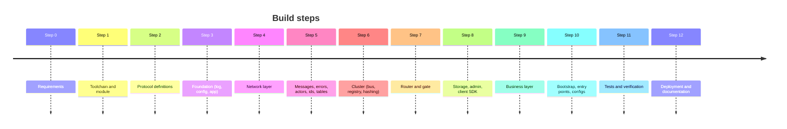

# Development log — how this server was built

[中文](development-log.zh-CN.md) · [Architecture](architecture.md)

A step-by-step record of the build: what was done at each step, why, which
alternatives were rejected, and how the step was verified. Read it to
understand the codebase in the order it was assembled.

---

## Step 0 — Requirements

Request: an industry-standard Go game server split into a **framework** layer
(generic) and a **business** layer (gameplay), with bilingual documentation,
English code comments, and illustrated READMEs per module.

Decisions confirmed with the requester:

| Question | Choice |
|---|---|
| Game type | generic MMO/RPG (login, character, bag, chat, scene) |
| Topology | runnable both as one process and as distributed services |
| Client protocol | TCP + WebSocket, Protobuf |
| Storage | Redis + MongoDB |

---

## Step 1 — Toolchain and module

* Go 1.27, module path `gameserver` (short internal path; rename with
  `go mod edit -module` when publishing).
* `buf` + `protoc-gen-go` installed with `go install` — **no `protoc` binary
  needed**, which keeps setup to Go-only tooling.
* Dependencies chosen (all de facto standards): `google.golang.org/protobuf`,
  `gorilla/websocket`, `nats.go`, `go-redis/v9`, `mongo-driver/v2`,
  `prometheus/client_golang`, `go.yaml.in/yaml/v3` (maintained successor of
  `gopkg.in/yaml.v3`), `x/crypto/bcrypt`, `x/time/rate`.

---

## Step 2 — Protocol definitions (`proto/`)

* `proto/framework/sys.proto`: reserved ids 1–999 — heartbeat, `ErrorResp`,
  `KickPush`, framework `ErrorCode`, `KickReason`.
* `proto/framework/cluster.proto`: the internal `Envelope` with a `Kind`
  (FORWARD, REPLY, BIND, KICK, SESSION_CLOSED, BROADCAST). Designing this first
  fixed the contract between gate and backends before any code existed.
* `proto/game/*.proto`: `MsgID` enum (login 1000–1999, game 2000–9999),
  `ErrCode` enum (≥1000), and messages for login, player, bag, chat, scene, GM.
* `buf.yaml` + `buf.gen.yaml` (`module=gameserver`) → generated code in
  `framework/pb/*` and `game/pb`, committed to the repo.

Why id ranges? The gate can route by number without decoding bodies, and the
range itself documents which service owns a message.

Verified: `buf generate` produced 9 `.pb.go` files.

---

## Step 3 — Foundation: `logx`, `config`, `app`

* `logx`: `log/slog` (standard library), text/JSON, per-module child loggers.
* `config`: YAML with `${ENV:-default}` expansion, **strict keys**
  (`KnownFields`), optional `Validate()` hook. Each component owns its config
  struct; the app composes them.
* `app`: the `Module` interface (`Init/Start/Stop`). All Inits before any
  Start; reverse-order Stop with one shared deadline; signal handling. This is
  what makes "save all players on shutdown" automatic.

---

## Step 4 — Network layer (`framework/network`)

* Payload `u32 msg_id | u32 seq | body`; TCP adds `u32 length`; WebSocket uses
  one binary message per payload.
* `Conn` interface hides TCP vs WebSocket; adding KCP later means one new type.
* `Session` with a dedicated writer goroutine and **non-blocking** `Send`; full
  queue ⇒ drop the slow client (protects game logic from back-pressure).
* `CloseAfterFlush` so kicks deliver their `KickPush` before closing.
* Acceptors split `Listen` from `Serve` to fail fast on port conflicts and to
  support port `0` in tests.

---

## Step 5 — Core utilities

* `message.Registry`: explicit, bidirectional `id ⇄ type`; duplicates panic at startup.
* `errcode`: errors with client-visible codes; other errors become `INTERNAL`
  (no internal details leak).
* `actor`: unbounded mailbox (no deadlocks on mutual posts), panic recovery,
  `Call`, `After`/`Every` timers that run inside the actor, drain-on-stop.
* `idgen`: Snowflake with clock-rollback and sequence-overflow handling.
* `datatable`: generic typed config tables, duplicate-key detection, atomic hot-swap holder.

---

## Step 6 — Cluster (`framework/cluster`)

* `Bus` interface with NATS semantics; `LocalBus` (synchronous calls, ordered)
  and `NatsBus` (reconnect, large pending limits, drain on close).
* Subjects: `gs.node.<svc>.<node>`, `gs.svc.<svc>` (queue group), `gs.bcast.<svc>`.
  Per-service node subjects let one process host gate+login+game without
  their messages colliding.
* `Registry`: `MemoryRegistry` and `RedisRegistry` (sorted set, score = expiry,
  heartbeat TTL/3, cached reads).
* `PickByKey`: rendezvous hashing — deterministic, balanced, minimal movement.

Rejected: etcd/Consul (extra infrastructure for no gain at this scale),
consistent-hash ring (more code than HRW for the same properties).

---

## Step 7 — Router and gate

* `router`: generic `Handle[Req]`, middleware chain (Recover, Metrics,
  AccessLog), automatic reply/ErrorResp, plus `Push`, `Broadcast`, `Bind`,
  `Kick` usable from any actor. Dispatch is synchronous; the service chooses
  the concurrency model.
* `gate`: TCP+WS acceptors, per-session token bucket, idle timeout, heartbeat
  answered locally, sorted route table (binary search), sticky vs stateless
  forwarding, BIND/KICK/REPLY/BROADCAST handling, SESSION_CLOSED notification,
  shutdown kick.

Issue found and fixed: the router `Context` embedded `context.Context` and also
had a field named `Value`, which shadowed `context.Context.Value` and broke the
interface. Renamed the field to `Data`.

Verified: `go build ./... && go vet ./...` clean.

---

## Step 8 — Storage, admin, client SDK

* `storage/redisx`, `storage/mongox`: clients as modules (eager create, ping
  in Init, close in Stop).
* `admin`: `/healthz`, `/readyz`, `/metrics`, `/debug/pprof`.
* `client`: Go SDK with seq correlation, push handler, heartbeat, typed `Call[Resp]`.

---

## Step 9 — Business layer (`game/`)

* `protocol`: registers all game messages once; defines gate routes.
* `gamedata`: `items.json` embedded via `go:embed`, loaded with `datatable`.
* `model` + `repo`: Account and Player documents; Mongo and memory
  implementations (memory stores deep copies to behave like a DB).
* `logic`: pure `aoi` (nine-grid), `bag`, `levelup`.
* `loginsvc`: validation, bcrypt, auto-register with duplicate-race handling,
  Snowflake uid, rendezvous assignment to a game node, BIND then REPLY.
* `gamesvc`: player actor per online player, scene actor with AOI,
  handlers for enter/bag/item/chat/move/GM, dirty-flag periodic saving,
  duplicate-login kick, stale `SESSION_CLOSED` detection, re-dispatch when a
  request races a logout, release of entities that never entered the game.

Issues found and fixed during this step:

* a temporary entity created by a request sent before `EnterGameReq` would have
  stayed in memory forever → released immediately (`logout` on unloaded players);
* a failed load would have left a half-initialized player → released.

---

## Step 10 — Bootstrap, entry points, configs

* `game/bootstrap`: root `Config` + `Validate()` (rejects local bus without
  all roles, NATS with memory registry/storage) and `Build()` with the module
  order `redis → mongo → cluster → admin → game → login → gate → ready`.
* `cmd/server`: loads config, sets up logging, runs the app.
* `cmd/robot`: N concurrent simulated players with a summary report.
* `configs/`: `allinone`, `allinone-mongo`, `gate`, `login`, `game`.

---

## Step 11 — Tests and verification

| Suite | Result |
|---|---|
| unit tests: network, actor, cluster, router, idgen, config, datatable, message, logic | pass |
| `test/e2e`: full server over TCP + WebSocket (login, AOI, bag, chat, move, GM, duplicate login, save on disconnect and shutdown, 50 concurrent players) | pass, stable over 10 repetitions |
| `test/cluster`: 2 gates + 1 login + 2 game nodes on embedded NATS + miniredis | pass, stable over 5 repetitions |
| smoke test of the real binaries: `server` + 20 TCP robots + 5 WebSocket robots | 25/25 logins, 0 errors, ~5 ms average latency |
| `/metrics`, `/readyz` | correct values |

To test the distributed path without Docker, `bootstrap.WithRepos` was added
so several nodes in one process can share a store, and `gamesvc.HasPlayer` to
observe placement.

### Step 11b — Race detector and real Docker cluster

Run later, once Docker Desktop was started:

| Check | Result |
|---|---|
| `go test -race -count=5 ./...` (inside `golang:1.27`) | **found a data race** → fixed → clean |
| `docker compose up --build` (NATS, Redis, Mongo, gate, login, 2 game nodes) | all 7 containers up; all nodes registered in Redis |
| robots against the cluster, first run | 50 TCP: **4 logins failed** → bug found → fixed |
| after fix, cold start, 3 rounds × 100 TCP robots | 300/300 logins, 0 errors, avg 5–11 ms |
| 10 WebSocket robots | 10/10, 0 errors |
| player placement | game-1: 146, game-2: 154 (rendezvous hashing spreads evenly) |
| MongoDB | 350 accounts and 350 players saved with correct bag/gold |
| stop `game-2` gracefully | deregistered immediately; next 50 logins all routed to game-1, 0 errors |

Bugs found and fixed:

1. **Data race in `network.WSAcceptor`** — `Serve` (own goroutine) wrote the
   `http.Server` field while `Close` (shutdown path) read it. A server stopped
   right after starting could leave the WebSocket port open. Fixed with a mutex
   and a `closed` flag; `Serve` returns immediately if `Close` already ran.
2. **Cold-cache race in `cluster.RedisRegistry.Nodes`** — the first caller
   marked a service as "watched" before its cache was filled, and concurrent
   callers then got an empty node list, so a burst of logins right after start
   received `SERVICE_UNAVAILABLE`. Now every caller fetches synchronously until
   the cache is populated. Regression test:
   `TestRedisRegistryColdCacheConcurrentReads` (50 concurrent cold reads).
3. **docker-compose** — four services building the same image tag in parallel
   collided (`image already exists`); the shared tag was removed. Host ports are
   now overridable (`GATE_TCP_PORT`, `GATE_WS_PORT`, `GATE_ADMIN_PORT`) for
   machines where 7000/7001 are taken.

---

## Step 12 — Deployment and documentation

* `deploy/Dockerfile`: multi-stage, static binary, distroless non-root image.
* `deploy/docker-compose.yml`: NATS, Redis, MongoDB (with health checks),
  gate, login, two game nodes.
* `Makefile`: proto, build, test, race, run, robot, up, down.
* Documentation: bilingual root README, this log, architecture, protocol,
  getting started, and a README (EN + 中文) for every module with diagrams.

## Step 13 — Browser test console

Goal: start the server with one command, then test it from a browser — by
clicking, or with a single "self-test" button.

Decisions:

| Question | Choice | Why |
|---|---|---|
| Should the page also start/stop the server? | No — server is started by command | a web "start" button needs another always-running process and is a security risk; lifecycle belongs to the command line / Docker / k8s |
| Where is the page served? | admin port, `/console/`, embedded with `go:embed` | nothing extra to deploy; enabled only in `allinone.yaml` |
| How does the browser speak protobuf? | `schema.json` built from Go descriptors + a small JS codec | always in sync with the server, no code generation, no CDN (works offline) |
| How is it verified? | Puppeteer (headless Chrome) in Docker against a real server | tests what a user actually does, including two browsers interacting |

Built: `framework/message.Registry.Each`, `game/webconsole` (schema + handler +
static page), `console` config section, Go unit tests, and
`test/webconsole` (28 browser checks).

Issues found by the tests and fixed before delivery:

1. Error-code enums were missing from the schema: `msgid.proto` has no
   messages, so walking "files of registered messages" skipped it. Now every
   file of the involved packages is scanned (caught by `webconsole_test.go`).
2. A 404 for `favicon.ico` showed up as a console error → inline SVG icon.
3. After a kick the bag panel rendered empty instead of "not in game": the
   views were redrawn before the state changed → order fixed, test added.
4. The message log displayed the login password → masked, test added.

Result: 28/28 browser checks, stable over 3 consecutive runs; verified
manually on the host with `go run ./cmd/server` + `http://127.0.0.1:9100/`.

## Possible next steps

1. CI pipeline: `gofmt`, `go vet`, `go test -race`, `buf lint`/`buf breaking`, image build.
2. Reconnect token (resume session without re-login).
3. Immediate save for critical operations (purchases) and an operation log.
4. Multiple scenes / dungeon instances; scene switching.
5. Admin GM HTTP API with authentication; config table hot reload.
6. Kubernetes manifests (Deployment per role, readiness on `/readyz`).
