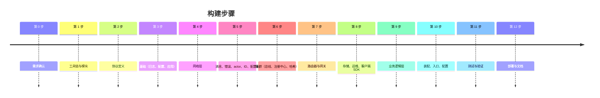

# 构建日志 —— 这个服务器是如何搭建起来的

[English](development-log.md) · [总体架构](architecture.zh-CN.md)

逐步记录整个构建过程：每一步做了什么、为什么、否决了哪些方案、如何验证。
按这个顺序阅读，可以跟着搭建顺序理解整个代码库。

---

## 第 0 步 —— 需求确认

需求：一个符合业界标准的 Go 游戏服务器，分为**基础框架**层（通用）和**业务逻辑**层（玩法），
文档中英双语、代码注释全英文、每个重要模块都有图文并茂的 README。

与需求方确认的决策：

| 问题 | 选择 |
|---|---|
| 游戏类型 | 通用 MMO/RPG（登录、角色、背包、聊天、场景） |
| 部署拓扑 | 既能单进程运行，也能拆成分布式服务 |
| 客户端协议 | TCP + WebSocket，Protobuf |
| 存储 | Redis + MongoDB |

---

## 第 1 步 —— 工具链与模块

* Go 1.27，模块路径 `gameserver`（简短的内部路径；发布时用 `go mod edit -module` 改名）。
* 通过 `go install` 安装 `buf` + `protoc-gen-go` —— **不需要 `protoc` 二进制**，环境只依赖 Go 工具链。
* 选定依赖（均为事实标准）：`google.golang.org/protobuf`、`gorilla/websocket`、`nats.go`、
  `go-redis/v9`、`mongo-driver/v2`、`prometheus/client_golang`、`go.yaml.in/yaml/v3`
  （`gopkg.in/yaml.v3` 的官方维护后继）、`x/crypto/bcrypt`、`x/time/rate`。

---

## 第 2 步 —— 协议定义（`proto/`）

* `proto/framework/sys.proto`：保留 ID 1–999 —— 心跳、`ErrorResp`、`KickPush`、框架 `ErrorCode`、`KickReason`。
* `proto/framework/cluster.proto`：内部 `Envelope`，带 `Kind`（FORWARD、REPLY、BIND、KICK、
  SESSION_CLOSED、BROADCAST）。先设计它，就在写代码之前确定了网关与后端之间的契约。
* `proto/game/*.proto`：`MsgID` 枚举（登录 1000–1999，游戏 2000–9999）、`ErrCode` 枚举（≥1000），
  以及登录、玩家、背包、聊天、场景、GM 的消息。
* `buf.yaml` + `buf.gen.yaml`（`module=gameserver`）→ 生成代码到 `framework/pb/*` 与 `game/pb`，并提交入库。

为什么用 ID 区间？网关不需要解码 body 就能按数字路由，区间本身也说明了消息归属哪个服务。

验证：`buf generate` 生成了 9 个 `.pb.go` 文件。

---

## 第 3 步 —— 基础：`logx`、`config`、`app`

* `logx`：`log/slog`（标准库），text/JSON，按模块的子 logger。
* `config`：YAML + `${ENV:-默认值}` 展开，**严格字段**（`KnownFields`），可选 `Validate()` 钩子。
  每个组件拥有自己的配置结构体，由应用组合。
* `app`：`Module` 接口（`Init/Start/Stop`）。所有 Init 先于任何 Start；逆序 Stop 且共享一个截止时间；信号处理。
  "停服时保存所有玩家"正是靠它自动实现的。

---

## 第 4 步 —— 网络层（`framework/network`）

* payload 为 `u32 msg_id | u32 seq | body`；TCP 额外加 `u32 length`；WebSocket 一条二进制消息即一个 payload。
* `Conn` 接口屏蔽 TCP 与 WebSocket 的差异；以后加 KCP 只需新增一个类型。
* `Session` 拥有独立写协程，`Send` **非阻塞**；队列满 ⇒ 断开慢客户端（防止背压拖累游戏逻辑）。
* `CloseAfterFlush` 保证踢人时 `KickPush` 先送达再关闭。
* Acceptor 把 `Listen` 与 `Serve` 分开，端口冲突立即失败，测试中也能使用 `0` 端口。

---

## 第 5 步 —— 核心工具

* `message.Registry`：显式、双向的 `ID ⇄ 类型` 映射；重复注册在启动时 panic。
* `errcode`：带客户端可见错误码的错误；其他错误统一变为 `INTERNAL`（不泄露内部细节）。
* `actor`：无界邮箱（互相投递不死锁）、panic 恢复、`Call`、在 actor 内执行的 `After`/`Every` 定时器、停止时排空。
* `idgen`：雪花算法，处理时钟回拨和序列号溢出。
* `datatable`：泛型强类型配置表、重复主键检测、原子热替换 Holder。

---

## 第 6 步 —— 集群（`framework/cluster`）

* 具有 NATS 语义的 `Bus` 接口；`LocalBus`（同步调用、有序）与 `NatsBus`（重连、大缓冲、关闭时 drain）。
* 主题：`gs.node.<svc>.<node>`、`gs.svc.<svc>`（队列组）、`gs.bcast.<svc>`。
  按服务区分的节点主题，让一个进程同时承载 gate+login+game 时消息不会串。
* `Registry`：`MemoryRegistry` 与 `RedisRegistry`（有序集合，score = 过期时间，每 TTL/3 心跳，读走缓存）。
* `PickByKey`：最高随机权重哈希 —— 确定、均衡、迁移最少。

否决的方案：etcd/Consul（此规模下徒增基础设施）、一致性哈希环（同样特性但代码比 HRW 多）。

---

## 第 7 步 —— 路由器与网关

* `router`：泛型 `Handle[Req]`、中间件链（Recover、Metrics、AccessLog）、自动回复/ErrorResp，
  以及在任意 actor 中可用的 `Push`、`Broadcast`、`Bind`、`Kick`。Dispatch 是同步的；并发模型由服务决定。
* `gate`：TCP+WS 监听、每会话令牌桶、空闲超时、本地应答心跳、有序路由表（二分查找）、
  粘性与无状态转发、处理 BIND/KICK/REPLY/BROADCAST、发送 SESSION_CLOSED、停服踢人。

发现并修复的问题：router 的 `Context` 内嵌了 `context.Context`，同时又有一个名为 `Value` 的字段，
遮蔽了 `context.Context.Value` 方法导致不再满足接口。已将字段改名为 `Data`。

验证：`go build ./... && go vet ./...` 无问题。

---

## 第 8 步 —— 存储、运维、客户端 SDK

* `storage/redisx`、`storage/mongox`：把客户端做成模块（构造时创建、Init 时 ping、Stop 时关闭）。
* `admin`：`/healthz`、`/readyz`、`/metrics`、`/debug/pprof`。
* `client`：Go SDK，按 seq 匹配、推送处理、心跳、强类型 `Call[Resp]`。

---

## 第 9 步 —— 业务逻辑层（`game/`）

* `protocol`：一次性注册所有游戏消息；定义网关路由。
* `gamedata`：`items.json` 通过 `go:embed` 内嵌，用 `datatable` 加载。
* `model` + `repo`：账号与玩家文档；Mongo 与内存实现（内存实现存深拷贝，行为与数据库一致）。
* `logic`：纯规则 `aoi`（九宫格）、`bag`、`levelup`。
* `loginsvc`：格式校验、bcrypt、自动注册并处理并发注册竞态、雪花 uid、HRW 分配游戏节点、先 BIND 后 REPLY。
* `gamesvc`：每在线玩家一个 actor、带 AOI 的场景 actor、进入/背包/道具/聊天/移动/GM 处理器、
  脏标记定时存盘、顶号踢人、识别过期的 `SESSION_CLOSED`、请求与下线竞态时重新分发、
  释放从未进入游戏的实体。

本步骤中发现并修复的问题：

* 在 `EnterGameReq` 之前发送的请求会创建一个临时实体，并永远留在内存中 → 现在立即释放（对未加载的玩家执行 `logout`）；
* 加载失败会留下半初始化的玩家 → 现在立即释放。

---

## 第 10 步 —— 装配、入口、配置

* `game/bootstrap`：根 `Config` + `Validate()`（拒绝缺少角色的本地总线、使用内存注册中心/存储的 NATS 模式），
  以及按 `redis → mongo → cluster → admin → game → login → gate → ready` 顺序构建的 `Build()`。
* `cmd/server`：加载配置、初始化日志、运行应用。
* `cmd/robot`：N 个并发模拟玩家，并输出汇总报告。
* `configs/`：`allinone`、`allinone-mongo`、`gate`、`login`、`game`。

---

## 第 11 步 —— 测试与验证

| 测试集 | 结果 |
|---|---|
| 单元测试：network、actor、cluster、router、idgen、config、datatable、message、logic | 通过 |
| `test/e2e`：通过 TCP + WebSocket 测试完整服务器（登录、AOI、背包、聊天、移动、GM、顶号、断线与停服存盘、50 个并发玩家） | 通过，重复 10 次稳定 |
| `test/cluster`：2 网关 + 1 登录 + 2 游戏节点，内嵌 NATS + miniredis | 通过，重复 5 次稳定 |
| 真实二进制冒烟测试：`server` + 20 个 TCP 机器人 + 5 个 WebSocket 机器人 | 25/25 登录成功，0 错误，平均延迟约 5 ms |
| `/metrics`、`/readyz` | 数值正确 |

为了在没有 Docker 的情况下测试分布式链路，新增了 `bootstrap.WithRepos`（让同一进程中的多个节点共享存储）
和 `gamesvc.HasPlayer`（观察玩家落在哪个节点）。

### 第 11b 步 —— 数据竞争检测与真实 Docker 集群

在启动 Docker Desktop 之后补充执行：

| 检查项 | 结果 |
|---|---|
| `go test -race -count=5 ./...`（在 `golang:1.27` 容器中） | **发现一处数据竞争** → 已修复 → 无警告 |
| `docker compose up --build`（NATS、Redis、Mongo、网关、登录、2 个游戏节点） | 7 个容器全部启动；所有节点都已在 Redis 注册 |
| 首次对集群跑机器人 | 50 个 TCP 机器人中 **4 个登录失败** → 发现 bug → 已修复 |
| 修复后冷启动，3 轮 × 100 个 TCP 机器人 | 300/300 登录成功，0 错误，平均 5–11 ms |
| 10 个 WebSocket 机器人 | 10/10，0 错误 |
| 玩家分布 | game-1：146，game-2：154（HRW 哈希分布均匀） |
| MongoDB | 350 个账号、350 个角色已保存，背包/金币数据正确 |
| 优雅停止 `game-2` | 立即从注册中心注销；随后 50 次登录全部路由到 game-1，0 错误 |

发现并修复的 bug：

1. **`network.WSAcceptor` 数据竞争** —— `Serve`（独立协程）写入 `http.Server` 字段，
   同时 `Close`（停机路径）读取它。服务器刚启动就停止时，WebSocket 端口可能关不掉。
   已用互斥锁 + `closed` 标记修复；若 `Close` 已执行，`Serve` 立即返回。
2. **`cluster.RedisRegistry.Nodes` 冷缓存竞态** —— 第一个调用者在缓存填充之前就把服务标记为"已关注"，
   其余并发调用者因此拿到空节点列表，导致启动后瞬间的一批登录收到 `SERVICE_UNAVAILABLE`。
   现在缓存填充前每个调用者都会同步拉取。回归测试：`TestRedisRegistryColdCacheConcurrentReads`（50 个并发冷读）。
3. **docker-compose** —— 四个服务并行构建同一个镜像标签发生冲突（`image already exists`），已去掉共享标签。
   宿主机端口现在可通过 `GATE_TCP_PORT`、`GATE_WS_PORT`、`GATE_ADMIN_PORT` 覆盖，
   适用于 7000/7001 被占用的机器。

---

## 第 12 步 —— 部署与文档

* `deploy/Dockerfile`：多阶段构建、静态二进制、distroless 非 root 镜像。
* `deploy/docker-compose.yml`：NATS、Redis、MongoDB（带健康检查）、网关、登录、两个游戏节点。
* `Makefile`：proto、build、test、race、run、robot、up、down。
* 文档：中英双语的根 README、本日志、架构、协议、快速上手，以及每个模块带图的 README（英文 + 中文）。

## 第 13 步 —— 网页测试控制台

目标：一条命令启动服务器，然后在浏览器里测试 —— 可以点按钮操作，也可以一键自检。

决策：

| 问题 | 选择 | 原因 |
|---|---|---|
| 网页是否也负责启停服务器？ | 否 —— 服务器用命令启动 | 网页上的"启动"按钮需要另一个常驻进程，且有安全风险；进程生命周期应交给命令行 / Docker / k8s |
| 页面由谁提供？ | 管理端口的 `/console/`，用 `go:embed` 内嵌 | 无需额外部署；只在 `allinone.yaml` 中开启 |
| 浏览器如何处理 protobuf？ | 由 Go 描述符生成的 `schema.json` + 一个小型 JS 编解码器 | 永远与服务器一致，无需代码生成，不依赖 CDN（断网可用） |
| 如何验证？ | 在 Docker 中用 Puppeteer（无头 Chrome）连接真实服务器 | 测的就是用户真实的操作，包括两个浏览器之间的互动 |

新增内容：`framework/message.Registry.Each`、`game/webconsole`（schema + 处理器 + 静态页面）、
`console` 配置段、Go 单元测试，以及 `test/webconsole`（28 项浏览器检查）。

测试发现并在交付前修复的问题：

1. schema 中缺少错误码枚举：`msgid.proto` 里没有消息，只遍历"已注册消息所在的文件"会漏掉它。
   现在会扫描相关 package 下的所有文件（由 `webconsole_test.go` 发现）。
2. `favicon.ico` 的 404 被记为控制台错误 → 改用内联 SVG 图标。
3. 被踢下线后背包面板显示为空，而不是"尚未进入游戏"：界面重绘早于状态切换 → 调整顺序并补充测试。
4. 消息日志中显示了登录密码 → 已打码并补充测试。

结果：28/28 项浏览器检查通过，连续 3 次运行稳定；并在本机用 `go run ./cmd/server` +
`http://127.0.0.1:9100/` 手动验证。

## 后续可做

1. CI 流水线：`gofmt`、`go vet`、`go test -race`、`buf lint`/`buf breaking`、镜像构建。
2. 断线重连令牌（无需重新登录即可恢复会话）。
3. 关键操作（充值）立即存盘，并记录操作日志。
4. 多场景 / 副本，场景切换。
5. 带鉴权的 GM HTTP 接口；配置表热更新。
6. Kubernetes 清单（每个角色一个 Deployment，就绪探针用 `/readyz`）。
