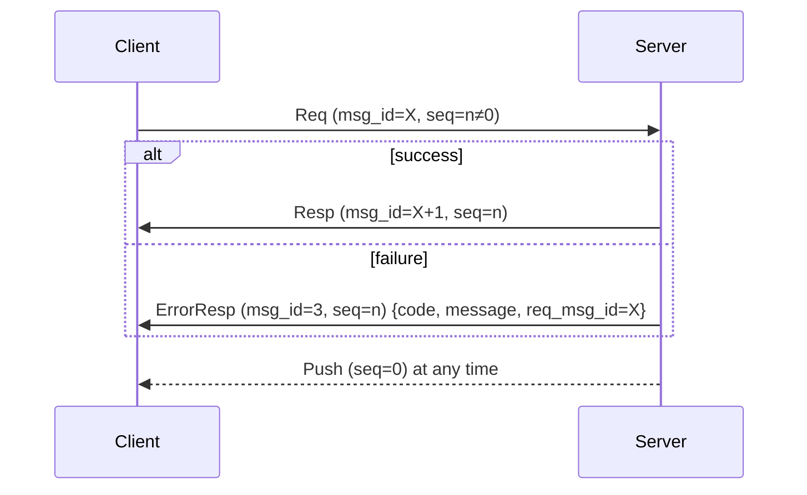
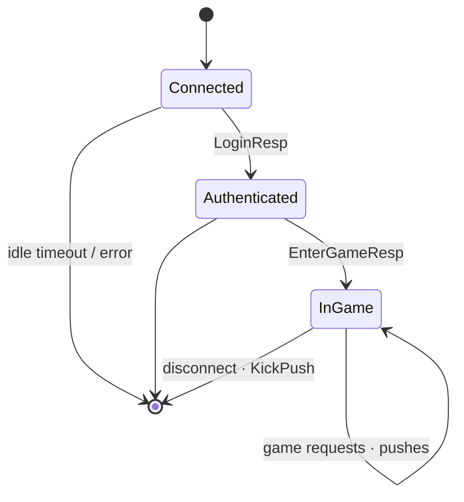

# Client protocol specification

[中文](protocol.zh-CN.md) · [Architecture](architecture.md)

Everything a client developer needs to talk to the server.

## 1. Transports

| Transport | Default address | Framing |
|---|---|---|
| TCP | `:7000` | `u32 big-endian length` + payload |
| WebSocket | `ws://host:7001/ws` | one **binary** message = one payload (text messages are ignored) |

Maximum payload: 64 KiB (`gate.max_packet_size`). Larger packets close the connection.

## 2. Payload

```
offset  size  field
0       4     msg_id   u32 big-endian — protobuf type of body
4       4     seq      u32 big-endian — request sequence, 0 for server pushes
8       n     body     protobuf-encoded message (may be empty)
```

Example — `HeartbeatReq{client_time_ms: 1}` over TCP:

```
00 00 00 0A   length = 10
00 00 00 01   msg_id = 1 (HEARTBEAT_REQ)
00 00 00 05   seq    = 5
08 01         body: field 1 varint 1
```

## 3. Request / response / push



* The client chooses `seq` (incrementing, non-zero, wraps around).
* Each request gets **exactly one** answer: its response or an `ErrorResp`.
* Pushes may arrive between a request and its response.
* Responses for one client are sent in request order.

## 4. Session lifecycle



| State | Allowed messages |
|---|---|
| Connected | heartbeat, login range (1000–1999) |
| Authenticated | + `EnterGameReq` |
| InGame | + all game messages (2000–9999) |

Game messages before `EnterGameReq` → `ERR_NOT_IN_GAME`; before login →
`NOT_AUTHENTICATED`.

## 5. Heartbeat

Send `HeartbeatReq{client_time_ms}` every 10–20 s. The gate replies directly
with `HeartbeatResp{client_time_ms, server_time_ms}` — use it for RTT
(`now - client_time_ms`) and clock offset. No traffic for `idle_timeout`
(default 60 s) ⇒ `KickPush(IDLE_TIMEOUT)` and disconnect.

## 6. Message table

### Framework (1–999)

| Id | Message | Dir | Notes |
|---|---|---|---|
| 1 | `HeartbeatReq` | C→S | answered by the gate |
| 2 | `HeartbeatResp` | S→C | |
| 3 | `ErrorResp` | S→C | `{code, message, req_msg_id}` |
| 4 | `KickPush` | S→C | `{reason, message}`, connection closes right after |

### Login (1000–1999, no auth, load-balanced)

| Id | Message | Fields |
|---|---|---|
| 1001 | `LoginReq` | `account` (3–32 `[A-Za-z0-9_]`), `password` (6–64), `client_version` |
| 1002 | `LoginResp` | `uid`, `new_account`, `server_time_ms` |

### Game (2000–9999, auth required, sticky)

| Id | Message | Fields |
|---|---|---|
| 2001 | `EnterGameReq` | `name` (used only when the character is created) |
| 2002 | `EnterGameResp` | `player: PlayerInfo`, `scene_id`, `position` |
| 2003 | `PlayerInfoPush` | `player` |
| 2101 | `BagGetReq` | — |
| 2102 | `BagGetResp` | `items[] {item_id, count}` |
| 2103 | `ItemUseReq` | `item_id`, `count` (≥1) |
| 2104 | `ItemUseResp` | — |
| 2105 | `BagUpdatePush` | changed `items[]`; `count = 0` ⇒ removed |
| 2201 | `ChatSendReq` | `channel` (WORLD=1, SCENE=2), `text` (≤200 chars) |
| 2202 | `ChatSendResp` | — |
| 2203 | `ChatPush` | `channel`, `from_uid`, `from_name`, `text`, `time_ms` |
| 2301 | `SceneMoveReq` | `target {x, y}` |
| 2302 | `SceneMoveResp` | `position` |
| 2303 | `SceneEntityEnterPush` | `entities[] {uid, name, position}` now visible |
| 2304 | `SceneEntityLeavePush` | `uids[]` no longer visible |
| 2305 | `SceneEntityMovePush` | `uid`, `position` |
| 2901 | `GmCommandReq` | `command` (only if GM enabled) |
| 2902 | `GmCommandResp` | `output` |

## 7. Error codes

| Code | Name | Meaning |
|---|---|---|
| 1 | `INTERNAL` | server bug or dependency failure; retry later |
| 2 | `UNKNOWN_MESSAGE` | msg_id not routed / no handler |
| 3 | `BAD_REQUEST` | body could not be decoded or is invalid |
| 4 | `NOT_AUTHENTICATED` | log in first |
| 5 | `RATE_LIMITED` | slow down |
| 6 | `SERVICE_UNAVAILABLE` | target service has no running instance |
| 7 | `TIMEOUT` | |
| 1001 | `ERR_INVALID_ACCOUNT` | |
| 1002 | `ERR_INVALID_PASSWORD` | |
| 1003 | `ERR_WRONG_PASSWORD` | |
| 2001 | `ERR_NOT_IN_GAME` | send `EnterGameReq` first (or this session was replaced) |
| 2101–2103 | `ERR_ITEM_NOT_FOUND / NOT_ENOUGH / NOT_USABLE` | |
| 2201–2203 | `ERR_CHAT_EMPTY / TOO_LONG / TOO_FAST` | |
| 2301–2302 | `ERR_POSITION_OUT_OF_BOUNDS / MOVE_TOO_FAR` | |
| 2901–2902 | `ERR_GM_DISABLED / GM_BAD_COMMAND` | |

## 8. Kick reasons

| Value | Reason | Client should |
|---|---|---|
| 1 | `KICK_DUPLICATE_LOGIN` | tell the user; **do not** auto-reconnect |
| 2 | `KICK_SERVER_SHUTDOWN` | show maintenance notice, retry later |
| 3 | `KICK_IDLE_TIMEOUT` | reconnect |
| 4 | `KICK_BY_ADMIN` | tell the user |

## 9. Compatibility rules

* Never renumber messages, fields or enum values.
* Add new optional fields freely; old clients ignore them.
* Clients must ignore unknown `msg_id`s (newer server).
* Response id = request id + 1 by convention.
