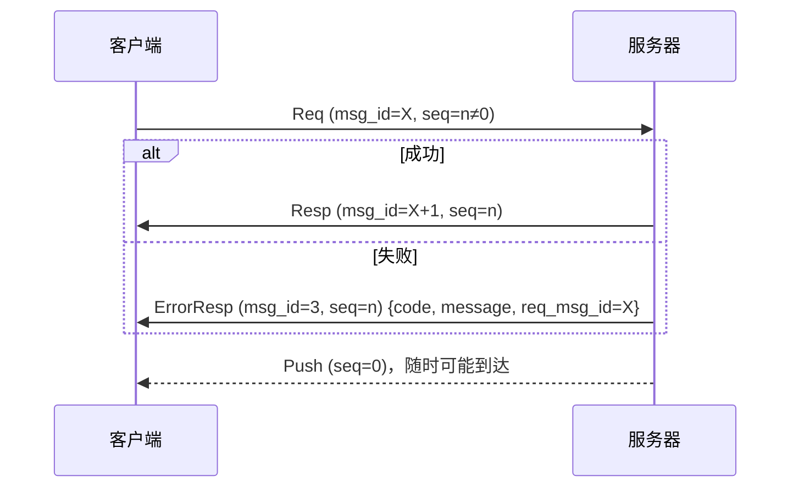
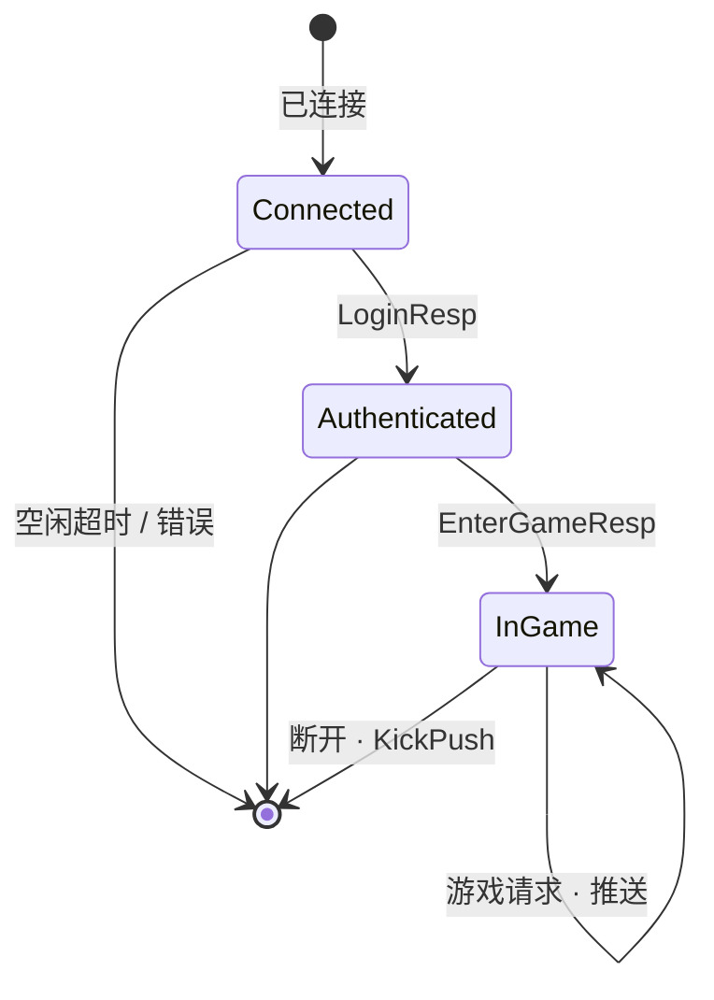

# 客户端协议规范

[English](protocol.md) · [总体架构](architecture.zh-CN.md)

客户端开发者与服务器通信所需的全部信息。

## 1. 传输方式

| 传输 | 默认地址 | 分帧 |
|---|---|---|
| TCP | `:7000` | `u32 大端长度` + payload |
| WebSocket | `ws://host:7001/ws` | 一条**二进制**消息 = 一个 payload（文本消息会被忽略） |

最大 payload：64 KiB（`gate.max_packet_size`）。超过则断开连接。

## 2. Payload 格式

```
偏移    大小  字段
0       4     msg_id   u32 大端 —— body 的 protobuf 类型
4       4     seq      u32 大端 —— 请求序号，服务端推送为 0
8       n     body     protobuf 编码的消息（可以为空）
```

示例 —— 通过 TCP 发送 `HeartbeatReq{client_time_ms: 1}`：

```
00 00 00 0A   length = 10
00 00 00 01   msg_id = 1 (HEARTBEAT_REQ)
00 00 00 05   seq    = 5
08 01         body：字段 1，varint 1
```

## 3. 请求 / 响应 / 推送



* `seq` 由客户端选择（递增、非零、可回绕）。
* 每个请求**恰好**得到一个回答：它的响应或一个 `ErrorResp`。
* 推送可能夹在请求与其响应之间到达。
* 同一客户端的响应按请求顺序发送。

## 4. 会话生命周期



| 状态 | 允许的消息 |
|---|---|
| Connected（已连接） | 心跳、登录区间（1000–1999） |
| Authenticated（已登录） | + `EnterGameReq` |
| InGame（游戏中） | + 所有游戏消息（2000–9999） |

`EnterGameReq` 之前发游戏消息 → `ERR_NOT_IN_GAME`；登录之前 → `NOT_AUTHENTICATED`。

## 5. 心跳

每 10–20 秒发送一次 `HeartbeatReq{client_time_ms}`。网关直接回复
`HeartbeatResp{client_time_ms, server_time_ms}` —— 可用于计算 RTT（`now - client_time_ms`）和时钟偏差。
`idle_timeout`（默认 60 秒）内没有任何数据 ⇒ `KickPush(IDLE_TIMEOUT)` 并断开。

## 6. 消息表

### 框架（1–999）

| ID | 消息 | 方向 | 说明 |
|---|---|---|---|
| 1 | `HeartbeatReq` | C→S | 由网关直接应答 |
| 2 | `HeartbeatResp` | S→C | |
| 3 | `ErrorResp` | S→C | `{code, message, req_msg_id}` |
| 4 | `KickPush` | S→C | `{reason, message}`，随后连接关闭 |

### 登录（1000–1999，无需登录，负载均衡）

| ID | 消息 | 字段 |
|---|---|---|
| 1001 | `LoginReq` | `account`（3–32 位 `[A-Za-z0-9_]`）、`password`（6–64）、`client_version` |
| 1002 | `LoginResp` | `uid`、`new_account`、`server_time_ms` |

### 游戏（2000–9999，需要登录，粘性路由）

| ID | 消息 | 字段 |
|---|---|---|
| 2001 | `EnterGameReq` | `name`（仅在创建角色时使用） |
| 2002 | `EnterGameResp` | `player: PlayerInfo`、`scene_id`、`position` |
| 2003 | `PlayerInfoPush` | `player` |
| 2101 | `BagGetReq` | — |
| 2102 | `BagGetResp` | `items[] {item_id, count}` |
| 2103 | `ItemUseReq` | `item_id`、`count`（≥1） |
| 2104 | `ItemUseResp` | — |
| 2105 | `BagUpdatePush` | 变化的 `items[]`；`count = 0` ⇒ 已移除 |
| 2201 | `ChatSendReq` | `channel`（WORLD=1，SCENE=2）、`text`（≤200 字） |
| 2202 | `ChatSendResp` | — |
| 2203 | `ChatPush` | `channel`、`from_uid`、`from_name`、`text`、`time_ms` |
| 2301 | `SceneMoveReq` | `target {x, y}` |
| 2302 | `SceneMoveResp` | `position` |
| 2303 | `SceneEntityEnterPush` | 新进入视野的 `entities[] {uid, name, position}` |
| 2304 | `SceneEntityLeavePush` | 离开视野的 `uids[]` |
| 2305 | `SceneEntityMovePush` | `uid`、`position` |
| 2901 | `GmCommandReq` | `command`（仅在开启 GM 时可用） |
| 2902 | `GmCommandResp` | `output` |

## 7. 错误码

| 错误码 | 名称 | 含义 |
|---|---|---|
| 1 | `INTERNAL` | 服务器 bug 或依赖故障；稍后重试 |
| 2 | `UNKNOWN_MESSAGE` | msg_id 没有路由 / 没有处理器 |
| 3 | `BAD_REQUEST` | body 无法解码或不合法 |
| 4 | `NOT_AUTHENTICATED` | 请先登录 |
| 5 | `RATE_LIMITED` | 请求过快 |
| 6 | `SERVICE_UNAVAILABLE` | 目标服务没有运行中的实例 |
| 7 | `TIMEOUT` | 超时 |
| 1001 | `ERR_INVALID_ACCOUNT` | 账号格式不合法 |
| 1002 | `ERR_INVALID_PASSWORD` | 密码格式不合法 |
| 1003 | `ERR_WRONG_PASSWORD` | 密码错误 |
| 2001 | `ERR_NOT_IN_GAME` | 请先发送 `EnterGameReq`（或本会话已被替换） |
| 2101–2103 | `ERR_ITEM_NOT_FOUND / NOT_ENOUGH / NOT_USABLE` | 道具不存在 / 数量不足 / 不可使用 |
| 2201–2203 | `ERR_CHAT_EMPTY / TOO_LONG / TOO_FAST` | 聊天为空 / 过长 / 过快 |
| 2301–2302 | `ERR_POSITION_OUT_OF_BOUNDS / MOVE_TOO_FAR` | 坐标越界 / 移动距离过大 |
| 2901–2902 | `ERR_GM_DISABLED / GM_BAD_COMMAND` | GM 未开启 / GM 命令错误 |

## 8. 踢人原因

| 值 | 原因 | 客户端应当 |
|---|---|---|
| 1 | `KICK_DUPLICATE_LOGIN` | 提示用户；**不要**自动重连 |
| 2 | `KICK_SERVER_SHUTDOWN` | 显示维护公告，稍后重试 |
| 3 | `KICK_IDLE_TIMEOUT` | 重连 |
| 4 | `KICK_BY_ADMIN` | 提示用户 |

## 9. 兼容性规则

* 绝不重新编号消息、字段或枚举值。
* 可以随意新增可选字段；老客户端会忽略。
* 客户端必须忽略未知的 `msg_id`（服务器更新了）。
* 约定响应 ID = 请求 ID + 1。
