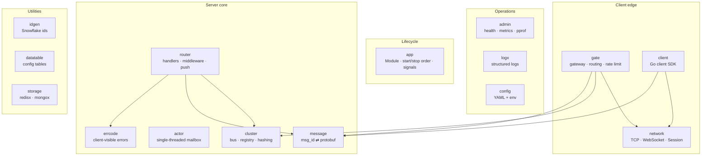

# Framework layer

[中文](README.zh-CN.md) · [Architecture](../docs/architecture.md)

`framework/` contains everything a game server needs **regardless of the game**:
networking, routing, clustering, concurrency, persistence plumbing, and
operations. It never imports anything from `game/`.

## Package map

| Package | One-line summary | README |
|---|---|---|
| `app` | Module lifecycle: ordered Init/Start, reverse Stop, signal handling | [app](app/README.md) |
| `config` | YAML loading with `${ENV:-default}` expansion and strict keys | [config](config/README.md) |
| `logx` | `log/slog` setup, per-module loggers | [logx](logx/README.md) |
| `network` | Wire format, TCP/WebSocket `Conn`, non-blocking `Session` | [network](network/README.md) |
| `message` | Bidirectional `msg_id ⇄ protobuf type` registry | [message](message/README.md) |
| `errcode` | Errors with numeric codes sent to clients | [errcode](errcode/README.md) |
| `gate` | Client gateway: sessions, heartbeat, rate limit, routing | [gate](gate/README.md) |
| `router` | Backend dispatch: typed handlers, middleware, push/broadcast/bind/kick | [router](router/README.md) |
| `cluster` | Message bus (local/NATS), registry (memory/Redis), rendezvous hashing | [cluster](cluster/README.md) |
| `actor` | Lock-free game logic via per-entity goroutine + mailbox, timers | [actor](actor/README.md) |
| `client` | Go client: request/response by seq, pushes, heartbeat | [client](client/README.md) |
| `storage` | Redis and MongoDB connections as modules | [storage](storage/README.md) |
| `admin` | `/healthz` `/readyz` `/metrics` `/debug/pprof` | [admin](admin/README.md) |
| `idgen` | Snowflake 63-bit unique ids | [idgen](idgen/README.md) |
| `datatable` | Typed, immutable, hot-swappable JSON config tables | [datatable](datatable/README.md) |
| `pb` | Generated code for `proto/framework/*.proto` (system messages, cluster envelope) | — |

## Design principles

1. **Business-agnostic.** Framework packages only know about bytes, ids,
   envelopes and protobuf messages, never about players or items.
2. **Same code, two topologies.** Swap `local` ⇄ `nats` and `memory` ⇄ `redis`
   in config; no code changes between a laptop and a cluster.
3. **No locks in game logic.** State is owned by actors; communication is by
   message passing.
4. **Fail fast at startup, degrade gracefully at runtime.** Bad config, duplicate
   message ids or port conflicts stop the process immediately; a panicking
   handler, a slow client or a crashed node does not.
5. **Observable by default.** Every node exposes metrics, health and pprof.
6. **Standard library first.** `log/slog`, `net`, `context`; third-party
   libraries only where they are the de facto standard (protobuf, NATS,
   go-redis, mongo-driver, gorilla/websocket, Prometheus client).
