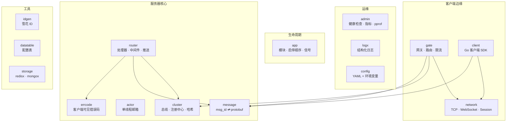

# 基础框架层

[English](README.md) · [总体架构](../docs/architecture.zh-CN.md)

`framework/` 包含**与具体游戏无关**、所有游戏服务器都需要的能力：网络、路由、集群、
并发模型、存储接入、运维。它从不 import `game/` 下的任何代码。

## 包结构图

| 包 | 一句话说明 | 文档 |
|---|---|---|
| `app` | 模块生命周期：按序 Init/Start，逆序 Stop，信号处理 | [app](app/README.zh-CN.md) |
| `config` | YAML 加载，支持 `${ENV:-默认值}` 展开，拒绝未知字段 | [config](config/README.zh-CN.md) |
| `logx` | `log/slog` 初始化、按模块打标签的日志 | [logx](logx/README.zh-CN.md) |
| `network` | 线上格式、TCP/WebSocket `Conn`、非阻塞 `Session` | [network](network/README.zh-CN.md) |
| `message` | `msg_id ⇄ protobuf 类型` 双向注册表 | [message](message/README.zh-CN.md) |
| `errcode` | 带数字错误码、会发给客户端的错误 | [errcode](errcode/README.zh-CN.md) |
| `gate` | 客户端网关：会话、心跳、限流、路由 | [gate](gate/README.zh-CN.md) |
| `router` | 后端分发：强类型处理器、中间件、推送/广播/绑定/踢人 | [router](router/README.zh-CN.md) |
| `cluster` | 消息总线（本地/NATS）、注册中心（内存/Redis）、一致性（HRW）哈希 | [cluster](cluster/README.zh-CN.md) |
| `actor` | 每个实体一个协程 + 邮箱，游戏逻辑无锁；定时器 | [actor](actor/README.zh-CN.md) |
| `client` | Go 客户端：按 seq 匹配请求响应、推送、心跳 | [client](client/README.zh-CN.md) |
| `storage` | Redis、MongoDB 连接模块 | [storage](storage/README.zh-CN.md) |
| `admin` | `/healthz` `/readyz` `/metrics` `/debug/pprof` | [admin](admin/README.zh-CN.md) |
| `idgen` | 雪花算法 63 位唯一 ID | [idgen](idgen/README.zh-CN.md) |
| `datatable` | 强类型、只读、可热替换的 JSON 配置表 | [datatable](datatable/README.zh-CN.md) |
| `pb` | `proto/framework/*.proto` 的生成代码（系统消息、集群信封） | — |

## 设计原则

1. **与业务无关。** 框架只认识字节、ID、信封和 protobuf 消息，从不认识"玩家""道具"。
2. **同一份代码，两种拓扑。** 配置里切换 `local` ⇄ `nats`、`memory` ⇄ `redis`，
   从笔记本到集群无需改代码。
3. **游戏逻辑无锁。** 状态归 actor 所有，通过消息传递通信。
4. **启动时快速失败，运行时优雅降级。** 配置错误、消息 ID 重复、端口冲突会让进程立即退出；
   而某个处理器 panic、某个客户端太慢、某个节点崩溃都不会拖垮整体。
5. **默认可观测。** 每个节点都暴露指标、健康检查和 pprof。
6. **标准库优先。** `log/slog`、`net`、`context`；只有在事实标准的领域才引入第三方库
   （protobuf、NATS、go-redis、mongo-driver、gorilla/websocket、Prometheus client）。
