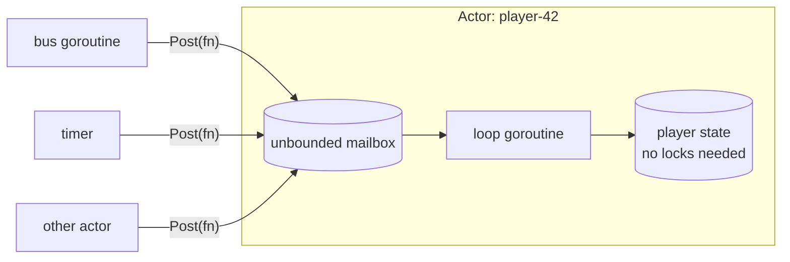

# actor — lock-free game logic

[中文](README.zh-CN.md)

Game servers mutate a lot of shared state at high frequency. Protecting it with
mutexes leads to deadlocks, lock contention and subtle races. The actor model
avoids all of that: **each piece of state is owned by exactly one goroutine**,
and everyone else sends it functions to run.



## API

```go
a := actor.New("player-42", logger) // starts the goroutine

a.Post(func() { p.gold += 10 })     // async, never blocks, false if stopped
err := a.Call(ctx, func() { n = p.gold }) // sync, waits (never call from inside a)

t := a.After(5*time.Second, fn)      // one-shot timer, fn runs inside the actor
t := a.Every(30*time.Second, p.save) // periodic timer
t.Stop()

a.Stop()      // reject new posts, run what is queued, exit
<-a.Done()
```

## Guarantees

| Property | How |
|---|---|
| Functions run one at a time, in post order | single loop goroutine, FIFO queue |
| `Post` never blocks | unbounded slice-based mailbox + 1-slot signal channel |
| No deadlock on self-post or mutual posts | consequence of the above (bounded channels would deadlock when full) |
| A panic does not kill the actor | each function runs under `recover`, logged with stack |
| Timers are race-free | timer callbacks are *posted*, so they run in the actor like any message |
| Clean shutdown | `Stop` drains already-queued functions before exiting |

## Usage pattern in this project

* **Player actor** (`game/gamesvc/player.go`): one per online player. All
  handlers for that player run in it, so `p.data`, `p.bag` etc. are plain fields.
* **Scene actor** (`game/gamesvc/scene.go`): owns the AOI grid; player actors
  post `Enter/Move/Leave` to it.

### Rules of thumb

1. Never touch another actor's state directly — post to it.
2. Never `Call` an actor from inside itself.
3. Keep functions short. Blocking I/O inside an actor delays only that actor
   (e.g. loading one player), which is acceptable; long CPU work should be
   offloaded.
4. Data passed between actors must not be shared mutably (copy it).

## Why unbounded?

A bounded mailbox gives back-pressure but can deadlock when two actors post to
each other while both queues are full. Game traffic is bounded upstream anyway
(gate rate limits per session), so an unbounded mailbox is the safer default.
Monitor goroutine counts and memory via `/metrics` and pprof.

## Tests

`actor_test.go`: ordering, drain on stop, panic recovery, timers, and 10,000
self-posts without stalling.
