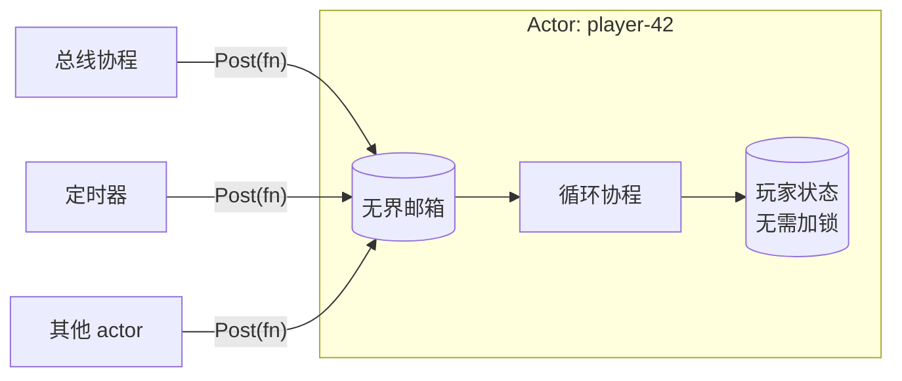

# actor —— 无锁的游戏逻辑

[English](README.md)

游戏服务器会高频修改大量共享状态。用互斥锁保护这些状态，很容易出现死锁、锁竞争和隐蔽的数据竞争。
Actor 模型从根本上避免了这些问题：**每份状态只归一个协程所有**，其他人只能把函数"投递"给它执行。



## API

```go
a := actor.New("player-42", logger) // 创建并启动协程

a.Post(func() { p.gold += 10 })     // 异步，永不阻塞；已停止则返回 false
err := a.Call(ctx, func() { n = p.gold }) // 同步等待（禁止在 a 内部调用）

t := a.After(5*time.Second, fn)      // 一次性定时器，fn 在 actor 内执行
t := a.Every(30*time.Second, p.save) // 周期定时器
t.Stop()

a.Stop()      // 拒绝新投递，执行完已排队的函数后退出
<-a.Done()
```

## 保证

| 特性 | 实现方式 |
|---|---|
| 函数逐个执行，按投递顺序 | 单个循环协程 + FIFO 队列 |
| `Post` 永不阻塞 | 基于切片的无界邮箱 + 容量为 1 的信号通道 |
| 自投递、互相投递都不会死锁 | 上一条的直接结果（有界通道满了就会死锁） |
| panic 不会杀死 actor | 每个函数都在 `recover` 保护下执行，并记录堆栈 |
| 定时器无数据竞争 | 定时回调是被*投递*进来的，和普通消息一样在 actor 内执行 |
| 干净停机 | `Stop` 会先执行完已排队的函数再退出 |

## 本项目中的用法

* **玩家 actor**（`game/gamesvc/player.go`）：每个在线玩家一个。该玩家的所有处理器都在其中执行，
  所以 `p.data`、`p.bag` 等都是普通字段。
* **场景 actor**（`game/gamesvc/scene.go`）：拥有 AOI 网格；玩家 actor 向它投递 `Enter/Move/Leave`。

### 经验法则

1. 永远不要直接访问别的 actor 的状态 —— 投递给它。
2. 永远不要在 actor 内部 `Call` 自己。
3. 函数要短。actor 内的阻塞 I/O 只会拖慢这一个 actor（比如加载一个玩家），可以接受；
   长时间的 CPU 计算应当移出去。
4. 在 actor 之间传递的数据不要共享可变引用（复制一份）。

## 为什么是无界邮箱？

有界邮箱能提供背压，但两个 actor 互相投递且队列都满时会死锁。
游戏流量在上游已经被限制了（网关对每个会话限流），所以无界邮箱是更安全的默认选择。
可以通过 `/metrics` 和 pprof 监控协程数量和内存。

## 测试

`actor_test.go`：顺序性、停止时排空、panic 恢复、定时器，以及 1 万次自投递不卡顿。
