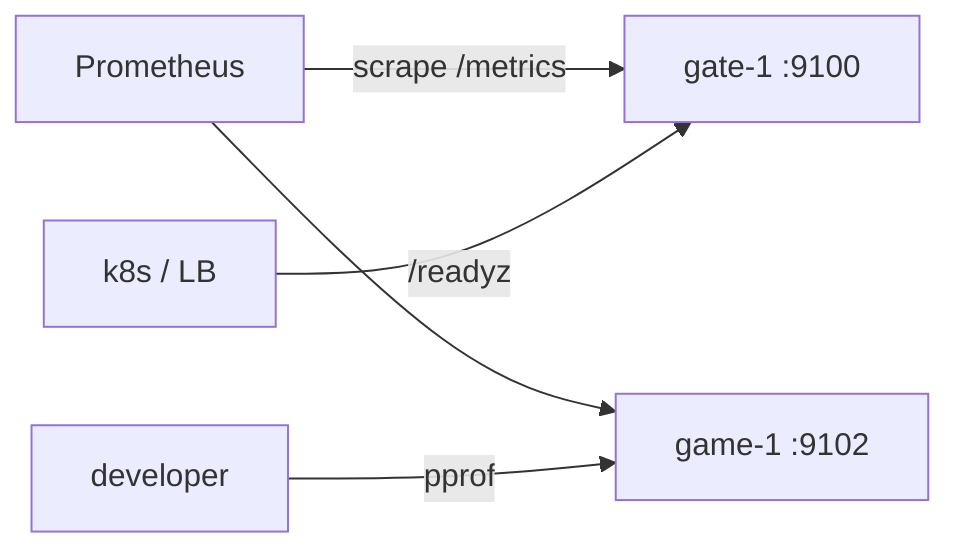

# admin — operations HTTP endpoint

[中文](README.zh-CN.md)

Every node exposes an internal HTTP server (default `127.0.0.1:9100`):

| Path | Purpose | Typical consumer |
|---|---|---|
| `/healthz` | liveness: the process is running | Kubernetes `livenessProbe`, Docker healthcheck |
| `/readyz` | readiness: all modules started and not shutting down (`503` otherwise) | load balancer, Kubernetes `readinessProbe` |
| `/metrics` | Prometheus metrics (Go runtime + `gs_*` game metrics) | Prometheus / Grafana |
| `/debug/pprof/` | CPU, heap, goroutine, block profiles | `go tool pprof http://host:9100/debug/pprof/profile` |

Readiness is flipped by the last module added in `game/bootstrap`, so a node
only reports ready after the gate is listening, and reports not-ready as the
very first step of shutdown.

## Metrics exported by the framework

| Metric | Labels |
|---|---|
| `gs_gate_sessions` | — |
| `gs_gate_packets_in_total`, `gs_gate_packets_out_total` | — |
| `gs_gate_rejected_total` | `reason` |
| `gs_handler_duration_seconds` (histogram) | `service`, `msg_id` |
| `gs_handler_errors_total` | `service`, `msg_id`, `code` |
| `go_*`, `process_*` | Go runtime / process |

Add your own with `promauto.NewCounter(...)` anywhere; they appear automatically.
Extra admin endpoints (GM tools, config reload) can be mounted with
`Server.Handle(pattern, handler)`.

> **Security:** bind to a private interface or protect it with network policy.
> pprof and GM endpoints must never be reachable from the internet.
