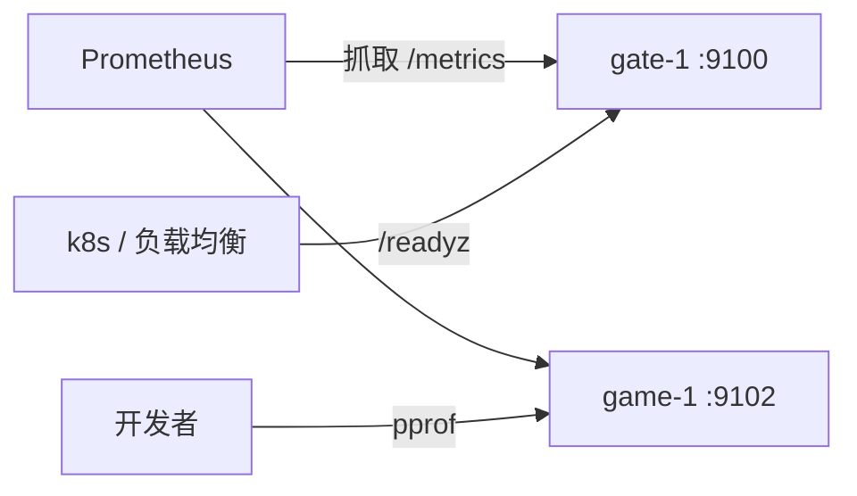

# admin —— 运维 HTTP 端点

[English](README.md)

每个节点都暴露一个内部 HTTP 服务（默认 `127.0.0.1:9100`）：

| 路径 | 作用 | 典型使用者 |
|---|---|---|
| `/healthz` | 存活：进程在运行 | Kubernetes `livenessProbe`、Docker 健康检查 |
| `/readyz` | 就绪：所有模块已启动且未在停机（否则返回 `503`） | 负载均衡、Kubernetes `readinessProbe` |
| `/metrics` | Prometheus 指标（Go 运行时 + `gs_*` 游戏指标） | Prometheus / Grafana |
| `/debug/pprof/` | CPU、堆、协程、阻塞分析 | `go tool pprof http://host:9100/debug/pprof/profile` |

就绪状态由 `game/bootstrap` 中最后添加的模块切换：节点只有在网关开始监听后才报告就绪，
停机时第一步就报告未就绪。

## 框架导出的指标

| 指标 | 标签 |
|---|---|
| `gs_gate_sessions` | — |
| `gs_gate_packets_in_total`、`gs_gate_packets_out_total` | — |
| `gs_gate_rejected_total` | `reason` |
| `gs_handler_duration_seconds`（直方图） | `service`、`msg_id` |
| `gs_handler_errors_total` | `service`、`msg_id`、`code` |
| `go_*`、`process_*` | Go 运行时 / 进程 |

在任何地方用 `promauto.NewCounter(...)` 定义自己的指标即可自动出现。额外的管理端点
（GM 工具、配置热更）可通过 `Server.Handle(pattern, handler)` 挂载。

> **安全：** 只绑定内网地址或用网络策略保护。pprof 和 GM 端点绝不能暴露到公网。
