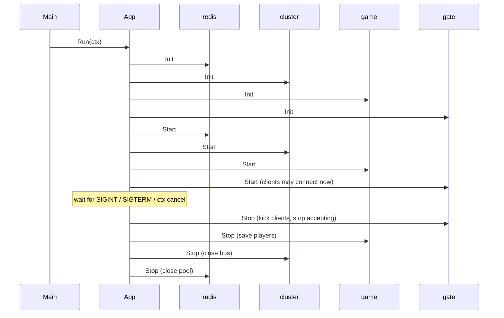

# app — process lifecycle

[中文](README.zh-CN.md)

A server process is an ordered list of **modules**. `app.App` initializes and
starts them in order, waits for a shutdown signal, and stops them in reverse
order. This gives every component one obvious place to acquire and release
resources and makes graceful shutdown automatic.

```go
type Module interface {
    Name() string
    Init(ctx context.Context) error  // prepare: connect, validate. Do not serve yet.
    Start(ctx context.Context) error // begin serving. Must not block.
    Stop(ctx context.Context) error  // release. Honour ctx deadline.
}
```

## Lifecycle



* **All `Init`s run before any `Start`** — a bad config or unreachable database
  is detected before a single client is accepted.
* If a `Start` fails, the modules already started are stopped (reverse order)
  and the error is returned.
* `Stop` shares one deadline (`StopTimeout`, default 30s) across all modules;
  errors are collected with `errors.Join`, so one failing module does not
  prevent the others from stopping.
* `Run` handles `SIGINT`/`SIGTERM` (Ctrl+C, `docker stop`, Kubernetes).
  Tests use `Start`/`Stop` directly.

## Ordering rule

**Add dependencies first.** Storage before services, services before the gate.
Then reverse stop order is automatically correct: the gate stops accepting
players before the game service saves them, and the database connection closes
last. See `game/bootstrap` for the real order.

## `app.Func`

Adapter for small modules without a dedicated type:

```go
a.Add(app.Func{
    ModuleName: "ready",
    OnStart: func(context.Context) error { admin.SetReady(true); return nil },
    OnStop:  func(context.Context) error { admin.SetReady(false); return nil },
})
```
