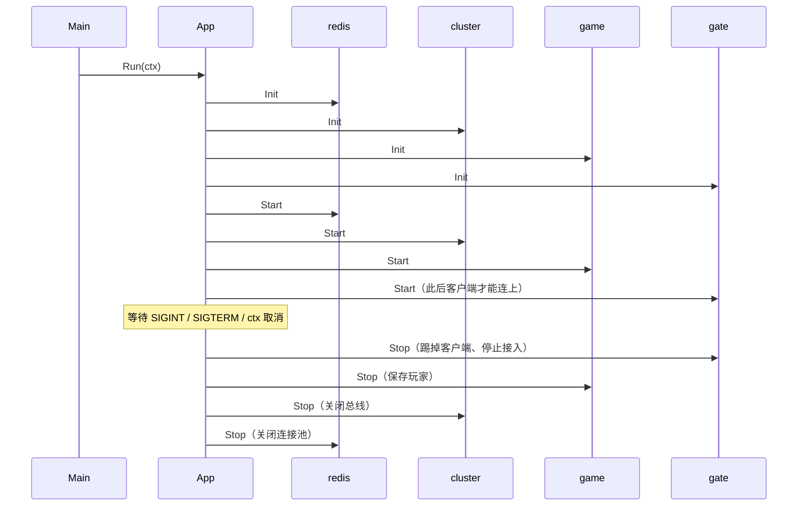

# app —— 进程生命周期

[English](README.md)

一个服务器进程就是一组有序的**模块**。`app.App` 按顺序初始化并启动它们，等待停机信号，
然后按相反顺序停止。每个组件因此都有一个明确的地方申请和释放资源，优雅停机也成了默认行为。

```go
type Module interface {
    Name() string
    Init(ctx context.Context) error  // 准备：建立连接、校验配置。此时还不能对外服务。
    Start(ctx context.Context) error // 开始服务。不能阻塞。
    Stop(ctx context.Context) error  // 释放资源。需遵守 ctx 的截止时间。
}
```

## 生命周期



* **所有 `Init` 都在任何 `Start` 之前执行** —— 配置错误、数据库连不上，会在接入第一个客户端之前就被发现。
* 某个 `Start` 失败时，已启动的模块会被逆序停止，并返回错误。
* 所有模块的 `Stop` 共享同一个截止时间（`StopTimeout`，默认 30 秒）；错误通过 `errors.Join`
  汇总，一个模块失败不会妨碍其他模块停止。
* `Run` 会处理 `SIGINT`/`SIGTERM`（Ctrl+C、`docker stop`、Kubernetes）。测试中直接调用 `Start`/`Stop`。

## 顺序规则

**被依赖的先添加。** 存储在服务之前，服务在网关之前。这样逆序停止自然就是正确的：
网关先停止接入玩家，游戏服再保存玩家，数据库连接最后关闭。真实顺序见 `game/bootstrap`。

## `app.Func`

给没有专门类型的小模块用的适配器：

```go
a.Add(app.Func{
    ModuleName: "ready",
    OnStart: func(context.Context) error { admin.SetReady(true); return nil },
    OnStop:  func(context.Context) error { admin.SetReady(false); return nil },
})
```
