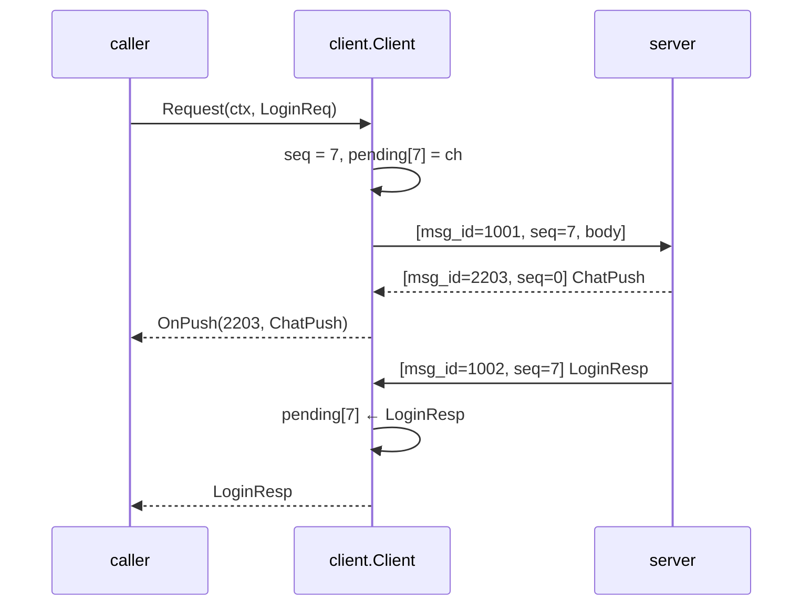

# client — Go client SDK

[中文](README.zh-CN.md)

A complete client for servers built on this framework. It powers the robot
(`cmd/robot`) and the end-to-end tests, and serves as the **reference
implementation** for engine programmers writing a Unity/Unreal/Cocos client.



```go
c, err := client.DialTCP("127.0.0.1:7000", client.Options{
    Registry: protocol.Registry(),
    OnPush: func(id uint32, msg proto.Message) { /* scene updates, chat, kick… */ },
})
defer c.Close()
c.StartHeartbeat(10 * time.Second)

resp, err := client.Call[*pb.LoginResp](ctx, c, &pb.LoginReq{Account: "alice", Password: "secret123"})
var se *client.ServerError
if errors.As(err, &se) { fmt.Println(se.Code, se.Msg) }
```

| Feature | Detail |
|---|---|
| Transports | `DialTCP(addr)` and `DialWS("ws://host:7001/ws")` |
| Correlation | each request gets a non-zero `seq`; responses are matched by `seq`, pushes have `seq = 0` |
| Errors | an `ErrorResp` answer becomes `*client.ServerError{Code, Msg}` |
| Concurrency | `Request` is safe from many goroutines; writes are serialized |
| Liveness | `StartHeartbeat(interval)`; `Done()` / `Err()` report disconnection (e.g. after `KickPush`) |
| Forward compatibility | unknown message ids are ignored, not fatal |

### Porting to another language

1. Frame: 4-byte big-endian length + payload (TCP) or one binary WS message.
2. Payload: `u32 msg_id`, `u32 seq`, protobuf body (big-endian).
3. Generate protobuf classes from `proto/` and build the same id table.
4. Keep a `seq → callback` map; deliver `seq == 0` to push handlers.
5. Heartbeat every 10–20 s; on `KickPush` show the reason and stop reconnecting
   for `DUPLICATE_LOGIN`.
