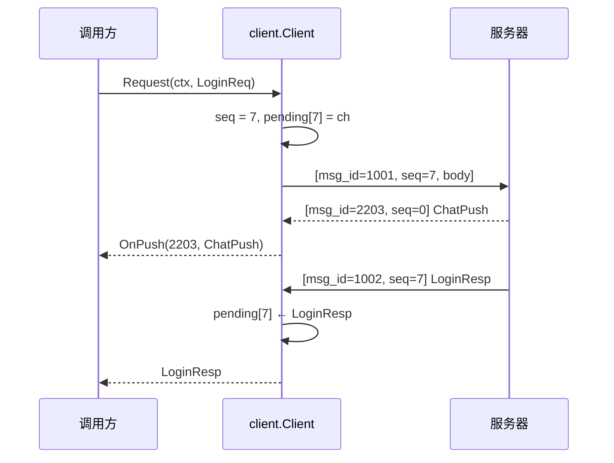

# client —— Go 客户端 SDK

[English](README.md)

一个完整的客户端实现。机器人（`cmd/robot`）和端到端测试都基于它，同时它也是给编写
Unity/Unreal/Cocos 客户端的引擎程序员看的**参考实现**。



```go
c, err := client.DialTCP("127.0.0.1:7000", client.Options{
    Registry: protocol.Registry(),
    OnPush: func(id uint32, msg proto.Message) { /* 场景同步、聊天、踢人…… */ },
})
defer c.Close()
c.StartHeartbeat(10 * time.Second)

resp, err := client.Call[*pb.LoginResp](ctx, c, &pb.LoginReq{Account: "alice", Password: "secret123"})
var se *client.ServerError
if errors.As(err, &se) { fmt.Println(se.Code, se.Msg) }
```

| 特性 | 说明 |
|---|---|
| 传输 | `DialTCP(addr)` 与 `DialWS("ws://host:7001/ws")` |
| 请求匹配 | 每个请求分配非零 `seq`；响应按 `seq` 匹配，推送的 `seq = 0` |
| 错误 | 服务端回 `ErrorResp` 时返回 `*client.ServerError{Code, Msg}` |
| 并发 | `Request` 可被多个协程同时调用；写操作串行化 |
| 存活 | `StartHeartbeat(interval)`；`Done()` / `Err()` 报告断线（例如收到 `KickPush` 后） |
| 向前兼容 | 遇到未知消息 ID 直接忽略，而不是报错 |

### 移植到其他语言

1. 分帧：4 字节大端长度 + payload（TCP），或一条 WebSocket 二进制消息。
2. payload：`u32 msg_id`、`u32 seq`、protobuf body（大端）。
3. 用 `proto/` 生成 protobuf 类，并建立同样的 ID 映射表。
4. 维护 `seq → 回调` 表；`seq == 0` 的消息交给推送处理器。
5. 每 10~20 秒发一次心跳；收到 `KickPush` 时提示原因，若为 `DUPLICATE_LOGIN` 则不要自动重连。
