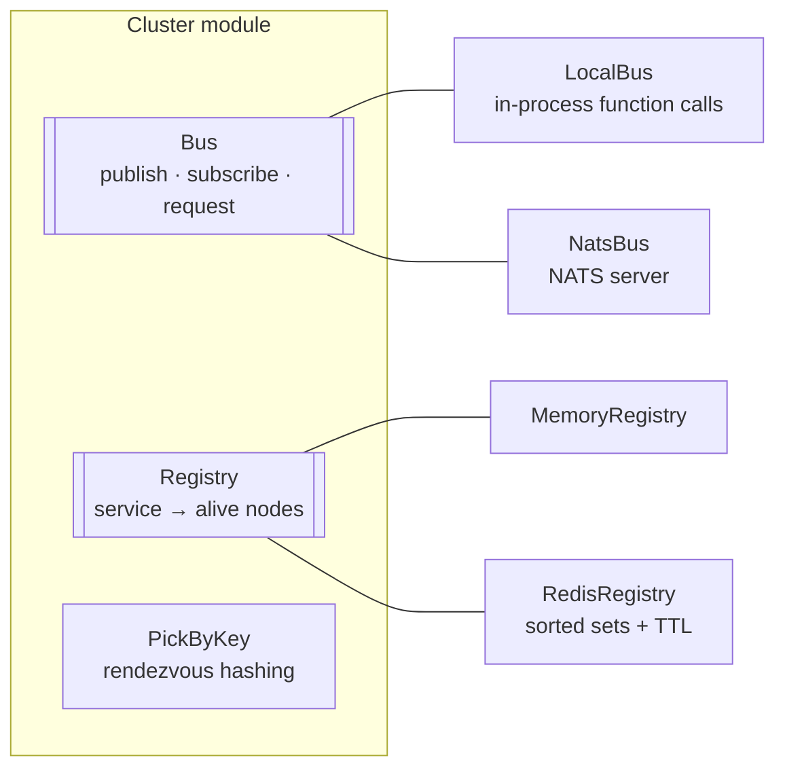
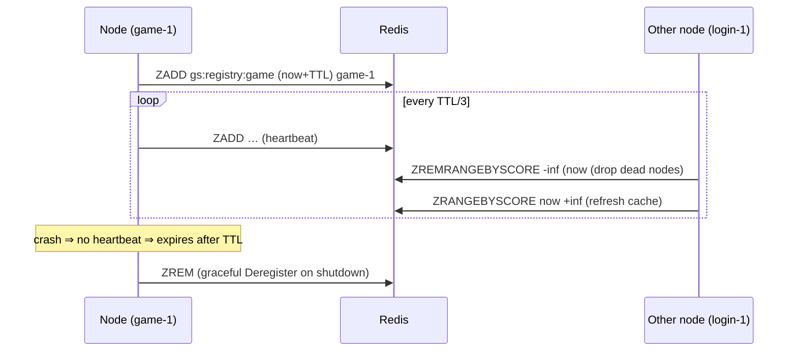

# cluster — bus, registry and node selection

[中文](README.zh-CN.md)

`framework/cluster` lets server nodes find and talk to each other. It is the
reason the **same binary** can run as one all-in-one process or as dozens of
specialized processes.



| Mode | Bus | Registry | Use |
|---|---|---|---|
| all-in-one | `local` | `memory` | development, tests, small games |
| distributed | `nats` | `redis` | production, horizontal scaling |

```yaml
cluster:
  bus: nats                      # local | nats
  nats_url: nats://127.0.0.1:4222
  registry: redis                # memory | redis
  registry_ttl: 10s
```

## Bus

```go
type Bus interface {
    Publish(subject string, data []byte) error
    Request(ctx context.Context, subject string, data []byte) ([]byte, error)
    Subscribe(subject, queue string, h Handler) (Subscription, error)
    Close() error
}
```

Semantics follow NATS so both implementations behave identically:

* `queue == ""` → **fan-out**: every subscriber receives every message.
* same non-empty `queue` → **load balancing**: one member of the group receives each message.
* messages from one publisher on one subject are delivered **in order**.
* handlers must be fast; hand heavy work to an actor or worker pool.

`LocalBus` calls handlers synchronously in the publisher's goroutine — zero
serialization cost apart from the protobuf envelope, and strict ordering.
`NatsBus` adds auto-reconnect, large pending buffers, and drains on close.

### Subject naming

| Helper | Example | Used for |
|---|---|---|
| `NodeSubject(svc, node)` | `gs.node.game.game-2` | one service instance (sticky routing, replies to a gate) |
| `ServiceSubject(svc)` | `gs.svc.login` | any instance, with queue group = service name |
| `BroadcastSubject(svc)` | `gs.bcast.gate` | every instance (world chat, announcements) |

Node ids and service names must not contain `.`, `*`, `>` or whitespace (`ValidateToken`).

## Envelope

All inter-node traffic is a protobuf `clusterpb.Envelope` (see
`proto/framework/cluster.proto`). Its `kind` says what to do:

| Kind | Direction | Meaning |
|---|---|---|
| `FORWARD` | gate → backend | a client request (msg_id, seq, body, uid, session) |
| `REPLY` | backend → gate | deliver one packet to one session |
| `BIND` | backend → gate | attach uid / service routes to a session |
| `KICK` | backend → gate | disconnect a session with a reason |
| `SESSION_CLOSED` | gate → backend | the client went away |
| `BROADCAST` | backend → all gates | deliver one packet to many uids |

`Cluster.Publish/SendToNode/SendToService/Broadcast` marshal envelopes and fill
`src_node`; `SubscribeEnvelopes` decodes them.

## Registry

```go
type Registry interface {
    Register(ctx, service, nodeID string) error
    Deregister(ctx, service, nodeID string) error
    Nodes(service string) []string // sorted, cached, never blocks on the hot path
    Start(ctx) error
    Close() error
}
```

### RedisRegistry

```
ZSET gs:registry:game
  member  game-1   score  1729400010000   (expiry, unix ms)
  member  game-2   score  1729400011500
```



A crashed node disappears within `registry_ttl`; a gracefully stopped node
disappears immediately.

## PickByKey — rendezvous hashing

`PickByKey(nodes, key)` computes `score = hash(node, key)` for each node and
returns the highest. Properties (verified in `cluster_test.go`):

* deterministic across processes (FNV-1a + splitmix64, no random seed);
* balanced (±20% on 30k keys over 3 nodes);
* minimal disruption: removing a node only moves the keys it owned.

The login service uses it to assign each uid to a game node, so the same player
always lands on the same node while the topology is stable.
