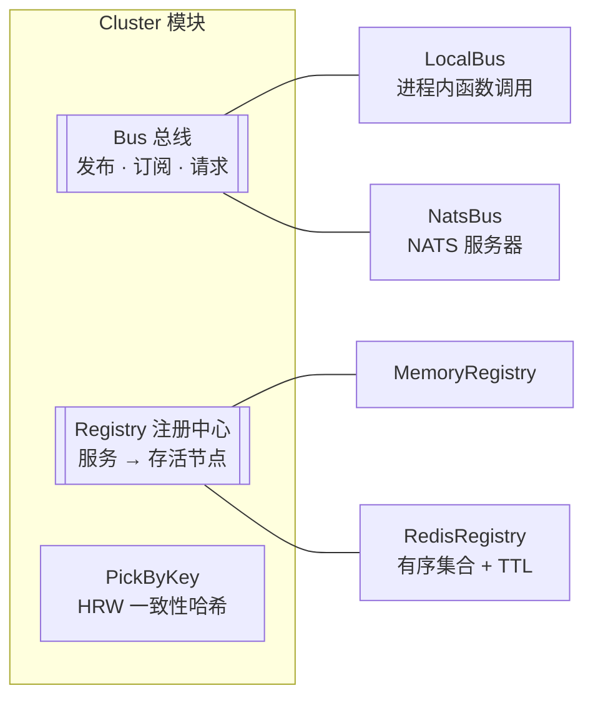
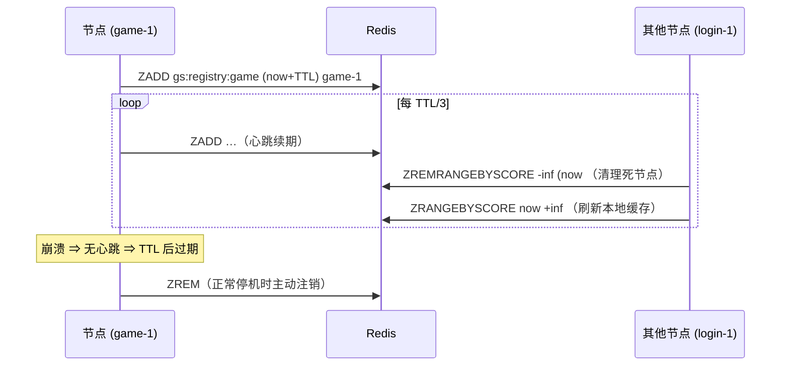

# cluster —— 消息总线、注册中心与节点选择

[English](README.md)

`framework/cluster` 让服务器节点彼此发现、彼此通信。正因为有它，**同一个二进制**
既能以单进程（all-in-one）运行，也能拆成几十个专职进程运行。



| 模式 | 总线 | 注册中心 | 场景 |
|---|---|---|---|
| 单体 all-in-one | `local` | `memory` | 开发、测试、小型游戏 |
| 分布式 | `nats` | `redis` | 生产环境、水平扩容 |

```yaml
cluster:
  bus: nats                      # local | nats
  nats_url: nats://127.0.0.1:4222
  registry: redis                # memory | redis
  registry_ttl: 10s
```

## 总线 Bus

```go
type Bus interface {
    Publish(subject string, data []byte) error
    Request(ctx context.Context, subject string, data []byte) ([]byte, error)
    Subscribe(subject, queue string, h Handler) (Subscription, error)
    Close() error
}
```

语义与 NATS 一致，因此两种实现行为完全相同：

* `queue == ""` → **广播**：每个订阅者都收到每条消息。
* 相同的非空 `queue` → **负载均衡**：组内只有一个成员收到某条消息。
* 同一发布者在同一主题上发的消息**保证有序**。
* 处理函数必须很快；重活交给 actor 或工作池。

`LocalBus` 在发布者的协程里同步调用处理函数 —— 除了 protobuf 信封外零开销，并严格有序。
`NatsBus` 额外提供自动重连、大容量待处理缓冲，关闭时会 drain（处理完在途消息）。

### 主题命名

| 辅助函数 | 示例 | 用途 |
|---|---|---|
| `NodeSubject(svc, node)` | `gs.node.game.game-2` | 某个具体服务实例（粘性路由、回复给某个网关） |
| `ServiceSubject(svc)` | `gs.svc.login` | 任意实例，队列组名 = 服务名 |
| `BroadcastSubject(svc)` | `gs.bcast.gate` | 所有实例（世界聊天、公告） |

节点 ID 和服务名不能包含 `.`、`*`、`>` 或空白字符（见 `ValidateToken`）。

## 信封 Envelope

节点之间的所有流量都是 protobuf `clusterpb.Envelope`（见 `proto/framework/cluster.proto`），
`kind` 字段表示要做什么：

| 类型 | 方向 | 含义 |
|---|---|---|
| `FORWARD` | 网关 → 后端 | 一个客户端请求（msg_id、seq、body、uid、会话） |
| `REPLY` | 后端 → 网关 | 给一个会话发一个数据包 |
| `BIND` | 后端 → 网关 | 给会话绑定 uid / 服务路由 |
| `KICK` | 后端 → 网关 | 带原因断开会话 |
| `SESSION_CLOSED` | 网关 → 后端 | 客户端断开了 |
| `BROADCAST` | 后端 → 所有网关 | 给多个 uid 发同一个数据包 |

`Cluster.Publish/SendToNode/SendToService/Broadcast` 负责序列化信封并填写 `src_node`；
`SubscribeEnvelopes` 负责解码。

## 注册中心 Registry

```go
type Registry interface {
    Register(ctx, service, nodeID string) error
    Deregister(ctx, service, nodeID string) error
    Nodes(service string) []string // 有序、带缓存，热路径上不会阻塞
    Start(ctx) error
    Close() error
}
```

### RedisRegistry

```
ZSET gs:registry:game
  member  game-1   score  1729400010000   （过期时间，毫秒时间戳）
  member  game-2   score  1729400011500
```



崩溃的节点会在 `registry_ttl` 内消失；正常停机的节点会立刻消失。

### 排空节点与 `NodeAlive`

不再接收**新**工作、但继续服务已有会话的节点，会先登记到 `DrainingService(svc)`（即 `game-draining`），
再从 `svc` 下注销。Rendezvous 哈希只看 `svc`，所以不会再选中它；
`NodeAlive(reg, svc, node)` 两个 key 都会查，所以已有会话仍然能找到它。


每个进程对每个 key 分别缓存，所以排空中的节点可能短暂地在两份缓存里都找不到。
因此 `NodeAlive` 对每个"不存活"的结论都会回 Redis 确认（`Refresher`），
并且先读正常 key、再读排空 key —— 与节点迁移的顺序一致。

## PickByKey —— 最高随机权重（Rendezvous）哈希

`PickByKey(nodes, key)` 对每个节点计算 `score = hash(node, key)`，取最大者。
它的特性（`cluster_test.go` 中有验证）：

* 跨进程确定（FNV-1a + splitmix64，没有随机种子）；
* 分布均衡（3 个节点、3 万个 key，偏差 ±20% 以内）；
* 扰动最小：移除一个节点，只有原本属于它的 key 会迁移。

登录服用它把每个 uid 分配到某个游戏节点，因此只要拓扑不变，同一个玩家总会落到同一个节点上。
