# config — YAML configuration

[中文](README.zh-CN.md)

The framework does not impose a global config struct. Each component exposes
its own `Config` type (`gate.Config`, `cluster.Config`, …) and the application
composes them into a root struct (see `game/bootstrap.Config`).

```mermaid
flowchart LR
    F[configs/game.yaml] --> E["ExpandEnv<br/>${NAME:-default}"] --> Y[yaml.v3 decode<br/>KnownFields = true] --> V{Validate&#40;&#41; error?}
    V -- ok --> S[root Config struct]
    V -- error --> X[exit at startup]
```



```go
var cfg bootstrap.Config
if err := config.Load("configs/game.yaml", &cfg); err != nil { ... }
```

## Features

| Feature | Detail |
|---|---|
| Environment variables | `${NAME}` or `${NAME:-default}` anywhere in the file, expanded before parsing. One file serves laptops and containers. |
| Strict keys | unknown keys are errors — a typo like `idle_timout` fails at startup instead of silently using the default |
| Validation hook | if the root struct has `Validate() error`, it is called after decoding |
| Durations | `30s`, `5m`, `1h30m` decode into `time.Duration` |

## Example

```yaml
node:
  id: ${NODE_ID:-game-1}
cluster:
  nats_url: ${NATS_URL:-nats://127.0.0.1:4222}
game:
  save_interval: 30s
```

```bash
NODE_ID=game-7 NATS_URL=nats://nats:4222 ./server -config configs/game.yaml
```

Secrets (passwords, tokens) should come from environment variables injected by
your orchestrator, never be committed in YAML.
