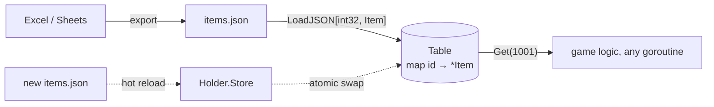

# datatable — static config tables

[中文](README.zh-CN.md)

Designers define items, skills, monsters, quests… in spreadsheets that are
exported to JSON ("配置表"). `datatable` loads them into **typed, immutable,
keyed** tables.



```go
type Item struct {
    ID     int32  `json:"id"`
    Name   string `json:"name"`
    Usable bool   `json:"usable"`
}

tbl, err := datatable.LoadJSON(fsys, "tables/items.json", func(i *Item) int32 { return i.ID })
item, ok := tbl.Get(1001)
tbl.Each(func(id int32, it *Item) { ... })   // file order
```

| Property | Why |
|---|---|
| Generic `Table[K, V]` | compile-time types; no `map[string]any` casting in game code |
| Duplicate keys rejected | a copy-paste error in the sheet fails at startup |
| Immutable after load | lock-free reads from every actor |
| `Holder[K, V]` with atomic pointer | hot reload: build a new table, `Store` it; in-flight readers keep the old one |

In this project tables are embedded with `go:embed` (`game/gamedata`), so a
binary always ships with data that matches its code. For live-ops hot reload,
load from a directory or object storage and swap via `Holder`.
