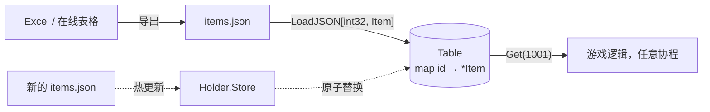

# datatable —— 静态配置表

[English](README.md)

策划在表格中定义道具、技能、怪物、任务……再导出成 JSON（即"配置表"）。
`datatable` 把它们加载成**强类型、只读、按主键索引**的表。



```go
type Item struct {
    ID     int32  `json:"id"`
    Name   string `json:"name"`
    Usable bool   `json:"usable"`
}

tbl, err := datatable.LoadJSON(fsys, "tables/items.json", func(i *Item) int32 { return i.ID })
item, ok := tbl.Get(1001)
tbl.Each(func(id int32, it *Item) { ... })   // 按文件顺序
```

| 特性 | 原因 |
|---|---|
| 泛型 `Table[K, V]` | 编译期类型检查；游戏代码里不需要 `map[string]any` 强转 |
| 拒绝重复主键 | 表格里复制粘贴出错会在启动时暴露 |
| 加载后只读 | 所有 actor 都能无锁读取 |
| 基于原子指针的 `Holder[K, V]` | 热更新：构建新表后 `Store`；正在读旧表的逻辑不受影响 |

本项目通过 `go:embed` 把表格嵌入二进制（`game/gamedata`），保证二进制与数据版本一致。
若需要线上运营热更，可从目录或对象存储加载，再通过 `Holder` 替换。
