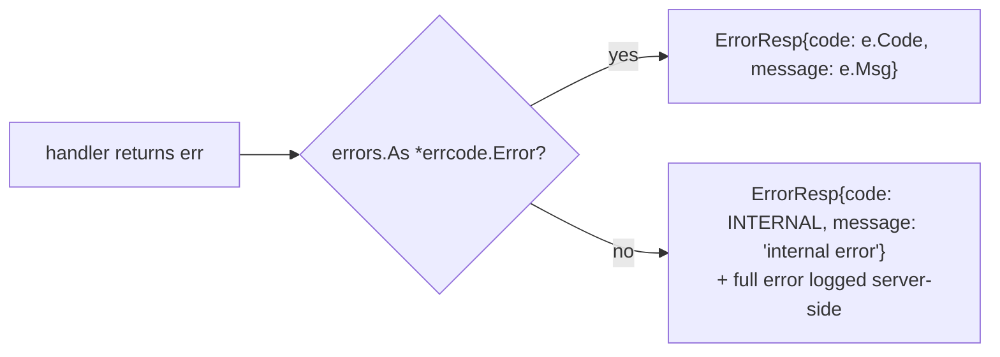

# errcode — client-visible errors

[中文](README.zh-CN.md)

Handlers return Go errors; the router turns them into an `ErrorResp` for the client.



```go
var errNotEnough = errcode.New(int32(pb.ErrCode_ERR_ITEM_NOT_ENOUGH), "not enough items")

func use(...) (proto.Message, error) {
    if bag.Count(id) < n {
        return nil, errNotEnough            // client sees 2102 "not enough items"
    }
    if err := db.Save(...); err != nil {
        return nil, err                     // client sees 1 "internal error"; details only in logs
    }
}
```

## Code ranges

| Range | Defined in | Examples |
|---|---|---|
| `0` | — | OK |
| `1 – 999` | `proto/framework/sys.proto` (`ErrorCode`) | `INTERNAL`, `UNKNOWN_MESSAGE`, `BAD_REQUEST`, `NOT_AUTHENTICATED`, `RATE_LIMITED`, `SERVICE_UNAVAILABLE`, `TIMEOUT` |
| `1000 +` | `proto/game/msgid.proto` (`ErrCode`) | `ERR_WRONG_PASSWORD`, `ERR_ITEM_NOT_ENOUGH`, `ERR_MOVE_TOO_FAR` |

Defining codes in `.proto` enums gives clients the same constants for free.

**Security:** only `*errcode.Error` messages reach clients. Internal error
strings (SQL, stack traces, file paths) never leak.

Predefined: `ErrInternal`, `ErrUnknownMessage`, `ErrBadRequest`,
`ErrNotAuthenticated`, `ErrRateLimited`, `ErrServiceUnavailable`, `ErrTimeout`.
