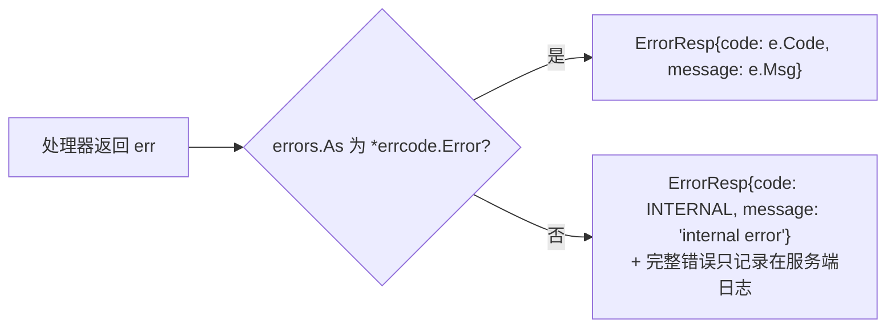

# errcode —— 客户端可见的错误码

[English](README.md)

处理器返回 Go 的 error；路由器把它转换成发给客户端的 `ErrorResp`。



```go
var errNotEnough = errcode.New(int32(pb.ErrCode_ERR_ITEM_NOT_ENOUGH), "not enough items")

func use(...) (proto.Message, error) {
    if bag.Count(id) < n {
        return nil, errNotEnough            // 客户端看到 2102 "not enough items"
    }
    if err := db.Save(...); err != nil {
        return nil, err                     // 客户端看到 1 "internal error"；详情只在日志里
    }
}
```

## 错误码区间

| 区间 | 定义位置 | 示例 |
|---|---|---|
| `0` | — | 成功 |
| `1 – 999` | `proto/framework/sys.proto`（`ErrorCode`） | `INTERNAL`、`UNKNOWN_MESSAGE`、`BAD_REQUEST`、`NOT_AUTHENTICATED`、`RATE_LIMITED`、`SERVICE_UNAVAILABLE`、`TIMEOUT` |
| `1000 +` | `proto/game/msgid.proto`（`ErrCode`） | `ERR_WRONG_PASSWORD`、`ERR_ITEM_NOT_ENOUGH`、`ERR_MOVE_TOO_FAR` |

把错误码定义在 `.proto` 枚举里，客户端可以直接生成同样的常量。

**安全性：** 只有 `*errcode.Error` 的信息会发给客户端。内部错误字符串（SQL、堆栈、文件路径）绝不外泄。

预定义错误：`ErrInternal`、`ErrUnknownMessage`、`ErrBadRequest`、`ErrNotAuthenticated`、
`ErrRateLimited`、`ErrServiceUnavailable`、`ErrTimeout`。
