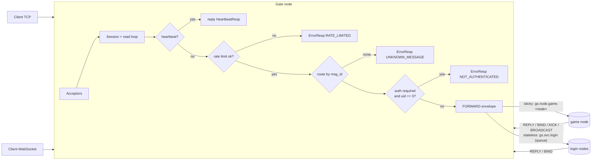
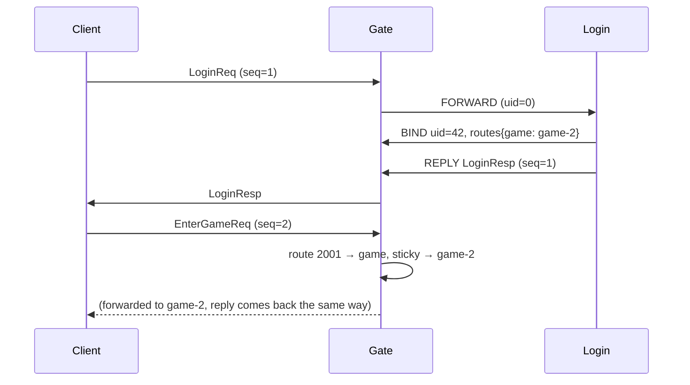

# gate — client gateway

[中文](README.zh-CN.md)

The gate is the **only** component that talks to game clients. It owns the
sockets, protects the backend, and routes messages. It contains no game logic,
so you can run as many gates as you need behind a TCP load balancer.

## What it does



1. **Connection management** — TCP and WebSocket acceptors, max connection
   limit, idle timeout (no packets, not even heartbeats ⇒ `KickPush(IDLE_TIMEOUT)`).
2. **Heartbeat** — `HeartbeatReq` is answered locally with server time (RTT and
   clock sync for the client) and never reaches backends.
3. **Rate limiting** — token bucket per session (`rate_limit`/s, `rate_burst`).
4. **Routing** — a table of message-id ranges → service.
5. **Authentication gate** — routes can require a bound uid.
6. **Delivery** — receives envelopes from backends and writes packets to the right session.
7. **Lifecycle** — notifies sticky backends with `SESSION_CLOSED` when a client
   disconnects; on shutdown kicks everyone with `SERVER_SHUTDOWN`.

## Route table

```go
gate.Route{MinID: 1000, MaxID: 1999, Service: "login", RequireAuth: false, Sticky: false}
gate.Route{MinID: 2000, MaxID: 9999, Service: "game",  RequireAuth: true,  Sticky: true}
```

| Field | Meaning |
|---|---|
| `MinID`/`MaxID` | inclusive range; must not overlap and must be > 999 (reserved for framework) |
| `Service` | backend service name |
| `RequireAuth` | reject until a backend has called `Bind(uid)` for this session |
| `Sticky` | `true`: send to the node stored in the session's route map (stateful services such as game); `false`: publish to the service's queue group (any instance, load balanced) |

Lookup is a binary search over sorted ranges.

## Session binding

Backends change a session's state with envelopes (see `router.Bind/Kick`):

| Envelope kind | Effect in the gate |
|---|---|
| `REPLY` | send one packet to `session_id` |
| `BIND` | set `uid`, merge `routes` (`service → node id`), index session by uid |
| `KICK` | send `KickPush(reason)`, flush, close |
| `BROADCAST` | send one packet to `uids` (or every authenticated session if empty); encoded once, shared by all targets |

Login flow example:



Because BIND and REPLY are published by the same goroutine on the same subject,
the gate always applies the binding before the client sees `LoginResp`.

## Configuration

```yaml
gate:
  tcp_addr: ":7000"        # empty disables TCP
  ws_addr: ":7001"         # empty disables WebSocket
  ws_path: /ws
  max_conns: 20000         # 0 = unlimited
  max_packet_size: 65536
  send_queue_size: 256     # per-session outgoing queue; full ⇒ slow client is dropped
  idle_timeout: 60s        # clients should heartbeat every ~10-20s
  rate_limit: 50           # requests/second per session
  rate_burst: 100
```

## Metrics

| Metric | Type |
|---|---|
| `gs_gate_sessions` | gauge |
| `gs_gate_packets_in_total` / `gs_gate_packets_out_total` | counter |
| `gs_gate_rejected_total{reason}` | counter (`max_conns`, `rate_limited`, `unknown_message`, `not_authenticated`) |

## Graceful shutdown

`Stop` deregisters the gate, closes acceptors, sends `KickPush(SERVER_SHUTDOWN)`
to every session, then waits (bounded by the app stop timeout) for all read
loops to end. Each closing session sends `SESSION_CLOSED` so game nodes save
players.
