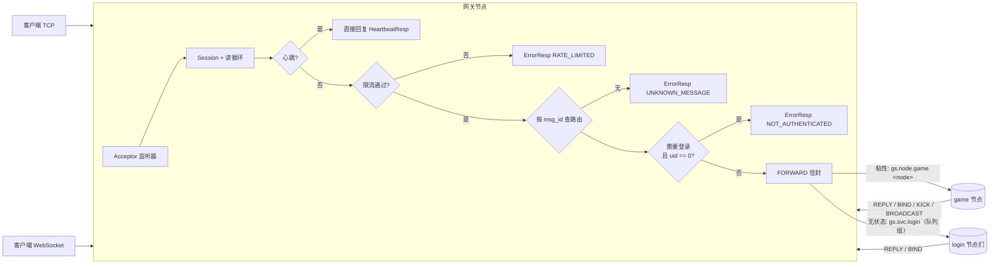
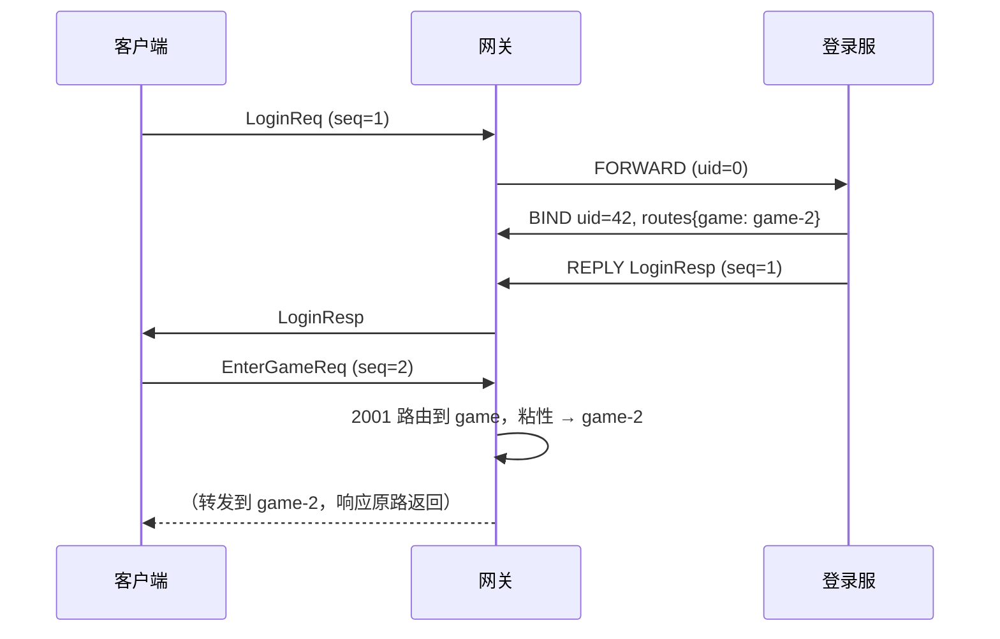
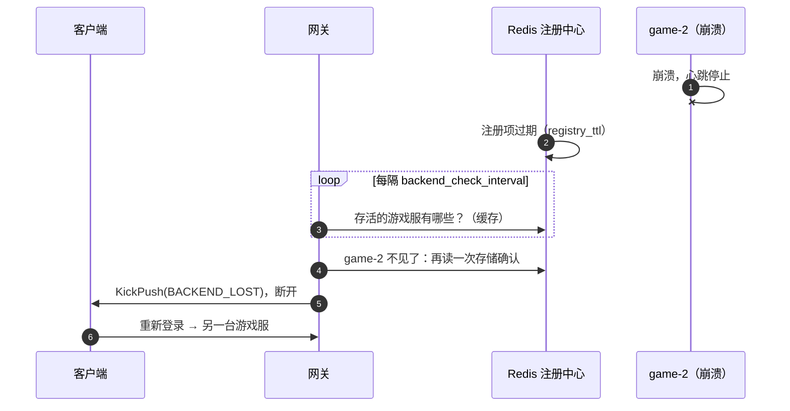

# gate —— 客户端网关

[English](README.md)

网关是**唯一**直接与游戏客户端通信的组件。它持有所有 socket、保护后端服务、
负责消息路由。网关内部没有任何游戏逻辑，因此可以在 TCP 负载均衡器后面部署任意多个。

## 网关做什么



1. **连接管理** —— TCP 和 WebSocket 监听、最大连接数限制、空闲超时
   （一段时间内连心跳都没有 ⇒ 发送 `KickPush(IDLE_TIMEOUT)` 后断开）。
2. **心跳** —— `HeartbeatReq` 由网关直接回复服务器时间（客户端可计算 RTT 和对时），不会转发给后端。
3. **限流** —— 每个会话一个令牌桶（`rate_limit` 次/秒，突发 `rate_burst`）。
4. **路由** —— 一张 "消息 ID 区间 → 服务" 的表。
5. **鉴权拦截** —— 路由可以要求会话已绑定 uid。
6. **投递** —— 接收后端发来的信封，把数据包写给对应会话。
7. **生命周期** —— 客户端断开时向粘性后端发送 `SESSION_CLOSED`；停服时以 `SERVER_SHUTDOWN` 踢掉所有人。

## 路由表

```go
gate.Route{MinID: 1000, MaxID: 1999, Service: "login", RequireAuth: false, Sticky: false}
gate.Route{MinID: 2000, MaxID: 9999, Service: "game",  RequireAuth: true,  Sticky: true}
```

| 字段 | 含义 |
|---|---|
| `MinID`/`MaxID` | 闭区间；区间不能重叠，且必须 > 999（1~999 为框架保留） |
| `Service` | 后端服务名 |
| `RequireAuth` | 在后端为该会话调用 `Bind(uid)` 之前拒绝请求 |
| `Sticky` | `true`：发给会话路由表里记录的那个节点（有状态服务，如 game）；`false`：发布到该服务的队列组（任意实例，负载均衡） |

查找方式是在有序区间上做二分查找。

## 会话绑定

后端通过信封修改会话状态（见 `router.Bind/Kick`）：

| 信封类型 | 网关中的效果 |
|---|---|
| `REPLY` | 给 `session_id` 发送一个数据包 |
| `BIND` | 设置 `uid`，合并 `routes`（`服务 → 节点 ID`），建立 uid 索引 |
| `KICK` | 发送 `KickPush(reason)`，发完后关闭 |
| `BROADCAST` | 给 `uids`（为空则所有已登录会话）发送同一个数据包；只编码一次，所有目标共享 |

登录流程示例：



由于 BIND 和 REPLY 是同一个协程按顺序发布到同一个主题上的，网关一定会先完成绑定，客户端才会收到 `LoginResp`。

## 配置

```yaml
gate:
  tcp_addr: ":7000"        # 留空则关闭 TCP
  ws_addr: ":7001"         # 留空则关闭 WebSocket
  ws_path: /ws
  max_conns: 20000         # 0 表示不限制
  max_packet_size: 65536
  send_queue_size: 256     # 每会话发送队列；满了说明客户端太慢，直接断开
  idle_timeout: 60s        # 客户端建议每 10~20 秒发一次心跳
  rate_limit: 50           # 每会话每秒请求数
  rate_burst: 100
  backend_check_interval: 2s   # 多久检查一次已失联的粘性后端节点，并踢掉绑定在它上面的会话
```

## 监控指标

| 指标 | 类型 |
|---|---|
| `gs_gate_sessions` | gauge（当前在线连接数） |
| `gs_gate_packets_in_total` / `gs_gate_packets_out_total` | counter |
| `gs_gate_rejected_total{reason}` | counter（`max_conns`、`rate_limited`、`unknown_message`、`not_authenticated`、`backend_lost`） |

## 后端节点失联

粘性会话绑定在某一台游戏服上。如果这台游戏服没有经过优雅停机就死掉了（崩溃、`kill -9`、Pod 被强制删除），
没有任何人会发踢人通知：客户端和网关的连接看起来一切正常，但每个请求都发往一台永远不会回复的机器。

网关会针对每个粘性服务监视注册中心，把这类会话用 `KickPush(BACKEND_LOST)` 踢下线；
客户端重新登录后会落到一台存活的节点上。



* 只有**本网关曾经看到它存活**的节点才会被判定为失联，因此刚注册、还没进缓存的新节点不会被误判。
* 排空中的节点算存活（它们登记在 `<服务名>-draining` 下）。
* 判定"不见了"之前会回 Redis 再确认一次（`cluster.NodeAlive`），缓存过期不会导致大规模误踢。

## 优雅停机

`Stop` 依次：从注册中心注销网关、关闭监听、给所有会话发送 `KickPush(SERVER_SHUTDOWN)`，
然后等待所有读循环结束（受应用停机超时限制）。每个关闭的会话都会发送 `SESSION_CLOSED`，
游戏节点据此保存玩家数据。
