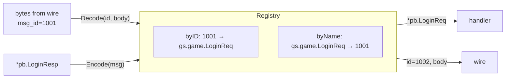

# message — message id registry

[中文](README.zh-CN.md)

The wire only carries a numeric `msg_id`. The registry maps ids to protobuf
types in both directions:



```go
reg := message.NewRegistry()
message.RegisterSystem(reg)                         // ids 1-4: heartbeat, error, kick
reg.Register(uint32(pb.MsgID_LOGIN_REQ), &pb.LoginReq{})

id, body, err := reg.Encode(&pb.LoginResp{Uid: 1})  // 1002, bytes
msg, err := reg.Decode(1001, body)                  // proto.Message (*pb.LoginReq)
```

## Id ranges

| Range | Owner |
|---|---|
| `0` | invalid |
| `1 – 999` | framework (`proto/framework/sys.proto`): heartbeat, error, kick |
| `1000 +` | game; the gate's route table splits it further per service |

## Rules

* Registering a duplicate id **or** the same message type twice panics at
  startup. Ids are part of the client contract: never reuse or renumber them.
* `message.Default` is the process-wide registry with system messages
  pre-registered; `game/protocol.Registry()` adds game messages to it once.
* The registry is safe for concurrent use (reads take an RLock).

Why explicit registration instead of reflection over all generated types? It is
obvious, greppable, and makes the client/server contract a single reviewed file
(`game/protocol/protocol.go`).
