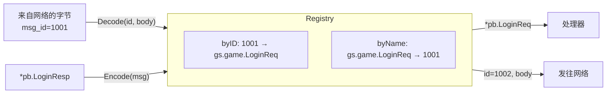

# message —— 消息 ID 注册表

[English](README.md)

线上只传输一个数字 `msg_id`。注册表负责在 ID 与 protobuf 类型之间双向映射：



```go
reg := message.NewRegistry()
message.RegisterSystem(reg)                         // ID 1-4：心跳、错误、踢人
reg.Register(uint32(pb.MsgID_LOGIN_REQ), &pb.LoginReq{})

id, body, err := reg.Encode(&pb.LoginResp{Uid: 1})  // 1002, 字节
msg, err := reg.Decode(1001, body)                  // proto.Message（*pb.LoginReq）
```

## ID 区间

| 区间 | 归属 |
|---|---|
| `0` | 无效 |
| `1 – 999` | 框架（`proto/framework/sys.proto`）：心跳、错误、踢人 |
| `1000 +` | 游戏；网关路由表再按服务细分 |

## 规则

* 重复注册同一个 ID **或**同一个消息类型会在启动时 panic。ID 是与客户端的契约：绝不复用、绝不重新编号。
* `message.Default` 是进程级注册表，已预先注册系统消息；`game/protocol.Registry()` 会把游戏消息注册进去（仅一次）。
* 注册表并发安全（读操作使用读锁）。

为什么显式注册而不是反射扫描所有生成类型？因为它直观、可 grep，并且让客户端/服务端契约集中在一个
经过评审的文件里（`game/protocol/protocol.go`）。
