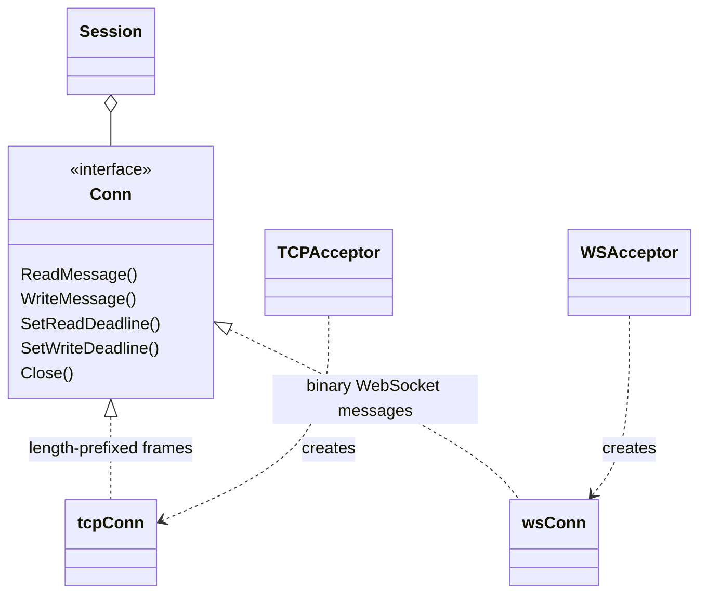
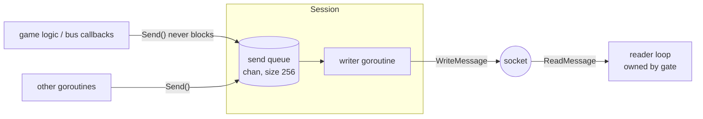

# network — client transport layer

[中文](README.zh-CN.md)

`framework/network` turns raw TCP and WebSocket connections into a stream of
**messages**. Everything above it (gate, client SDK) is transport-agnostic.

## Responsibilities

| Concern | Where |
|---|---|
| Payload format (`msg_id` + `seq` + body) | `packet.go` |
| TCP length-prefixed framing, WebSocket binary frames | `conn.go` |
| Listening / accepting connections | `acceptor.go` |
| Per-client write queue, graceful "flush then close" | `session.go` |

## Wire format

```
TCP:        ┌──────────────┬───────────────────────────────┐
            │ length u32BE │ payload (length bytes)        │
            └──────────────┴───────────────────────────────┘
WebSocket:  one binary message == one payload

payload:    ┌────────────┬────────────┬─────────────────────┐
            │ msg_id u32 │ seq u32    │ body (protobuf)     │
            └────────────┴────────────┴─────────────────────┘
               4 bytes      4 bytes      length - 8 bytes
```

* `msg_id` selects the protobuf type of `body` (see `framework/message`).
* `seq` is chosen by the client for each request and echoed in the response.
  Server pushes always use `seq = 0`.
* Payloads larger than `MaxPacketSize` (default 64 KiB) are rejected and the
  connection is dropped — this protects the server from memory exhaustion.

Why a 4-byte length instead of varint? It is trivial to implement in every
game engine (Unity C#, Unreal C++, Cocos JS/TS) and costs ≤3 extra bytes.

## The `Conn` abstraction

```go
type Conn interface {
    ReadMessage() ([]byte, error)      // one payload
    WriteMessage(payload []byte) error // one payload
    SetReadDeadline(t time.Time) error
    SetWriteDeadline(t time.Time) error
    RemoteAddr() net.Addr
    Close() error
}
```



Adding a new transport (e.g. KCP/UDP) only requires implementing `Conn` and
`Acceptor`; nothing else changes.

## Session: one reader, one writer



* **`Send` never blocks.** If the queue is full, the client cannot keep up
  (bad network or a malicious client not reading). The session is closed with
  `ErrSendQueueFull` instead of letting memory grow or stalling game logic.
* **`CloseAfterFlush(last...)`** queues final packets (e.g. `KickPush`) and a
  sentinel; the writer flushes everything before closing. Used for kicks and
  server shutdown so clients learn *why* they were disconnected.
* **`Close`** is idempotent and closes the socket immediately, which also
  unblocks the reader loop.
* Every write has a 10s deadline so a stuck peer cannot pin a goroutine.

## Acceptors

| Type | Constructor | Notes |
|---|---|---|
| TCP | `NewTCPAcceptor(":7000", maxSize)` | `TCP_NODELAY` on, retries temporary accept errors with backoff |
| WebSocket | `NewWSAcceptor(":7001", "/ws", maxSize, checkOrigin)` | gorilla/websocket; pass a strict `checkOrigin` for browser games |

`Listen()` is separate from `Serve()` so port conflicts fail fast during
startup, and `Addr()` reports the real port when listening on `:0` (tests).

## Client-side helpers

`DialTCP(addr, maxSize, timeout)` and `DialWS(url, maxSize, timeout)` return a
`Conn` for clients and tools (used by `framework/client`).

## Tests

`network_test.go` covers packet encoding, TCP framing, oversize rejection and
flush-then-close ordering.
