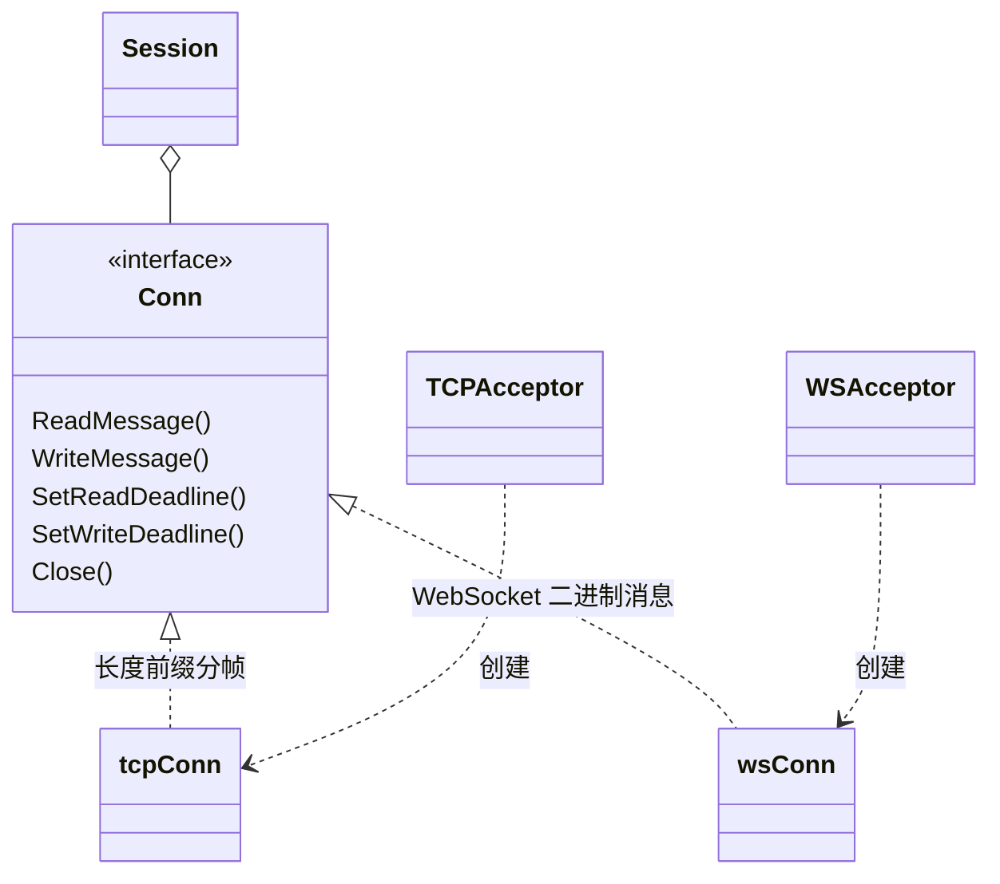
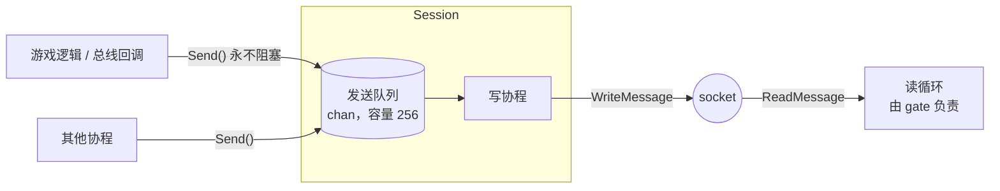

# network —— 客户端传输层

[English](README.md)

`framework/network` 把原始的 TCP 和 WebSocket 连接转换成一条条**消息**。
它之上的所有模块（网关 gate、客户端 SDK）都与具体传输协议无关。

## 职责划分

| 关注点 | 文件 |
|---|---|
| 消息载荷格式（`msg_id` + `seq` + body） | `packet.go` |
| TCP 长度前缀分帧、WebSocket 二进制帧 | `conn.go` |
| 监听、接受连接 | `acceptor.go` |
| 每个客户端独立的写队列、"先发完再关闭" | `session.go` |

## 线上协议格式

```
TCP:        ┌──────────────┬───────────────────────────────┐
            │ length u32BE │ payload（length 字节）          │
            └──────────────┴───────────────────────────────┘
WebSocket:  一条二进制消息 == 一个 payload

payload:    ┌────────────┬────────────┬─────────────────────┐
            │ msg_id u32 │ seq u32    │ body（protobuf）     │
            └────────────┴────────────┴─────────────────────┘
               4 字节       4 字节       length - 8 字节
```

* `msg_id` 决定 `body` 对应哪个 protobuf 类型（见 `framework/message`）。
* `seq` 由客户端为每个请求生成，服务端在响应里原样带回；服务端主动推送一律 `seq = 0`。
* 超过 `MaxPacketSize`（默认 64 KiB）的消息会被拒绝并断开连接，防止恶意客户端耗尽内存。

为什么用 4 字节长度而不是 varint？因为在所有游戏引擎（Unity C#、Unreal C++、
Cocos JS/TS）里实现都极其简单，最多也只多 3 个字节。

## `Conn` 抽象

```go
type Conn interface {
    ReadMessage() ([]byte, error)      // 读一个 payload
    WriteMessage(payload []byte) error // 写一个 payload
    SetReadDeadline(t time.Time) error
    SetWriteDeadline(t time.Time) error
    RemoteAddr() net.Addr
    Close() error
}
```



新增一种传输（比如 KCP/UDP）只需要实现 `Conn` 和 `Acceptor` 两个接口，其他代码完全不用改。

## Session：一读一写



* **`Send` 永不阻塞。** 队列满说明客户端跟不上（网络差或恶意不读数据），此时直接以
  `ErrSendQueueFull` 关闭会话，而不是让内存无限增长或卡住游戏逻辑。
* **`CloseAfterFlush(last...)`** 先放入最后几条消息（如 `KickPush`）和一个结束标记，
  写协程把之前所有数据发完后才关闭。用于踢人和停服，让客户端知道**为什么**被断开。
* **`Close`** 可重复调用，立即关闭 socket，同时会让读循环退出。
* 每次写都有 10 秒超时，卡死的对端不会永久占用协程。

## Acceptor（监听器）

| 类型 | 构造函数 | 说明 |
|---|---|---|
| TCP | `NewTCPAcceptor(":7000", maxSize)` | 开启 `TCP_NODELAY`；临时性 accept 错误会退避重试 |
| WebSocket | `NewWSAcceptor(":7001", "/ws", maxSize, checkOrigin)` | 基于 gorilla/websocket；浏览器游戏请传入严格的 `checkOrigin` |

`Listen()` 与 `Serve()` 分开：端口冲突会在启动阶段立刻报错；监听 `:0` 时
`Addr()` 能返回真实端口（测试用）。

## 客户端辅助函数

`DialTCP(addr, maxSize, timeout)` 和 `DialWS(url, maxSize, timeout)` 为客户端和工具返回
一个 `Conn`（`framework/client` 使用它们）。

## 测试

`network_test.go` 覆盖了消息编解码、TCP 分帧、超长包拒绝、"先发完再关闭" 的顺序。
