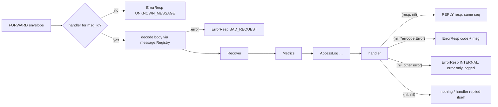

# router — backend message dispatch

[中文](README.zh-CN.md)

`framework/router` is what backend services (login, game, …) use to handle
client requests that arrive as `FORWARD` envelopes, and to send messages back
to clients through their gates.

## Dispatch pipeline



`Dispatch` runs **synchronously in the caller's goroutine**. The service decides
the concurrency model:

* login: one goroutine per request, bounded by a semaphore;
* game: posted into the owning player's actor (single-threaded state).

## Writing handlers

```go
r := router.New("game", registry, cluster)       // Recover + Metrics installed
r.Use(router.AccessLog(logger, 50*time.Millisecond))

router.Handle(r, uint32(pb.MsgID_BAG_GET_REQ),
    func(c *router.Context, req *pb.BagGetReq) (proto.Message, error) {
        p := c.Data.(*Player)                        // set by the service at Dispatch
        return &pb.BagGetResp{Items: p.Items()}, nil
    })
```

* `Handle` is generic: the request is already the concrete type.
* Registration panics on duplicate ids or ids missing from the registry — bugs
  surface at startup, not in production.
* `c.Session` identifies the client (`GateNode`, `SessionID`, `UID`) and can be
  stored for later pushes.
* `c.Data` carries per-dispatch business data (the game service passes `*Player`).

## Context

| Method | Purpose |
|---|---|
| `c.Reply(msg)` | explicit response (first one wins); useful to reply before doing follow-up work |
| `c.ReplyError(err)` | explicit error response |
| `c.Push(msg)` | server push (seq 0) to the requesting client |
| `c.UID()`, `c.MsgID()` | request metadata |
| `context.Context` | embedded; cancellation and deadlines |

## Sending from anywhere

Any goroutine/actor holding a `router.Session` can talk to clients:

| Method | Envelope | Example use |
|---|---|---|
| `r.Push(sess, msg)` | `REPLY` seq 0 | scene updates, item changes |
| `r.Broadcast(uids, msg)` | `BROADCAST` to all gates | world chat (`nil` = everyone online) |
| `r.Bind(sess, uid, routes)` | `BIND` | after login: `{game: "game-2"}` |
| `r.Kick(sess, reason)` | `KICK` | duplicate login, ban, shutdown |

## Middleware

```go
type Middleware func(next HandlerFunc) HandlerFunc
```

| Built-in | Behaviour |
|---|---|
| `Recover(logger)` | panic → logged with stack, client gets `INTERNAL` (default) |
| `Metrics(service)` | `gs_handler_duration_seconds{service,msg_id}`, `gs_handler_errors_total{service,msg_id,code}` (default) |
| `AccessLog(logger, slow)` | debug log per request, warn if slower than `slow` |

Write your own for auth checks, request tracing, per-message rate limits, etc.
Call `Use` **before** registering handlers.

## Tests

`router_test.go` uses a fake `Sender` to assert reply envelopes, error codes,
unknown messages and panic recovery.
