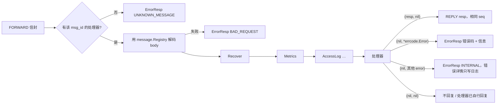

# router —— 后端消息分发

[English](README.md)

后端服务（login、game……）用 `framework/router` 处理以 `FORWARD` 信封形式到达的客户端请求，
并通过网关把消息发回给客户端。

## 分发流水线



`Dispatch` 在**调用者的协程里同步执行**，并发模型由服务自己决定：

* 登录服：每个请求一个协程，用信号量限制并发；
* 游戏服：投递到玩家自己的 actor 中执行（单线程拥有状态）。

## 编写处理器

```go
r := router.New("game", registry, cluster)       // 默认已安装 Recover + Metrics
r.Use(router.AccessLog(logger, 50*time.Millisecond))

router.Handle(r, uint32(pb.MsgID_BAG_GET_REQ),
    func(c *router.Context, req *pb.BagGetReq) (proto.Message, error) {
        p := c.Data.(*Player)                        // 由服务在 Dispatch 时传入
        return &pb.BagGetResp{Items: p.Items()}, nil
    })
```

* `Handle` 是泛型函数：拿到的 req 已经是具体类型。
* 消息 ID 重复注册或未在注册表中登记会直接 panic —— 问题在启动时暴露，而不是线上。
* `c.Session` 标识客户端（`GateNode`、`SessionID`、`UID`），可以保存下来以后推送用。
* `c.Data` 携带本次分发的业务数据（游戏服传入 `*Player`）。

## Context 上下文

| 方法 | 用途 |
|---|---|
| `c.Reply(msg)` | 显式回复（只有第一次生效）；适合先回复再做后续工作 |
| `c.ReplyError(err)` | 显式回复错误 |
| `c.Push(msg)` | 给发请求的客户端推送（seq 0） |
| `c.UID()`、`c.MsgID()` | 请求元信息 |
| `context.Context` | 内嵌；用于取消和超时 |

## 在任何地方发送消息

任何持有 `router.Session` 的协程/actor 都可以与客户端通信：

| 方法 | 信封 | 典型用法 |
|---|---|---|
| `r.Push(sess, msg)` | `REPLY` seq 0 | 场景同步、道具变化 |
| `r.Broadcast(uids, msg)` | 发给所有网关的 `BROADCAST` | 世界聊天（`nil` = 所有在线玩家） |
| `r.Bind(sess, uid, routes)` | `BIND` | 登录后：`{game: "game-2"}` |
| `r.Kick(sess, reason)` | `KICK` | 顶号、封禁、停服 |

## 中间件

```go
type Middleware func(next HandlerFunc) HandlerFunc
```

| 内置中间件 | 行为 |
|---|---|
| `Recover(logger)` | panic → 带堆栈写日志，客户端收到 `INTERNAL`（默认安装） |
| `Metrics(service)` | `gs_handler_duration_seconds{service,msg_id}`、`gs_handler_errors_total{service,msg_id,code}`（默认安装） |
| `AccessLog(logger, slow)` | 每个请求一条 debug 日志，超过 `slow` 记 warn |

可以自己写中间件实现鉴权、链路追踪、按消息限流等。务必在注册处理器**之前**调用 `Use`。

## 测试

`router_test.go` 用一个假的 `Sender` 断言回复信封、错误码、未知消息和 panic 恢复。
