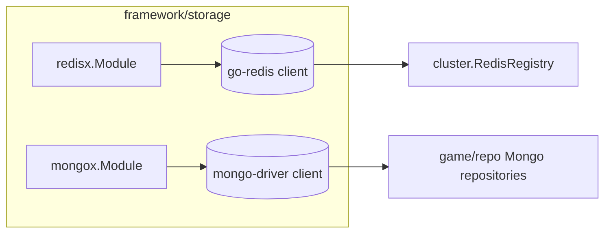

# storage — Redis and MongoDB connections

[中文](README.zh-CN.md)

Thin `app.Module` wrappers that own database clients and tie them to the
process lifecycle. Business persistence (repositories) lives in `game/repo`.



| Phase | redisx | mongox |
|---|---|---|
| construct (`New`) | creates the client (lazy connect) so other modules can receive it immediately | creates the client and `DB()` handle |
| `Init` | `PING` (5s) — fail fast if unreachable | `Ping(primary)` (5s) |
| `Stop` | close pool | `Disconnect(ctx)` — flushes in-flight operations |

## Config

```yaml
redis:
  addr: 127.0.0.1:6379
  password: ""
  db: 0
  pool_size: 0        # 0 = go-redis default (10 × GOMAXPROCS)

mongo:
  uri: mongodb://127.0.0.1:27017
  database: game
  pool_size: 0        # 0 = driver default (100)
```

## Why Redis + MongoDB?

* **Redis** — sub-millisecond shared state between processes: service registry
  (here), and typical extensions such as online status, leaderboards (ZSET),
  rate limits, distributed locks and caches.
* **MongoDB** — a player is naturally one document (attributes, bag, quests…);
  saving is one `ReplaceOne(upsert)`; adding a field needs no migration.
  Unique `_id` gives race-free account registration.

Helpers: `mongox.IsDuplicateKey(err)`, `mongox.IsNotFound(err)`.

## Swapping databases

Services depend on repository *interfaces* (`game/repo`). To use MySQL or
PostgreSQL, implement `AccountRepo`/`PlayerRepo` and wire them in
`game/bootstrap` (or pass them via `bootstrap.WithRepos`).
