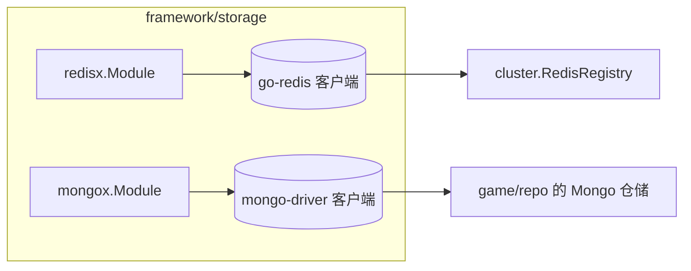

# storage —— Redis 与 MongoDB 连接

[English](README.md)

把数据库客户端包装成 `app.Module`，使其与进程生命周期绑定。业务持久化（Repository）放在 `game/repo`。



| 阶段 | redisx | mongox |
|---|---|---|
| 构造（`New`） | 创建客户端（懒连接），其他模块可立即拿到 | 创建客户端和 `DB()` 句柄 |
| `Init` | `PING`（5 秒）—— 连不上就启动失败 | `Ping(primary)`（5 秒） |
| `Stop` | 关闭连接池 | `Disconnect(ctx)` —— 等待在途操作完成 |

## 配置

```yaml
redis:
  addr: 127.0.0.1:6379
  password: ""
  db: 0
  pool_size: 0        # 0 = go-redis 默认值（10 × GOMAXPROCS）

mongo:
  uri: mongodb://127.0.0.1:27017
  database: game
  pool_size: 0        # 0 = 驱动默认值（100）
```

## 为什么选 Redis + MongoDB？

* **Redis** —— 进程间亚毫秒级共享状态：本项目用于服务注册中心；常见扩展还有在线状态、
  排行榜（ZSET）、限流、分布式锁、缓存。
* **MongoDB** —— 一个玩家天然就是一个文档（属性、背包、任务……）；保存只需一次
  `ReplaceOne(upsert)`；加字段无需迁移。唯一的 `_id` 让账号注册天然无竞态。

辅助函数：`mongox.IsDuplicateKey(err)`、`mongox.IsNotFound(err)`。

## 更换数据库

服务依赖的是仓储*接口*（`game/repo`）。若要使用 MySQL 或 PostgreSQL，实现 `AccountRepo`/`PlayerRepo`，
然后在 `game/bootstrap` 中接入（或通过 `bootstrap.WithRepos` 传入）即可。
