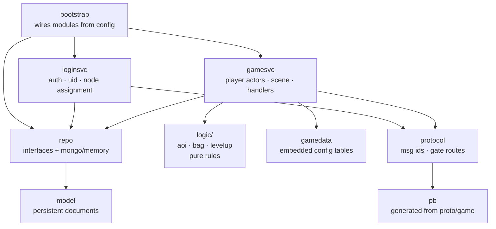

# Business layer (`game/`)

[中文](README.zh-CN.md) · [Framework](../framework/README.md) · [Architecture](../docs/architecture.md)

`game/` is a sample **MMO/RPG** built on the framework. It shows where game
code lives and how it plugs into the framework, and it is meant to be replaced
or extended with your own gameplay.

## Package map



| Package | Role | README |
|---|---|---|
| `bootstrap` | Builds a node from config: which roles, which storage, which bus | [bootstrap](bootstrap/README.md) |
| `protocol` | Registers every game message id; declares gate routes | [proto](../proto/README.md) |
| `pb` | Go code generated from `proto/game/*.proto` | — |
| `loginsvc` | Login service: accounts, bcrypt, Snowflake uid, game-node assignment | [loginsvc](loginsvc/README.md) |
| `gamesvc` | Game service: player actors, world scene, bag/chat/move/GM handlers | [gamesvc](gamesvc/README.md) |
| `logic` | Pure, unit-tested rules: AOI grid, bag, experience curve | [logic](logic/README.md) |
| `repo`, `model` | Persistence interfaces, MongoDB + in-memory implementations, documents | [repo](repo/README.md) |
| `gamedata` | Designer tables (`tables/items.json`) embedded into the binary | below |
| `webconsole` | Browser test client + one-click self-test, served on the admin port | [webconsole](webconsole/README.md) |

## Implemented features

| System | Messages | Highlights |
|---|---|---|
| Login | `LoginReq/Resp` | auto-register, bcrypt, Snowflake uid, sticky node assignment via rendezvous hashing |
| Enter game | `EnterGameReq/Resp`, `PlayerInfoPush` | load-or-create character, starter pack, duplicate-login kick |
| Bag | `BagGetReq/Resp`, `ItemUseReq/Resp`, `BagUpdatePush` | data-driven item effects (exp, gold), level-up curve |
| Chat | `ChatSendReq/Resp`, `ChatPush` | world (cross-node broadcast) and scene (AOI) channels, length and frequency limits |
| Scene | `SceneMoveReq/Resp`, `SceneEntityEnter/Leave/MovePush` | nine-grid AOI, server-authoritative movement, anti-teleport |
| GM | `GmCommandReq/Resp` | `additem`, `addgold`, `addexp`, `info` (config-gated) |
| Persistence | — | periodic save of dirty players, save on logout and on shutdown |

## gamedata

`gamedata/tables/items.json` is loaded with `framework/datatable` and embedded
via `go:embed`:

```json
{ "id": 1001, "name": "Small EXP Potion", "usable": true, "exp": 50, "gold": 0 }
```

Add columns by adding struct fields to `gamedata.Item`; add tables by adding
a field to `gamedata.Tables` and a `LoadJSON` call in `Load()`.

---

## Tutorial: adding a new gameplay system

Example: a **daily sign-in** system that grants gold once per day.

### 1. Define messages (`proto/game/signin.proto`)

```proto
syntax = "proto3";
package gs.game;
option go_package = "gameserver/game/pb";

message SignInReq {}
message SignInResp { int64 gold_reward = 1; int32 streak = 2; }
```

Add ids and an error code to `proto/game/msgid.proto` (inside the game range):

```proto
SIGN_IN_REQ = 2401;
SIGN_IN_RESP = 2402;
...
ERR_ALREADY_SIGNED_IN = 2401;
```

Regenerate: `buf generate` (see [proto/README](../proto/README.md)).

### 2. Register ids (`game/protocol/protocol.go`)

```go
r.Register(uint32(pb.MsgID_SIGN_IN_REQ), &pb.SignInReq{})
r.Register(uint32(pb.MsgID_SIGN_IN_RESP), &pb.SignInResp{})
```

No gate change is needed: 2401 already falls in the `[2000, 9999] → game` route.

### 3. Persist state (`game/model/model.go`)

```go
LastSignIn time.Time `bson:"last_sign_in"`
SignStreak int32     `bson:"sign_streak"`
```

MongoDB needs no migration; old documents just have zero values.

### 4. Write pure rules (`game/logic/signin/signin.go`) and unit-test them

```go
func Reward(streak int32) int64 { return 100 * int64(min(streak, 7)) }
func SameDay(a, b time.Time) bool { ... }
```

### 5. Add the handler (`game/gamesvc/handlers_signin.go`)

```go
func (s *Service) handleSignIn(p *Player, _ *router.Context, _ *pb.SignInReq) (proto.Message, error) {
    now := time.Now()
    if signin.SameDay(p.data.LastSignIn, now) {
        return nil, errAlreadySignedIn
    }
    p.data.SignStreak++
    p.data.LastSignIn = now
    gold := signin.Reward(p.data.SignStreak)
    p.data.Gold += gold
    p.dirty = true                                   // saved by the periodic saver
    p.push(&pb.PlayerInfoPush{Player: p.info()})
    return &pb.SignInResp{GoldReward: gold, Streak: p.data.SignStreak}, nil
}
```

and register it in `registerHandlers()`:

```go
handle(s, pb.MsgID_SIGN_IN_REQ, false, s.handleSignIn)
```

The handler runs inside the player's actor: no locks, `p` is yours.

### 6. Test end-to-end

Add a case to `test/e2e/e2e_test.go` using the client SDK, run `go test ./...`.

### Checklist

- [ ] ids unique and inside the service's range
- [ ] request validated (never trust the client)
- [ ] state changes set `p.dirty = true`
- [ ] clients notified with pushes where state is visible
- [ ] error codes defined in `ErrCode`, not ad-hoc strings
- [ ] pure logic unit-tested, flow covered by an e2e test

### Adding a whole new service

For a separate stateful/stateless service (e.g. `guild`, `match`):

1. Pick a name and id range; add a `gate.Route` in `protocol.GateRoutes()`.
2. Create a module (like `loginsvc`) that subscribes to
   `cluster.ServiceSubject(name)` (stateless, queue group) or
   `cluster.NodeSubject(name, nodeID)` (stateful, sticky), and registers in the
   registry.
3. For sticky services, `Bind` the session to the chosen node
   (`router.Bind(sess, uid, map[string]string{"guild": node})`).
4. Add a role in `bootstrap` and a config file.
