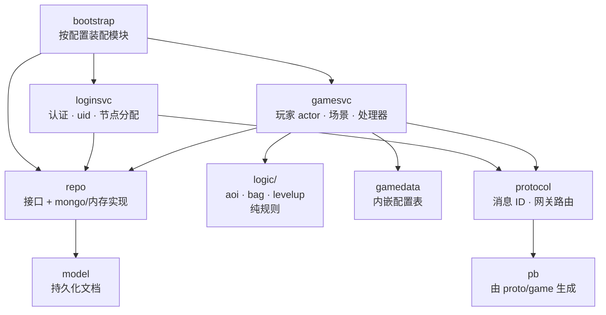

# 业务逻辑层（`game/`）

[English](README.md) · [基础框架](../framework/README.zh-CN.md) · [总体架构](../docs/architecture.zh-CN.md)

`game/` 是一个基于本框架实现的 **MMO/RPG** 示例。它演示了游戏代码放在哪里、如何接入框架，
你可以替换或扩展成自己的玩法。

## 包结构



| 包 | 职责 | 文档 |
|---|---|---|
| `bootstrap` | 根据配置构建节点：运行哪些角色、用什么存储、用什么总线 | [bootstrap](bootstrap/README.zh-CN.md) |
| `protocol` | 注册所有游戏消息 ID；声明网关路由 | [proto](../proto/README.zh-CN.md) |
| `pb` | 由 `proto/game/*.proto` 生成的 Go 代码 | — |
| `loginsvc` | 登录服：账号、bcrypt、雪花 uid、分配游戏节点 | [loginsvc](loginsvc/README.zh-CN.md) |
| `gamesvc` | 游戏服：玩家 actor、世界场景、背包/聊天/移动/GM 处理器 | [gamesvc](gamesvc/README.zh-CN.md) |
| `logic` | 纯规则、有单元测试：AOI 网格、背包、经验曲线 | [logic](logic/README.zh-CN.md) |
| `repo`、`model` | 持久化接口、MongoDB 与内存实现、文档结构 | [repo](repo/README.zh-CN.md) |
| `gamedata` | 策划配置表（`tables/items.json`），编译进二进制 | 见下文 |
| `webconsole` | 浏览器测试客户端 + 一键自检，挂在管理端口上 | [webconsole](webconsole/README.zh-CN.md) |

## 已实现功能

| 系统 | 消息 | 亮点 |
|---|---|---|
| 登录 | `LoginReq/Resp` | 自动注册、bcrypt、雪花 uid、HRW 哈希粘性分配节点 |
| 进入游戏 | `EnterGameReq/Resp`、`PlayerInfoPush` | 加载或创建角色、新手礼包、顶号踢人 |
| 背包 | `BagGetReq/Resp`、`ItemUseReq/Resp`、`BagUpdatePush` | 数据驱动的道具效果（经验、金币）、升级曲线 |
| 聊天 | `ChatSendReq/Resp`、`ChatPush` | 世界频道（跨节点广播）与场景频道（AOI），长度与频率限制 |
| 场景 | `SceneMoveReq/Resp`、`SceneEntityEnter/Leave/MovePush` | 九宫格 AOI、服务器权威移动、防瞬移 |
| GM | `GmCommandReq/Resp` | `additem`、`addgold`、`addexp`、`info`（受配置开关控制） |
| 持久化 | — | 定时保存脏数据，下线和停服时保存 |

## gamedata 配置表

`gamedata/tables/items.json` 通过 `framework/datatable` 加载，并用 `go:embed` 内嵌：

```json
{ "id": 1001, "name": "Small EXP Potion", "usable": true, "exp": 50, "gold": 0 }
```

加列：给 `gamedata.Item` 加字段；加表：给 `gamedata.Tables` 加字段，并在 `Load()` 中调用 `LoadJSON`。

---

## 教程：新增一个玩法系统

示例：**每日签到**，每天可领取一次金币。

### 1. 定义消息（`proto/game/signin.proto`）

```proto
syntax = "proto3";
package gs.game;
option go_package = "gameserver/game/pb";

message SignInReq {}
message SignInResp { int64 gold_reward = 1; int32 streak = 2; }
```

在 `proto/game/msgid.proto` 中添加 ID 和错误码（位于 game 区间内）：

```proto
SIGN_IN_REQ = 2401;
SIGN_IN_RESP = 2402;
...
ERR_ALREADY_SIGNED_IN = 2401;
```

重新生成代码：`buf generate`（见 [proto/README](../proto/README.zh-CN.md)）。

### 2. 注册 ID（`game/protocol/protocol.go`）

```go
r.Register(uint32(pb.MsgID_SIGN_IN_REQ), &pb.SignInReq{})
r.Register(uint32(pb.MsgID_SIGN_IN_RESP), &pb.SignInResp{})
```

网关无需改动：2401 已经落在 `[2000, 9999] → game` 路由内。

### 3. 持久化字段（`game/model/model.go`）

```go
LastSignIn time.Time `bson:"last_sign_in"`
SignStreak int32     `bson:"sign_streak"`
```

MongoDB 不需要迁移；老文档中这些字段就是零值。

### 4. 编写纯规则（`game/logic/signin/signin.go`）并写单元测试

```go
func Reward(streak int32) int64 { return 100 * int64(min(streak, 7)) }
func SameDay(a, b time.Time) bool { ... }
```

### 5. 编写处理器（`game/gamesvc/handlers_signin.go`）

```go
func (s *Service) handleSignIn(p *Player, _ *router.Context, _ *pb.SignInReq) (proto.Message, error) {
    now := time.Now()
    if signin.SameDay(p.data.LastSignIn, now) {
        return nil, errAlreadySignedIn
    }
    p.data.SignStreak++
    p.data.LastSignIn = now
    gold := signin.Reward(p.data.SignStreak)
    p.data.Gold += gold
    p.dirty = true                                   // 由定时存盘负责保存
    p.push(&pb.PlayerInfoPush{Player: p.info()})
    return &pb.SignInResp{GoldReward: gold, Streak: p.data.SignStreak}, nil
}
```

并在 `registerHandlers()` 中注册：

```go
handle(s, pb.MsgID_SIGN_IN_REQ, false, s.handleSignIn)
```

处理器在玩家自己的 actor 中执行：无需加锁，`p` 完全归你。

### 6. 端到端测试

在 `test/e2e/e2e_test.go` 中用客户端 SDK 增加用例，运行 `go test ./...`。

### 检查清单

- [ ] 消息 ID 唯一且位于服务区间内
- [ ] 校验请求（永远不要信任客户端）
- [ ] 修改状态后设置 `p.dirty = true`
- [ ] 状态对客户端可见时发推送
- [ ] 错误码定义在 `ErrCode` 中，而不是随手写字符串
- [ ] 纯逻辑有单元测试，流程有端到端测试覆盖

### 新增一个独立服务

若要新增独立的有状态/无状态服务（如 `guild` 公会、`match` 匹配）：

1. 选定服务名和 ID 区间；在 `protocol.GateRoutes()` 中加一条 `gate.Route`。
2. 仿照 `loginsvc` 创建模块，订阅 `cluster.ServiceSubject(name)`（无状态，队列组）
   或 `cluster.NodeSubject(name, nodeID)`（有状态，粘性），并在注册中心注册。
3. 粘性服务需要把会话 `Bind` 到选中的节点
   （`router.Bind(sess, uid, map[string]string{"guild": node})`）。
4. 在 `bootstrap` 中增加角色，并添加配置文件。
