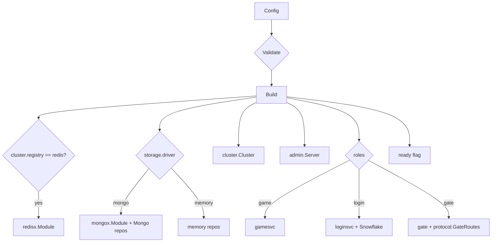

# bootstrap — assembling a node

[中文](README.zh-CN.md)

`bootstrap.Build(cfg)` turns a configuration file into a runnable `app.App`.
It is the single place that knows which concrete implementations to use.



## Module order (start ↓, stop ↑)

| # | Module | Present when |
|---|---|---|
| 1 | `redis` | `cluster.registry: redis` |
| 2 | `mongo` | `storage.driver: mongo` |
| 3 | `cluster` | always |
| 4 | `admin` | always (no-op if `admin.addr` empty) |
| 5 | `game` | role `game` |
| 6 | `login` | role `login` |
| 7 | `gate` | role `gate` |
| 8 | `ready` | always — flips `/readyz` |

Clients are accepted only after backends are up; on shutdown the gate stops
first and the database closes last.

## Roles and modes

| Config | Roles | Bus / Registry | Storage |
|---|---|---|---|
| `configs/allinone.yaml` | gate, login, game | local / memory | memory |
| `configs/allinone-mongo.yaml` | gate, login, game | local / memory | mongo |
| `configs/gate.yaml` | gate | nats / redis | — |
| `configs/login.yaml` | login | nats / redis | mongo |
| `configs/game.yaml` | game | nats / redis | mongo |

`Validate()` rejects inconsistent combinations, e.g. `bus: local` without all
three roles (nobody would receive the messages) or `bus: nats` with memory
registry/storage (processes would not share state).

## Options

```go
srv, err := bootstrap.Build(cfg, bootstrap.WithRepos(accounts, players))
```

`WithRepos` overrides storage — used by tests that run several nodes in one
process, and by projects that bring their own persistence.

`Server` exposes the built modules (`Gate`, `Game`, `Login`, `Cluster`,
`Players`…) so tests can query addresses and state.
