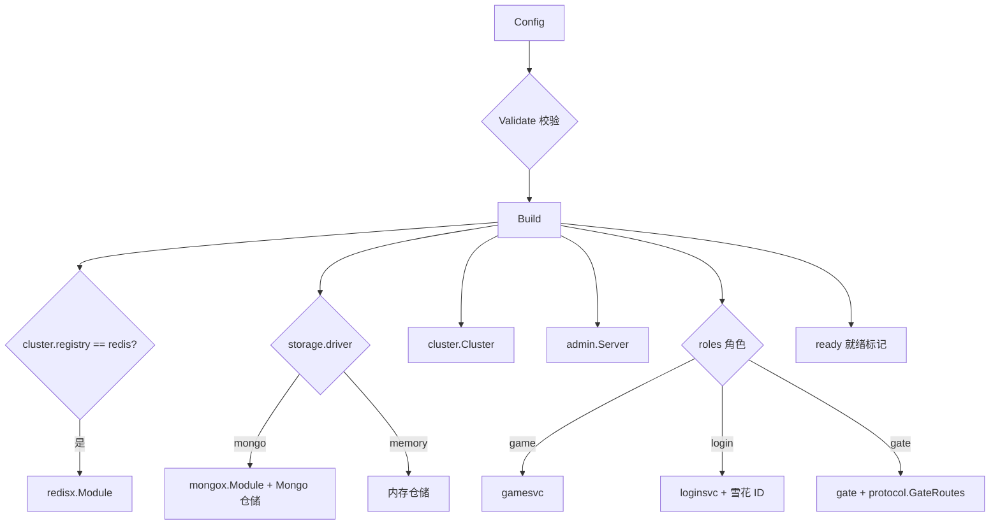

# bootstrap —— 节点装配

[English](README.md)

`bootstrap.Build(cfg)` 把一份配置变成可运行的 `app.App`。它是唯一知道该使用哪些具体实现的地方。



## 模块顺序（启动 ↓，停止 ↑）

| # | 模块 | 何时存在 |
|---|---|---|
| 1 | `redis` | `cluster.registry: redis` |
| 2 | `mongo` | `storage.driver: mongo` |
| 3 | `cluster` | 总是 |
| 4 | `admin` | 总是（`admin.addr` 为空时不监听） |
| 5 | `game` | 角色含 `game` |
| 6 | `login` | 角色含 `login` |
| 7 | `gate` | 角色含 `gate` |
| 8 | `ready` | 总是 —— 切换 `/readyz` |

后端就绪后才接入客户端；停机时网关最先停止，数据库最后关闭。

## 角色与模式

| 配置 | 角色 | 总线 / 注册中心 | 存储 |
|---|---|---|---|
| `configs/allinone.yaml` | gate, login, game | local / memory | memory |
| `configs/allinone-mongo.yaml` | gate, login, game | local / memory | mongo |
| `configs/gate.yaml` | gate | nats / redis | — |
| `configs/login.yaml` | login | nats / redis | mongo |
| `configs/game.yaml` | game | nats / redis | mongo |

`Validate()` 会拒绝不一致的组合，例如 `bus: local` 却没有同时包含三个角色（消息没人接收），
或者 `bus: nats` 却使用内存注册中心/存储（进程之间无法共享状态）。

## 选项

```go
srv, err := bootstrap.Build(cfg, bootstrap.WithRepos(accounts, players))
```

`WithRepos` 覆盖存储 —— 用于在一个进程里运行多个节点的测试，以及使用自定义持久化的项目。

`Server` 暴露构建出的模块（`Gate`、`Game`、`Login`、`Cluster`、`Players`……），方便测试查询地址和状态。
