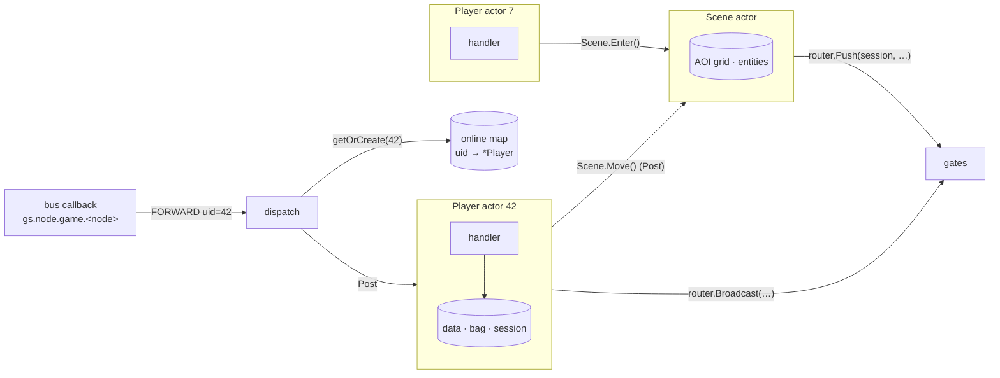
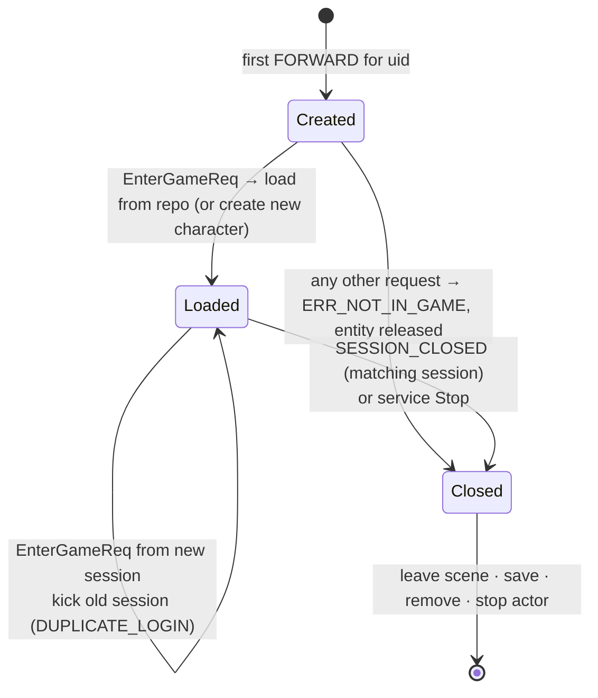
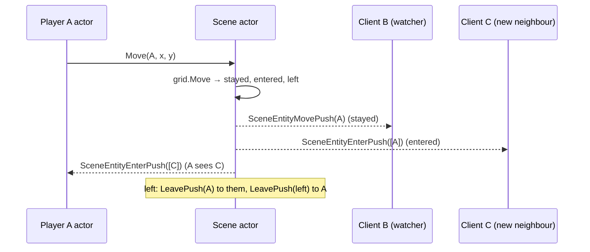

# gamesvc — game service

[中文](README.zh-CN.md)

The game service hosts **online players** and the **world scene**. It is
stateful: a player lives on exactly one game node, chosen at login by
rendezvous hashing of the uid, and the gate routes all of that player's
requests to that node (sticky routing).

## Threading model



* One **actor per online player**: all handlers of that player run sequentially
  in it, so player state needs no locks.
* One **actor per scene**: owns the AOI grid and entity table; players talk to
  it by posting (`Enter`, `Leave`, `Move`, `BroadcastNearby`).
* The bus callback only looks up the actor and posts — it never blocks.

## Player lifecycle



Key details:

* **Session check** — every handler except `EnterGameReq` requires the request
  to come from the session bound at enter time. Requests from stale sessions
  get `ERR_NOT_IN_GAME`.
* **Duplicate login** — a new `EnterGameReq` for a loaded player kicks the old
  session. The old session's `SESSION_CLOSED` is ignored because its session id
  no longer matches.
* **Logout race** — if a request is posted to a player that logs out before
  processing it, the request is re-dispatched to a fresh player instance
  (`p.closed` check), so nothing is lost.
* **Persistence** — handlers set `p.dirty`; an actor timer saves every
  `save_interval`; logout and service shutdown save synchronously. `Version`
  increments on each save.

## Handlers

| Request | Behaviour | Errors |
|---|---|---|
| `EnterGameReq{name}` | load/create, bind session, reply, then enter scene | storage failure |
| `BagGetReq` | all stacks sorted by item id | |
| `ItemUseReq{item_id,count}` | consume, apply table effects (gold/exp), push `BagUpdatePush` + `PlayerInfoPush` | `ERR_ITEM_NOT_FOUND/NOT_USABLE/NOT_ENOUGH` |
| `ChatSendReq{channel,text}` | world: broadcast through every gate; scene: AOI neighbours | `ERR_CHAT_EMPTY/TOO_LONG/TOO_FAST` |
| `SceneMoveReq{target}` | validate bounds and step ≤ `max_move_step`, update, notify scene | `ERR_POSITION_OUT_OF_BOUNDS`, `ERR_MOVE_TOO_FAR` |
| `GmCommandReq{command}` | `help`, `additem id n`, `addgold n`, `addexp n`, `info` | `ERR_GM_DISABLED`, `ERR_GM_BAD_COMMAND` |

`EnterGameResp` is sent **before** the player enters the scene, so clients
always receive it before any scene push.

## Scene and AOI

The world is 1000×1000 with 100×100 cells (`AOICellSize`). Players see the 3×3
cells around them (see [logic/aoi](../logic/README.md)).



## Configuration

```yaml
game:
  save_interval: 30s   # periodic save of dirty players
  gm_enabled: false    # NEVER true in production
  chat_interval: 1s    # min time between two chat messages per player
  max_move_step: 50    # anti-teleport: max distance per SceneMoveReq
```

## Files

| File | Content |
|---|---|
| `service.go` | module lifecycle, envelope routing, player map, logout |
| `player.go` | `Player` entity: load/create, snapshot, save, push |
| `scene.go` | scene actor, AOI-driven pushes |
| `handlers.go` | all request handlers + `handle` adapter |
