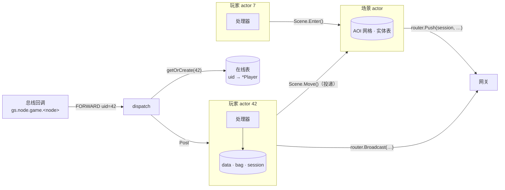
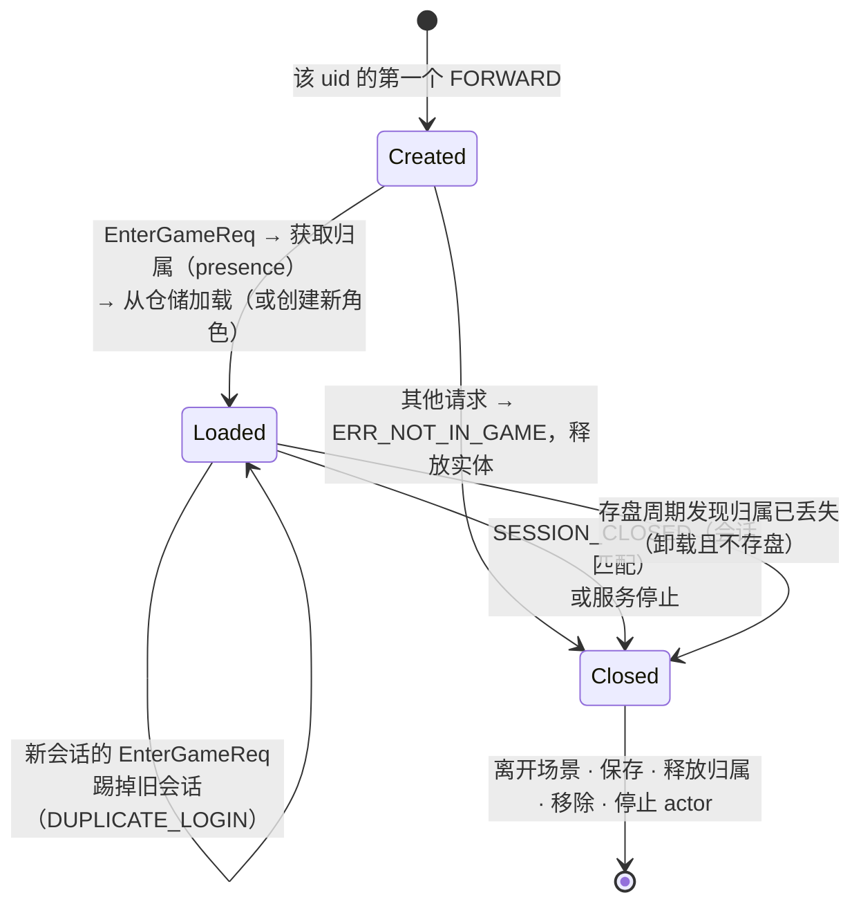
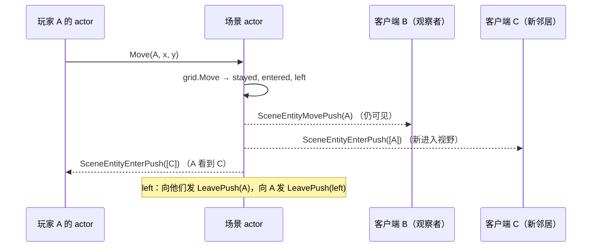
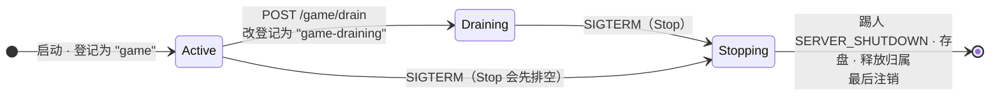

# gamesvc —— 游戏服务

[English](README.md)

游戏服承载**在线玩家**和**世界场景**。它是有状态的：每个玩家只存在于一个游戏节点上，
该节点在登录时通过 uid 的 HRW 哈希选定，之后网关会把该玩家的所有请求都路由到这个节点（粘性路由）。

## 线程模型



* **每个在线玩家一个 actor**：该玩家的所有处理器在其中顺序执行，玩家状态无需加锁。
* **每个场景一个 actor**：拥有 AOI 网格和实体表；玩家通过投递（`Enter`、`Leave`、`Move`、`BroadcastNearby`）与之交互。
* 总线回调只负责找到 actor 并投递 —— 永不阻塞。

## 玩家生命周期



关键细节：

* **会话校验** —— 除 `EnterGameReq` 外，所有处理器都要求请求来自进入游戏时绑定的会话；
  来自过期会话的请求返回 `ERR_NOT_IN_GAME`。
* **顶号** —— 已加载的玩家收到新的 `EnterGameReq` 时，会踢掉旧会话。旧会话随后发来的
  `SESSION_CLOSED` 因会话 ID 不匹配而被忽略。
* **下线竞态** —— 如果请求投递给了一个在处理前就已下线的玩家，该请求会被重新分发到新的玩家实例
  （通过 `p.closed` 判断），不会丢失。
* **归属** —— 加载之前，节点要先在[归属目录 presence](../presence/README.zh-CN.md) 中认领该玩家；
  如果玩家归另一台存活节点所有，则拒绝（`SERVICE_UNAVAILABLE`，客户端重试）。
  归属在每个存盘周期刷新，在最后一次存盘后释放。
* **持久化** —— 处理器设置 `p.dirty`；actor 定时器每 `save_interval` 保存一次；下线和停服时同步保存。
  每次保存 `Version` 自增。

## 处理器

| 请求 | 行为 | 错误 |
|---|---|---|
| `EnterGameReq{name}` | 加载/创建、绑定会话、回复，然后进入场景 | 存储失败 |
| `BagGetReq` | 返回所有道具，按 ID 排序 | |
| `ItemUseReq{item_id,count}` | 扣除道具，按配置表效果加金币/经验，推送 `BagUpdatePush` + `PlayerInfoPush` | `ERR_ITEM_NOT_FOUND/NOT_USABLE/NOT_ENOUGH` |
| `ChatSendReq{channel,text}` | 世界频道：通过所有网关广播；场景频道：发给 AOI 邻居 | `ERR_CHAT_EMPTY/TOO_LONG/TOO_FAST` |
| `SceneMoveReq{target}` | 校验边界与步长 ≤ `max_move_step`，更新位置，通知场景 | `ERR_POSITION_OUT_OF_BOUNDS`、`ERR_MOVE_TOO_FAR` |
| `GmCommandReq{command}` | `help`、`additem id n`、`addgold n`、`addexp n`、`info` | `ERR_GM_DISABLED`、`ERR_GM_BAD_COMMAND` |

`EnterGameResp` 在玩家进入场景**之前**发出，因此客户端一定先收到它，再收到场景推送。

## 场景与 AOI

世界大小 1000×1000，格子 100×100（`AOICellSize`）。玩家能看到自己周围 3×3 个格子
（见 [logic/aoi](../logic/README.zh-CN.md)）。



## 排空与停机（供 Kubernetes Operator 使用）

| 管理端点（9100 端口） | 作用 |
|---|---|
| `GET /game/status` | `{"node":"game-1","players":42,"draining":false,"stopping":false}` |
| `POST /game/drain` | 不再接收**新**玩家；现有玩家照常游戏，重连也仍会回到这里 |



`Stop` 会一直保持节点处于（排空中的）登记状态，直到每个玩家都存盘并释放归属，
这样客户端重连时，不会在数据还没写完的情况下被路由到别的节点。

## 配置

```yaml
game:
  save_interval: 30s   # 定时保存脏数据
  gm_enabled: false    # 生产环境绝不能为 true
  chat_interval: 1s    # 同一玩家两次聊天的最小间隔
  max_move_step: 50    # 防瞬移：每次 SceneMoveReq 的最大移动距离
```

## 文件

| 文件 | 内容 |
|---|---|
| `service.go` | 模块生命周期、排空/状态、信封路由、玩家表、下线 |
| `player.go` | `Player` 实体：归属、加载/创建、快照、存盘周期、推送 |
| `scene.go` | 场景 actor、基于 AOI 的推送 |
| `handlers.go` | 所有请求处理器 + `handle` 适配器 |
