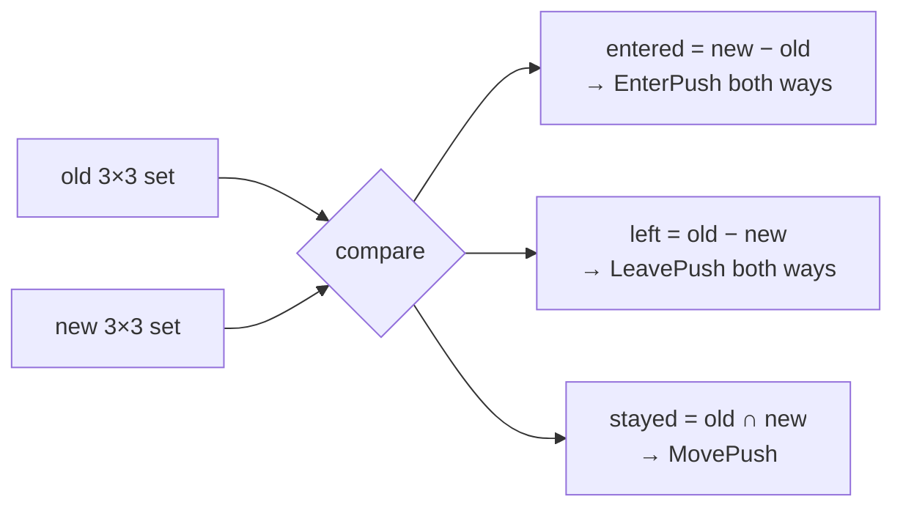

# logic — pure gameplay rules

[中文](README.zh-CN.md)

Rules with **no I/O, no goroutines, no framework imports**. They are the
easiest code to reason about and test, so as much gameplay as possible should
live here; services only orchestrate (load state → call rules → save/push).

| Package | Content | Tests |
|---|---|---|
| `aoi` | nine-grid Area Of Interest | `logic_test.go: TestAOIGrid` |
| `bag` | inventory container with atomic remove | `TestBag` |
| `levelup` | experience curve and level cap | `TestLevelUp` |

None of these types are safe for concurrent use: each instance is owned by one actor.

## aoi — nine-grid AOI

Broadcasting every movement to every player is O(N²). The grid limits updates
to players that can actually see each other.

```
 world 1000 × 1000, cell 100 × 100 → 10 × 10 cells

     0     1     2     3     4
   ┌─────┬─────┬─────┬─────┬─────┐
 0 │     │     │     │     │     │
   ├─────┼─────┼─────┼─────┼─────┤
 1 │     │ ░░░ │ ░░░ │ ░░░ │     │   ░ = visible to P
   ├─────┼─────┼─────┼─────┼─────┤
 2 │     │ ░░░ │  P  │ ░░░ │     │   P sees its cell + 8 neighbours
   ├─────┼─────┼─────┼─────┼─────┤
 3 │     │ ░░░ │ ░░░ │ ░░░ │     │
   └─────┴─────┴─────┴─────┴─────┘
```

```go
g := aoi.NewGrid(1000, 1000, 100)
visible := g.Add(uid, x, y)                 // who sees the newcomer
entered, left, stayed := g.Move(uid, x, y)  // diff of the 3×3 neighbourhood
watchers := g.Remove(uid)                   // who must be told it left
g.Neighbors(uid)
```

`Move` within the same cell returns only `stayed` (cheap fast path). Crossing
cells computes set differences of the old and new 3×3 blocks:



Coordinates outside the world are clamped to border cells. Choose the cell size
close to the client's view radius: smaller cells mean fewer false positives
but more cell crossings.

## bag — inventory

```go
b := bag.New(stacks)        // from storage
n, err := b.Add(1001, 5)    // err on count <= 0
n, err = b.Remove(1001, 2)  // all-or-nothing; ErrNotEnough
b.Count(1001)
b.Stacks()                  // sorted by id: deterministic for storage and clients
```

Empty stacks are deleted so they are not persisted.

## levelup — experience curve

```go
level, exp := levelup.AddExp(level, exp, gained)
```

* required to level up: `level × 100`;
* multi-level gains in one call are handled;
* capped at `MaxLevel` (100), where experience is reset to 0.
