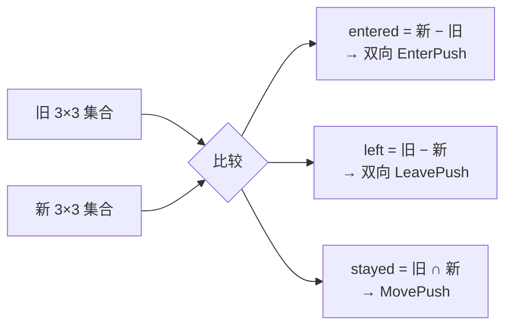

# logic —— 纯玩法规则

[English](README.md)

这里的规则**没有 I/O、没有协程、不 import 框架**。它们最容易推理和测试，所以应尽可能把玩法放在这里；
服务层只负责编排（加载状态 → 调用规则 → 保存/推送）。

| 包 | 内容 | 测试 |
|---|---|---|
| `aoi` | 九宫格视野管理（Area Of Interest） | `logic_test.go: TestAOIGrid` |
| `bag` | 背包容器，扣除操作原子化 | `TestBag` |
| `levelup` | 经验曲线与等级上限 | `TestLevelUp` |

这些类型都不是并发安全的：每个实例只归一个 actor 所有。

## aoi —— 九宫格 AOI

把每次移动广播给所有玩家是 O(N²) 的。网格把更新限制在真正能互相看到的玩家之间。

```
 世界 1000 × 1000，格子 100 × 100 → 10 × 10 个格子

     0     1     2     3     4
   ┌─────┬─────┬─────┬─────┬─────┐
 0 │     │     │     │     │     │
   ├─────┼─────┼─────┼─────┼─────┤
 1 │     │ ░░░ │ ░░░ │ ░░░ │     │   ░ = P 可见范围
   ├─────┼─────┼─────┼─────┼─────┤
 2 │     │ ░░░ │  P  │ ░░░ │     │   P 能看到自己所在格 + 周围 8 格
   ├─────┼─────┼─────┼─────┼─────┤
 3 │     │ ░░░ │ ░░░ │ ░░░ │     │
   └─────┴─────┴─────┴─────┴─────┘
```

```go
g := aoi.NewGrid(1000, 1000, 100)
visible := g.Add(uid, x, y)                 // 谁能看到新来的
entered, left, stayed := g.Move(uid, x, y)  // 3×3 邻域的差异
watchers := g.Remove(uid)                   // 需要通知"它离开了"的人
g.Neighbors(uid)
```

在同一格内 `Move` 只返回 `stayed`（快速路径）。跨格时计算新旧两个 3×3 区域的集合差：



超出世界范围的坐标会被夹到边界格子。格子大小应接近客户端视野半径：格子越小误判越少，但跨格越频繁。

## bag —— 背包

```go
b := bag.New(stacks)        // 来自存储
n, err := b.Add(1001, 5)    // count <= 0 时报错
n, err = b.Remove(1001, 2)  // 要么全扣，要么不扣；不足返回 ErrNotEnough
b.Count(1001)
b.Stacks()                  // 按 ID 排序：存储与客户端结果确定
```

数量为 0 的堆叠会被删除，不会被持久化。

## levelup —— 经验曲线

```go
level, exp := levelup.AddExp(level, exp, gained)
```

* 升级所需经验：`等级 × 100`；
* 一次获得的经验可连升多级；
* 上限 `MaxLevel`（100），满级后经验归 0。
