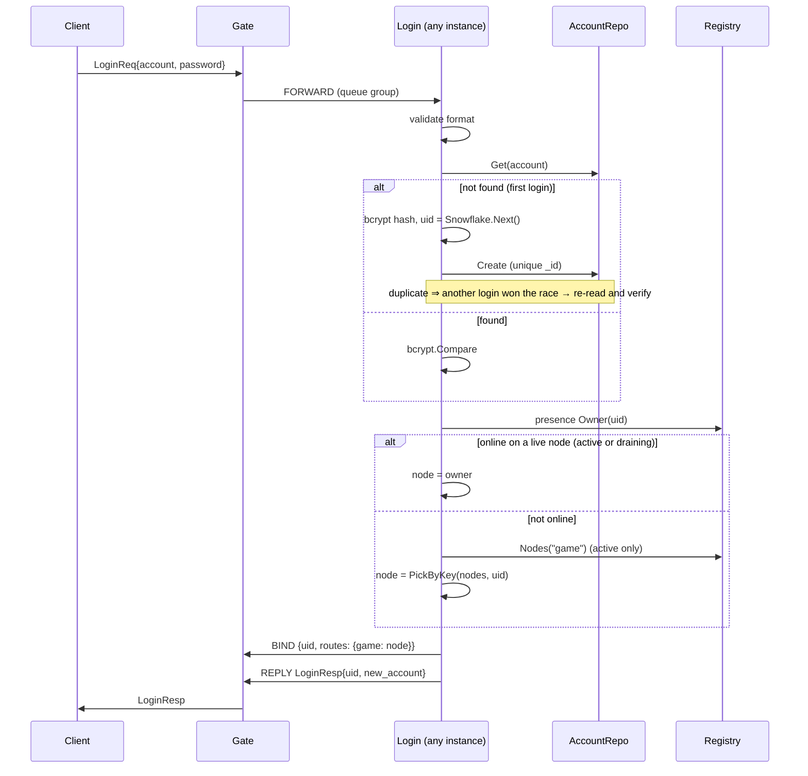

# loginsvc — login service

[中文](README.zh-CN.md)

Authenticates accounts, issues uids and assigns each player to a game node.
It is **stateless**: any instance can serve any request, so the gate
load-balances login traffic over a NATS queue group (`gs.svc.login`).

## Flow



## Rules

| Check | Error |
|---|---|
| account matches `^[A-Za-z0-9_]{3,32}$` | `ERR_INVALID_ACCOUNT` |
| password length 6–64 | `ERR_INVALID_PASSWORD` |
| password matches stored bcrypt hash | `ERR_WRONG_PASSWORD` |
| session not already logged in | `BAD_REQUEST` |
| at least one game node registered | `SERVICE_UNAVAILABLE` |
| presence directory readable (fail closed) | `SERVICE_UNAVAILABLE` |

An online player always goes back to the node that holds it, even after
nodes are added or while that node drains; see [presence](../presence/README.md).

## Concurrency

bcrypt is deliberately CPU-heavy (~50 ms at cost 10). Each request runs in its
own goroutine, bounded by `max_concurrent`; when saturated, the bus callback
blocks, applying back-pressure instead of exhausting CPU. `Stop` waits for
in-flight logins.

## Configuration

```yaml
login:
  bcrypt_cost: 10       # 4 (min) in tests, 10-12 in production
  max_concurrent: 256
  request_timeout: 10s
```

## Production notes

* Auto-registration is demo behaviour. Real games usually verify a token from
  a platform SDK (Steam, Apple, Google, WeChat…) — replace `findOrCreate`.
* Add per-IP/per-account attempt limits (Redis counters) against brute force.
* Every login node needs a distinct `node.worker_id` for unique uids. On
  Kubernetes the operator runs login as a StatefulSet and uses the pod index.
